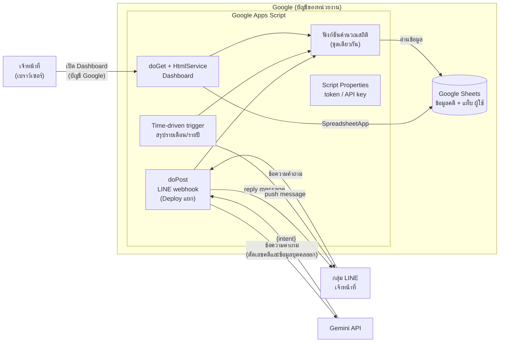
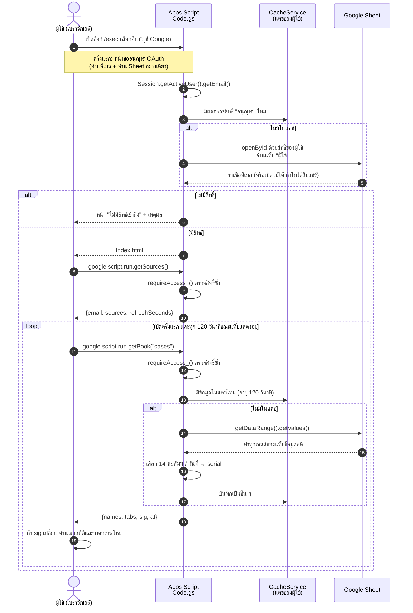
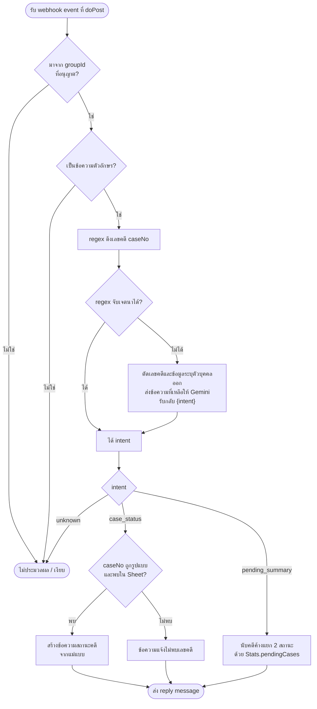

# บทที่ 3 การออกแบบระบบ

บทนี้อธิบายการออกแบบระบบ Dashboard และแชตบอต AI สำหรับติดตามและสรุปสถานะคดีส่งตรวจพิสูจน์ DNA ประกอบด้วย สถาปัตยกรรมระบบ โครงสร้างข้อมูล การออกแบบส่วนแสดงผล Dashboard การควบคุมสิทธิ์ การออกแบบแชตบอต LINE การออกแบบรายงานสรุปอัตโนมัติ และการออกแบบด้านความปลอดภัยและการคุ้มครองข้อมูลส่วนบุคคล โครงงานนี้เป็นงานด้านซอฟต์แวร์ทั้งหมด ไม่มีส่วนฮาร์ดแวร์ ภาพหน้าจอและตัวอย่างข้อความทั้งหมดในบทนี้สร้างจากข้อมูลจำลอง ไม่มีข้อมูลคดีจริง

> หมายเหตุสำหรับบรรณาธิการ: การอ้างอิงในบทนี้เขียนเป็น `[อ้างอิง: ...]` ชั่วคราว รอจัดเลขลำดับต่อจากบทที่ 1–2 รายการแหล่งอ้างอิงอยู่ท้ายไฟล์

## 3.1 ภาพรวมและสถาปัตยกรรมระบบ

ระบบออกแบบให้ทำงานบนบริการของ Google ทั้งหมดโดยไม่มีค่าใช้จ่าย และไม่ต้องมีเครื่องแม่ข่ายของหน่วยงานเอง องค์ประกอบหลักมี 5 ส่วน ดังนี้

1) **Google Sheets (แหล่งเก็บข้อมูล)** เป็นที่เก็บข้อมูลคดีเพียงแห่งเดียวของระบบ เจ้าหน้าที่ยังคงบันทึกข้อมูลลงตารางในรูปแบบเดิม ระบบเพิ่มเพียงแท็บ "ผู้ใช้" สำหรับควบคุมสิทธิ์ (หัวข้อ 3.2) Sheet ไม่เปิดให้ "ทุกคนที่มีลิงก์" อ่านได้ แต่แชร์แบบผู้มีสิทธิ์อ่าน (Viewer) เฉพาะบัญชีที่อยู่ในแท็บ "ผู้ใช้" (หัวข้อ 3.4)

2) **Dashboard (Apps Script web app)** หน้าเว็บแสดงผลเสิร์ฟผ่าน `HtmlService` ของ Google Apps Script โดยมีฟังก์ชัน `doGet` เป็นจุดรับคำขอ [อ้างอิง: Google, "Web apps," Apps Script guides — https://developers.google.com/apps-script/guides/web] ข้อมูลอ่านจาก Sheet ฝั่งเซิร์ฟเวอร์ด้วย `SpreadsheetApp` แทนการให้เบราว์เซอร์ดึงข้อมูลเอง จึงไม่ต้องเปิด Sheet เป็นสาธารณะ และตรวจสิทธิ์ผู้ใช้ทุกครั้งที่ขอข้อมูล (หัวข้อ 3.4)

3) **LINE bot (webhook)** รับข้อความจากกลุ่ม LINE ของเจ้าหน้าที่ผ่าน LINE Messaging API ซึ่งส่งเหตุการณ์ (webhook event) มาเป็นคำขอ HTTP POST [อ้างอิง: LY Corporation, "Receive messages (webhook)," LINE Developers — https://developers.line.biz/en/docs/messaging-api/receiving-messages/] ปลายทางของ webhook คือฟังก์ชัน `doPost` ของ Apps Script ซึ่ง Deploy แยกจาก Dashboard เพราะ LINE Platform เรียก webhook โดยไม่มีบัญชี Google (หัวข้อ 3.4.7 และ 3.5)

4) **Time-driven trigger** ตัวตั้งเวลาของ Apps Script เรียกฟังก์ชันสรุปรายเดือนและรายปี แล้วส่งข้อความเข้ากลุ่ม LINE ด้วย push message ตัวตั้งเวลาแบบรายเดือนกำหนดวันที่ของเดือน ชั่วโมง และเขตเวลาได้ [อ้างอิง: Google, "Class ClockTriggerBuilder," Apps Script reference — https://developers.google.com/apps-script/reference/script/clock-trigger-builder]

5) **Gemini API (เฉพาะการแยกเจตนา)** ใช้เป็นตัวช่วยเมื่อกฎแบบ regular expression จับคำถามไม่ได้ ระบบส่งให้ Gemini **เฉพาะข้อความคำถามของผู้ใช้ที่ตัดเลขคดีและข้อความที่ระบุตัวบุคคลออกแล้ว** และรับกลับเพียงเจตนา (intent) เลขคดีดึงด้วยโค้ดของระบบเอง ไม่ส่งข้อมูลคดีจาก Sheet ไปยังบริการ AI



[รูปที่ 3.1: สถาปัตยกรรมระบบและเส้นทางการไหลของข้อมูล]

### 3.1.1 การไหลของข้อมูล

หลักการสำคัญของสถาปัตยกรรมคือ **ข้อมูลคดีไม่ออกนอก Google Apps Script ไปยังบริการ AI** เส้นทางข้อมูลแบ่งได้ 3 กรณี

1) **Dashboard** ผู้ใช้เปิดลิงก์ web app ด้วยบัญชี Google สคริปต์ตรวจสิทธิ์ แล้วอ่านข้อมูลจาก Sheet ฝั่งเซิร์ฟเวอร์ และส่งเฉพาะคอลัมน์ที่ Dashboard ใช้กลับไปยังเบราว์เซอร์ของผู้ใช้ที่มีสิทธิ์ เบราว์เซอร์เป็นผู้คำนวณสถิติและวาดกราฟ (หัวข้อ 3.4)

2) **คำถามในกลุ่ม LINE** ข้อความเดินทางจาก LINE Platform มาที่ `doPost` โค้ดดึงเลขคดีจากข้อความด้วย regular expression เอง ถ้าต้องใช้ AI ช่วยแยกเจตนา จะตัดเลขคดีและข้อความที่ระบุตัวบุคคลออกก่อน แล้วส่งข้อความที่เหลือไปยัง Gemini ข้อมูลที่ได้กลับมามีเพียงเจตนา จากนั้นโค้ดของระบบเป็นผู้ค้นข้อมูลใน Sheet และประกอบข้อความตอบเอง ข้อความตอบจึงเดินทางกลับไปที่กลุ่ม LINE เท่านั้น

3) **สรุปตามเวลา** ตัวตั้งเวลาเรียกฟังก์ชันคำนวณสถิติ แล้วส่งข้อความสรุปที่เป็นตัวเลขรวม (ไม่มีเลขคดีหรือรายละเอียดรายคดี) เข้ากลุ่ม LINE ขั้นตอนนี้ไม่ใช้ AI

เหตุผลที่ไม่ส่งข้อมูลคดีให้ AI คือ ข้อกำหนดของ Gemini API ระบุว่าข้อมูลที่ส่งผ่านบริการแบบไม่เสียค่าใช้จ่าย (Unpaid Services) อาจถูกนำไปปรับปรุงผลิตภัณฑ์และอาจมีผู้ตรวจที่เป็นมนุษย์อ่าน รวมถึงแนะนำว่าไม่ควรส่งข้อมูลอ่อนไหว ข้อมูลลับ หรือข้อมูลส่วนบุคคลเข้าสู่บริการดังกล่าว [อ้างอิง: Google, "Gemini API Additional Terms of Service" — https://ai.google.dev/gemini-api/terms] การออกแบบให้ AI เห็นเพียงข้อความคำถามที่ตัดเลขคดีและข้อความที่ระบุตัวบุคคลออกแล้วจึงลดความเสี่ยงนี้ แม้เลขคดีเพียงอย่างเดียวจะไม่บอกผลการตรวจ เจ้าของโครงงานตัดสินใจไม่ส่งเลขคดีให้ Gemini เพื่อไม่ให้ข้อความที่ผู้ตรวจของ Google อาจอ่านเชื่อมโยงกลับไปยังคดีใดคดีหนึ่งได้

## 3.2 การออกแบบโครงสร้างข้อมูล

ระบบใช้โครงสร้างตารางเดิมที่เจ้าหน้าที่ใช้อยู่ เพื่อไม่ให้เปลี่ยนวิธีทำงาน โครงสร้างได้จากการอ่านชื่อคอลัมน์ของไฟล์ต้นฉบับ (ไม่ได้คัดลอกค่าข้อมูล) และบันทึกไว้ที่ `docs/data-schema.md` ข้อมูลจำลองสำหรับพัฒนาและทดสอบสร้างให้มีโครงสร้างเดียวกันทุกคอลัมน์

### 3.2.1 แท็บข้อมูลคดี

แท็บ "ข้อมูลคดี" เป็นตารางหลัก หนึ่งแถวคือหนึ่งคดี คอลัมน์แรกต้องเป็น "เลข บก." ตารางที่ 3.1 แสดงคอลัมน์ตามลำดับ

ตารางที่ 3.1 คอลัมน์ในแท็บข้อมูลคดี

| คอลัมน์ | ชนิดข้อมูล | ความหมาย / การใช้งาน |
|---|---|---|
| เลข บก. | ข้อความ | เลขคดีรูปแบบ `ลำดับ/ปี พ.ศ.` เช่น `123/2568` ใช้เป็นคีย์ที่แชตบอตค้นหา |
| เลขรายงาน | ข้อความ | รูปแบบ `NN-YY-NNNNN` |
| สภ. (ท้องที่) | ข้อความ | สถานีตำรวจที่ส่งตรวจ |
| จังหวัด | ข้อความ | จังหวัดของสถานีที่ส่งตรวจ |
| เลขหนังสือนำส่ง | ข้อความ | เลขที่หนังสือนำส่งของกลาง |
| ลงวันที่ | วันที่ | วันที่ของหนังสือนำส่ง |
| วันที่รับ | วันที่ | วันที่รับคดี ใช้กำหนดเดือนและปีของคดีในสถิติและสรุป |
| วันที่ตรวจเสร็จ | วันที่ | ใช้คำนวณระยะเวลาตรวจ |
| วันที่มารับผล | วันที่ | ใช้คำนวณระยะเวลารอรับผล |
| สถานะ | ข้อความ | ค่าที่กำหนด 3 ค่า (หัวข้อ 3.2.3) |
| ประเภทคดี (เลือก) | ข้อความ (dropdown) | เช่น ทรัพย์ พ.ร.บ.อาวุธปืน เพศ |
| ผู้ตรวจ (เลือก) | ข้อความ (dropdown) | ชื่อเจ้าหน้าที่ผู้ตรวจ — ข้อมูลส่วนบุคคล |
| ของกลาง (ชิ้น) | ตัวเลข | จำนวนของกลางของคดี |
| เดือนที่รับ | วันที่ | คอลัมน์คำนวณ |
| ปี พ.ศ. (รับ) | ตัวเลข | คอลัมน์คำนวณ |
| นับในสถิติ | ตัวเลข 0/1 | คอลัมน์คำนวณ แถวที่เป็น 0 ไม่นับในสถิติ |
| ข้อสังเกต (ผิดปกติ) | ข้อความ | คอลัมน์คำนวณ ระบุเหตุผลที่แถวควรตรวจสอบ |
| ปีเลขรายงาน, ลำดับเลขรายงาน | ตัวเลข | คอลัมน์คำนวณ |
| อันดับ (ช่วยคำนวณ), ตั้งค่า, เกณฑ์ของกลางผิดปกติ (ชิ้น) | — | ช่วยคำนวณและตั้งค่า เช่น เกณฑ์จำนวนของกลางที่ถือว่าสูงผิดปกติ |

ไฟล์ต้นฉบับเดิมมีคอลัมน์ "User ID (LINE)" ซึ่งเป็นข้อมูลส่วนบุคคลและไม่จำเป็นต่อการติดตามคดี เจ้าของโครงงานจึงลบคอลัมน์นี้ออกจาก Sheet จริงตามหลักการใช้ข้อมูลเท่าที่จำเป็น (data minimisation) ระบบไม่อ่านและไม่พึ่งคอลัมน์นี้

ในไฟล์เดิมยังมีแท็บสรุปอื่น ได้แก่ "Dashboard" "สภ.และประเภทคดี" และ "ผู้ตรวจ" ซึ่งเป็นสูตรสรุปของ Excel ระบบนี้ไม่อ่านแท็บเหล่านี้ แต่คำนวณสถิติใหม่จากแท็บข้อมูลคดีโดยตรง

นอกจากข้อมูลรายคดี Dashboard ต้นแบบยังรองรับไฟล์ข้อมูลห้องปฏิบัติการ (แท็บ "ข้อมูลเคส" "ข้อมูลงบ" "ข้อมูล Lot" และ "หมายเหตุ") ซึ่งเป็นสถิติรายเดือนระดับห้องปฏิบัติการ ไม่มีข้อมูลรายคดี รายละเอียดคอลัมน์อยู่ใน `docs/data-schema.md`

### 3.2.2 แท็บผู้ใช้

แท็บ "ผู้ใช้" เป็นแท็บที่เพิ่มขึ้นใหม่ ใช้เป็นรายชื่อผู้มีสิทธิ์เปิด Dashboard

ตารางที่ 3.2 คอลัมน์ในแท็บผู้ใช้

| คอลัมน์ | ชนิดข้อมูล | ความหมาย |
|---|---|---|
| อีเมล | ข้อความ | อีเมลบัญชี Google ที่อนุญาตให้เปิด Dashboard |
| ชื่อ | ข้อความ | ชื่อผู้ใช้ เพื่อให้ผู้ดูแลจำได้ |
| หมายเหตุ | ข้อความ | เช่น ตำแหน่ง หรือวันที่เพิ่มสิทธิ์ |

การเพิ่มหรือถอนสิทธิ์ทำได้โดยแก้แถวในแท็บนี้ ไม่ต้องแก้โค้ด

### 3.2.3 ค่าสถานะคดี

คอลัมน์สถานะมีค่าที่กำหนด 3 ค่า เรียงตามลำดับงาน

1) **กำลังดำเนินการ** รับคดีแล้ว ยังตรวจไม่เสร็จ
2) **เสร็จแล้ว รอรับผล** ตรวจเสร็จแล้ว รอพนักงานสอบสวนมารับผล
3) **รับผลไปแล้ว** ปิดงานของคดี

"คดีค้าง" ในระบบหมายถึงคดีที่ยังไม่อยู่ในสถานะ "รับผลไปแล้ว" (เฉพาะแถวที่นับในสถิติ) และ**รายงานแยกเป็น 2 กลุ่มเสมอ** คือ "กำลังดำเนินการ" (งานที่ยังอยู่ในห้องปฏิบัติการ) และ "เสร็จแล้ว รอรับผล" (งานที่รอหน่วยงานผู้ส่งมารับ) เพราะทั้งสองกลุ่มมีความหมายต่อการบริหารต่างกัน ฟังก์ชัน `Stats.pendingCases` คืนจำนวนแยกตามสถานะ (`byStatus`) และรายการคดีเรียงจากค้างนานที่สุด แถวที่ช่องสถานะว่างหรือมีค่านอกเหนือจาก 3 ค่าข้างต้น นับเป็น "กำลังดำเนินการ" เพื่อไม่ให้คดีที่ข้อมูลไม่ครบหายไปจากรายการคดีค้าง ฟังก์ชันนี้ใช้กติกาเดียวกับ Dashboard (เมนูระยะเวลาและงานค้าง) และใช้ในคำสั่งสรุปคดีค้างของแชตบอต

### 3.2.4 ข้อมูลส่วนบุคคลและการจัดการ

คอลัมน์ที่เป็นข้อมูลส่วนบุคคลและวิธีจัดการแสดงในตารางที่ 3.3

ตารางที่ 3.3 คอลัมน์ที่เป็นข้อมูลส่วนบุคคลและการจัดการ

| คอลัมน์ | การจัดการในระบบ |
|---|---|
| ผู้ตรวจ (เลือก) | แสดงใน Dashboard เฉพาะผู้มีสิทธิ์ ในสรุปอัตโนมัติแสดงเป็นจำนวนคดีต่อคน แยกตามประเภท ไม่แสดงเลขคดี ไม่ส่งให้ AI |
| User ID (LINE) | ลบออกจาก Sheet จริงแล้ว (หัวข้อ 3.2.1) ถ้ายังมีอยู่ในไฟล์ใด ระบบก็ไม่ส่งออกจากเซิร์ฟเวอร์ เพราะเลือกส่งเฉพาะคอลัมน์ที่กำหนด (หัวข้อ 3.4.5) และ Dashboard ต้นแบบกรองคอลัมน์ที่ชื่อเข้าข่าย เช่น "line" "user id" "เบอร์" "โทร" "บัตร" "เลขประจำตัว" ออกตั้งแต่ขั้นอ่านไฟล์ |
| อีเมลและชื่อในแท็บผู้ใช้ | ใช้ตรวจสิทธิ์ฝั่งเซิร์ฟเวอร์เท่านั้น ไม่แสดงบนหน้า Dashboard |

ข้อมูลที่ใช้พัฒนาและทดสอบเป็นข้อมูลจำลองทั้งหมด เช่น ชื่อเจ้าหน้าที่ "เจ้าหน้าที่ ก" ถึง "เจ้าหน้าที่ จ" สถานี "สภ.ตัวอย่าง1" ถึง "สภ.ตัวอย่าง15" และอีเมลโดเมน `@example.com` ข้อมูลจำลองสร้างด้วยสคริปต์ `tools/make_mock_data.py` ซึ่งกำหนด seed คงที่ ทำให้สร้างซ้ำได้ผลเหมือนเดิมทุกครั้ง ระบบไม่มีคอลัมน์และไม่แสดง DNA profile

ข้อสังเกตด้านคุณภาพข้อมูล ณ วันที่ได้รับโครงสร้างไฟล์ คอลัมน์ "ประเภทคดี (เลือก)" และ "ผู้ตรวจ (เลือก)" ยังกรอกไว้เพียงส่วนน้อย สถิติแยกประเภทและแยกผู้ตรวจจึงออกแบบให้แสดงกลุ่ม "ยังไม่ระบุ" ไว้ชัดเจน แทนการตัดแถวทิ้ง

## 3.3 การออกแบบส่วนแสดงผล Dashboard

Dashboard ต้นแบบพัฒนาเป็นไฟล์ HTML ไฟล์เดียว (`dashboard/index.html`) วาดกราฟด้วย SVG ที่เขียนเอง ไม่พึ่งไลบรารีกราฟภายนอก และใช้ไลบรารี JSZip อ่านไฟล์ .xlsx ในเบราว์เซอร์ หน้าเว็บนี้ย้ายไปเสิร์ฟผ่าน Apps Script `HtmlService` แล้ว (`apps-script/Index.html` สร้างจากต้นแบบด้วยสคริปต์ `apps-script/test/build_index.py`) โดยเปลี่ยนแหล่งข้อมูลเป็นการขอข้อมูลจากเซิร์ฟเวอร์ (หัวข้อ 3.4) และตัดปุ่มเพิ่มลิงก์ Google Sheet ออก การจัดหน้า เมนู และกราฟที่อธิบายต่อไปนี้ใช้ร่วมกันทั้งสองรุ่น

### 3.3.1 โครงหน้าจอและเมนู

หน้าจอแบ่งเป็นแถบเมนูด้านซ้ายและพื้นที่เนื้อหาด้านขวา ส่วนหัวมีชื่อ Dashboard ตัวเลือกแหล่งข้อมูล ป้ายสถานะการเชื่อมต่อ (เช่น "เชื่อมสด · Google Sheet · อัปเดต ...") และปุ่มสลับโหมดมืด/สว่าง ใต้ส่วนหัวมีแถบปุ่มเลือกปี (chip) สำหรับกรองข้อมูล Dashboard ตรวจรูปแบบข้อมูลจากชื่อแท็บและหัวคอลัมน์ แล้วเลือกชุดเมนูให้ตรงกับข้อมูลโดยอัตโนมัติ

ตารางที่ 3.4 เมนูของ Dashboard แยกตามรูปแบบข้อมูล

| รูปแบบข้อมูล | เมนู | ตัวกรองปี |
|---|---|---|
| คดีส่งตรวจ DNA (รายคดี) | ภาพรวม, พื้นที่และประเภทคดี, ประเภท/ผู้ตรวจรายเดือน, ระยะเวลาและงานค้าง, ตรวจสอบข้อมูล | ปีที่รับคดี (พ.ศ.) หรือ "ทั้งหมด" |
| งานตรวจ · Lot · งบประมาณ | ภาพรวม, งบประมาณ, Lot พัสดุ | ปีงบประมาณ (พ.ศ.) นับ ต.ค. – ก.ย. |
| ทุกรูปแบบ | แหล่งข้อมูล | — |

สถิติรายคดีนับตามวันที่รับคดี และนับเฉพาะแถวที่คอลัมน์ "นับในสถิติ" ไม่เป็น 0

[รูปที่ 3.2: โครงหน้าจอ Dashboard แถบเมนูด้านซ้าย ส่วนหัว และแถบเลือกปี — ภาพจากข้อมูลจำลอง]

### 3.3.2 หน้าภาพรวม (ข้อมูลคดี)

หน้าภาพรวมมีการ์ดตัวชี้วัด (KPI card) 6 ใบ ได้แก่ คดีทั้งหมด, ของกลางรวม (ชิ้น), ของกลางเฉลี่ยต่อคดี (พร้อมค่ามัธยฐาน), คดีเดือนล่าสุด (เทียบกับเดือนก่อน), แถวที่ควรตรวจสอบ และอยู่ระหว่างดำเนินการ (พร้อมจำนวนที่เสร็จแล้ว รอรับผล) ถ้ามีคดีที่ของกลางเกินเกณฑ์ที่ตั้งไว้ในชีต ระบบแสดงแถบหมายเหตุด้านบน

ส่วนกราฟและตารางประกอบด้วย กราฟแท่งจำนวนคดีรายเดือน กราฟแท่งของกลางรายเดือน (ชิ้น) รายการจุดเด่น (เดือนที่มีคดีมากที่สุด คดีเฉลี่ยต่อเดือน จังหวัดที่ส่งตรวจมากที่สุด และมัธยฐานระยะเวลารับถึงตรวจเสร็จ) ตารางสถิติรายปีที่คลิกแถวเพื่อกรองปีได้ ตารางสถิติรายเดือน และตาราง 10 คดีที่มีของกลางมากที่สุด

[รูปที่ 3.3: หน้าภาพรวมของ Dashboard ข้อมูลคดี — ภาพจากข้อมูลจำลอง]

### 3.3.3 หน้าพื้นที่และประเภทคดี

มีการ์ดตัวชี้วัด 4 ใบ ได้แก่ จำนวนจังหวัดที่ส่งตรวจ จำนวน สภ. ที่ส่งตรวจ คดีที่ระบุประเภทแล้ว และคดีที่ระบุผู้ตรวจแล้ว (แสดงร้อยละของคดีทั้งหมด) ตามด้วยกราฟแท่งแนวนอน 4 ชุด คือ จำนวนคดีแยกตามจังหวัด, สภ. ที่ส่งตรวจมากที่สุด 15 อันดับ, ประเภทคดี และผู้ตรวจ

[รูปที่ 3.4: หน้าพื้นที่และประเภทคดี — ภาพจากข้อมูลจำลอง]

### 3.3.4 หน้าประเภท/ผู้ตรวจรายเดือน

หน้านี้มีตัวเลือกเดือนที่รับคดี และตัวเลือกซ่อนกลุ่มที่ยังไม่ระบุ องค์ประกอบได้แก่ กราฟแท่งซ้อนประเภทคดีรายเดือน (แสดง 5 ประเภทที่มากที่สุด ที่เหลือรวมเป็น "อื่นๆ") ตารางประเภทคดีที่มากที่สุดในแต่ละเดือน ตารางจำนวนคดีแยกประเภทรายเดือน ตารางไขว้จังหวัด × ประเภทคดี และผู้ตรวจ × ประเภทคดี ที่คลิกแถวเพื่อดูรายการคดีได้ และตารางไขว้จังหวัด × เดือน กับผู้ตรวจ × เดือน ถ้าคดีที่ระบุประเภทหรือผู้ตรวจมีน้อยกว่าครึ่งหนึ่ง ระบบแสดงกล่องเตือนว่าข้อมูลส่วนนี้ยังน้อย

[รูปที่ 3.5: หน้าประเภทคดีและผู้ตรวจรายเดือน — ภาพจากข้อมูลจำลอง]

### 3.3.5 หน้าระยะเวลาและงานค้าง

มีการ์ดตัวชี้วัด 4 ใบ ได้แก่ ระยะเวลาเฉลี่ยจากรับถึงตรวจเสร็จ (วัน) ค่ามัธยฐาน (พร้อมค่าเร็วสุดและนานสุด) มัธยฐานระยะเวลาจากตรวจเสร็จถึงมารับผล และคดีที่ยังไม่รับผล ส่วนกราฟประกอบด้วย กราฟเส้นระยะเวลาตรวจเฉลี่ยรายเดือน แถบสถานะคดีทั้ง 3 ค่า และการกระจายของระยะเวลาตรวจเป็นช่วง (ไม่เกิน 14 วัน, 15–21, 22–28, 29–35 และมากกว่า 35 วัน) ด้านล่างเป็นตารางคดีที่ยังไม่รับผล เรียงจากค้างนานที่สุด กรองตามสถานะได้ และแสดงทีละ 25 แถวพร้อมปุ่มแสดงเพิ่ม

[รูปที่ 3.6: หน้าระยะเวลาและงานค้าง — ภาพจากข้อมูลจำลอง]

### 3.3.6 หน้าตรวจสอบข้อมูลและหน้าข้อมูลห้องปฏิบัติการ

หน้าตรวจสอบข้อมูลรวบรวมแถวที่คอลัมน์ "ข้อสังเกต (ผิดปกติ)" มีค่า แสดงการ์ดตัวชี้วัด กราฟสรุปตามเหตุผล และตารางรายการที่ควรตรวจสอบกับต้นฉบับ หน้านี้ช่วยให้เจ้าหน้าที่แก้ข้อมูลต้นทางก่อนนำตัวเลขไปใช้

สำหรับข้อมูลห้องปฏิบัติการ หน้าภาพรวมแสดงตัวชี้วัด 6 ใบ (ตัวอย่างตรวจ ของกลาง เฉลี่ยตัวอย่างต่อเดือน งบประมาณรวม บาทต่อตัวอย่าง และ Lot พัสดุ) พร้อมกราฟเทียบปีงบประมาณก่อนหน้า หน้างบประมาณแสดงกราฟแท่งซ้อนงบรายปีแยกหมวดและกราฟเส้นต้นทุนวัสดุตรวจต่อตัวอย่าง หน้า Lot พัสดุแสดงจำนวนตัวอย่างรายรอบ 26–25 ของเดือน และเทียบกับรายงานรายเดือน

[รูปที่ 3.7: หน้าตรวจสอบข้อมูล — ภาพจากข้อมูลจำลอง]

### 3.3.7 หลักการออกแบบส่วนแสดงผล

1) **ภาษาไทยทั้งหมด** ชื่อเมนู หัวกราฟ คำอธิบาย และข้อความแจ้งเตือนเป็นภาษาไทย ปีแสดงเป็น พ.ศ.
2) **รองรับอุปกรณ์เคลื่อนที่** ที่ความกว้างไม่เกิน 900 พิกเซล เมนูย้ายจากแถบซ้ายเป็นแถบเลื่อนแนวนอนด้านบน การ์ดตัวชี้วัดลดเหลือ 3 และ 2 คอลัมน์ตามความกว้างจอ และบนจอสัมผัสปุ่มมีความสูงอย่างน้อย 44 พิกเซล
3) **โหมดมืด** ใช้ตามการตั้งค่าของระบบปฏิบัติการโดยอัตโนมัติ และสลับเองได้ด้วยปุ่มที่ส่วนหัว สีทั้งหมดกำหนดเป็นตัวแปรที่มีค่าสำหรับทั้งสองโหมด
4) **ค่าที่ขาดหาย** ถ้าคอลัมน์จังหวัดหรือ สภ. ว่าง ระบบจัดเป็นกลุ่ม "ไม่ระบุ" ถ้าประเภทคดีหรือผู้ตรวจว่าง จัดเป็น "ยังไม่ระบุ" (หรือ "ยังไม่ระบุผู้ตรวจ") ตัวชี้วัดที่คำนวณไม่ได้แสดงเป็น "—" พร้อมเหตุผล เช่น "คำนวณเมื่อครบ 12 เดือน"
5) **อ่านได้ทั้งแบบกราฟและตาราง** การ์ดกราฟทุกใบมีปุ่ม "ดูเป็นตาราง" กราฟมีคำอธิบายสำหรับโปรแกรมอ่านหน้าจอ (`aria-label`) มีลิงก์ข้ามไปยังเนื้อหา และงดภาพเคลื่อนไหวเมื่อผู้ใช้ตั้งค่าลดการเคลื่อนไหว
6) **ข้อมูลเป็นปัจจุบัน** หน้าเว็บขอข้อมูลซ้ำตามรอบเวลา (ต้นแบบที่อ่าน Google Sheet เอง 30 วินาที รุ่น Apps Script 120 วินาทีเท่ากับอายุแคชฝั่งเซิร์ฟเวอร์ หัวข้อ 3.4.4) และวาดใหม่เฉพาะเมื่อข้อมูลเปลี่ยน การ์ดที่ตัวเลขเปลี่ยนจะกะพริบให้เห็น

## 3.4 การควบคุมสิทธิ์และการทำงานฝั่งเซิร์ฟเวอร์

หัวข้อนี้อธิบายการทำงานของ Dashboard รุ่น Apps Script ตามโค้ดที่พัฒนาแล้วใน `apps-script/` ได้แก่ `Code.gs` (หน้าเว็บ การตรวจสิทธิ์ และการอ่านข้อมูล) `Stats.gs` (ฟังก์ชันคำนวณสถิติที่ใช้ร่วมกับแชตบอต) `Index.html` (หน้า Dashboard) และ `appsscript.json` (การตั้งค่าโปรเจกต์) ค่าที่ไม่ควรอยู่ในโค้ดเก็บใน Script Properties ได้แก่ `CASES_SHEET_ID` (รหัส Sheet ข้อมูลคดี) `LAB_SHEET_ID` (รหัส Sheet ข้อมูลห้องปฏิบัติการ ไม่บังคับ) และ `ADMIN_CONTACT` (ข้อความบอกผู้ไม่มีสิทธิ์ว่าให้ติดต่อใคร ไม่บังคับ)

### 3.4.1 ปัญหาของการ Deploy แบบ "Execute as: Me"

การตรวจสิทธิ์ตามรายชื่อต้องรู้อีเมลของผู้ที่เปิด Dashboard เพื่อนำไปเทียบกับแท็บ "ผู้ใช้" Apps Script ให้ค่านี้ผ่าน `Session.getActiveUser().getEmail()` แต่เอกสารของ Google ระบุว่าเมธอดนี้คืนค่าเป็นสตริงว่างเมื่อนโยบายความปลอดภัยไม่อนุญาตให้เข้าถึงตัวตนของผู้ใช้ ซึ่งรวมถึงเว็บแอปที่ Deploy แบบ "execute as me" (สคริปต์ได้รับอนุญาตจากผู้พัฒนา ไม่ใช่จากผู้ใช้) ข้อจำกัดนี้จะผ่อนลงเฉพาะเมื่อผู้พัฒนาและผู้ใช้อยู่ในโดเมน Google Workspace เดียวกัน [อ้างอิง: Google, "Class Session," Apps Script reference — https://developers.google.com/apps-script/reference/base/session] (ดูบทที่ 2 หัวข้อ 2.3.2 ข้อ 3)

ผู้ใช้ที่ใช้บัญชี Gmail ทั่วไปไม่อยู่ในโดเมน Workspace ของเจ้าของสคริปต์ ถ้า Deploy แบบ Execute as: Me ระบบจะได้อีเมลว่างสำหรับผู้ใช้เหล่านี้ และเนื่องจากโค้ดออกแบบให้ปฏิเสธเมื่อไม่ทราบอีเมล (fail closed) ทุกคนยกเว้นเจ้าของสคริปต์จะถูกปฏิเสธ แบบ Execute as: Me จึงใช้กับการตรวจสิทธิ์ตามรายชื่ออีเมลไม่ได้

### 3.4.2 การควบคุมสิทธิ์ 2 ชั้น

เจ้าของโครงงานเลือกการออกแบบต่อไปนี้ (ตั้งค่าใน `appsscript.json` และหน้าจอ Deploy)

ตารางที่ 3.5 การตั้งค่า Deploy ของ Dashboard

| ช่องตั้งค่า | ค่าที่ใช้ | ค่าใน `appsscript.json` |
|---|---|---|
| Execute as | User accessing the web app | `"executeAs": "USER_ACCESSING"` |
| Who has access | Anyone with Google account | `"access": "ANYONE"` |
| เขตเวลา | Asia/Bangkok | `"timeZone": "Asia/Bangkok"` |

เมื่อ Deploy แบบ User accessing the web app สคริปต์ทำงานในนามผู้ใช้ที่เปิดเว็บแอป และผู้ใช้ต้องผ่านหน้าขออนุญาต (OAuth consent) ก่อนใช้งาน [อ้างอิง: Google, "Web apps," Apps Script guides — https://developers.google.com/apps-script/guides/web] เมื่อผู้ใช้อนุญาตแล้ว Google จึงส่งอีเมลของผู้ใช้ให้สคริปต์ และสคริปต์อ่าน Sheet ด้วยสิทธิ์ของผู้ใช้คนนั้น ทำให้เกิดการป้องกัน 2 ชั้น

1) **ชั้นที่ 1 รายชื่อในแท็บ "ผู้ใช้"** ฟังก์ชัน `checkAccess_` อ่านคอลัมน์ "อีเมล" ของแท็บ "ผู้ใช้" แล้วเทียบกับอีเมลของผู้ใช้ (ตัดช่องว่างหัวท้ายและไม่สนตัวพิมพ์เล็กใหญ่) การตรวจนี้ทำทั้งตอนเปิดหน้า (`doGet`) และ**ทุกครั้งที่หน้าเว็บขอข้อมูล** (`getSources` `getBook` และ `checkSetup` เรียก `requireAccess_` ก่อนทำงาน) ผู้ที่เรียกฟังก์ชันข้อมูลโดยตรงโดยไม่ผ่านหน้าแรกจึงได้รับข้อผิดพลาด "ไม่มีสิทธิ์เข้าถึงข้อมูล" เช่นกัน
2) **ชั้นที่ 2 การแชร์ Sheet แบบผู้มีสิทธิ์อ่าน (Viewer)** เพราะสคริปต์ทำงานในนามผู้ใช้ `SpreadsheetApp.openById` จะเปิด Sheet ได้ก็ต่อเมื่อผู้ใช้ได้รับแชร์ Sheet นั้นแล้ว ผู้ดูแลจึงแชร์ Sheet ทั้งสองไฟล์แบบ Viewer เฉพาะอีเมลที่อยู่ในแท็บ "ผู้ใช้" และตั้งการเข้าถึงทั่วไปเป็น "จำกัด" (Restricted) ผู้ที่อยู่ในรายชื่อแต่ไม่ได้รับแชร์จะเปิด Sheet ไม่ได้และถูกปฏิเสธ

การตรวจสิทธิ์ออกแบบให้ปฏิเสธเมื่อมีเงื่อนไขใดไม่ครบ (fail closed) แต่ละกรณีแสดงเหตุผลเป็นภาษาไทยบนหน้า "ไม่มีสิทธิ์เข้าถึง" พร้อมอีเมลของบัญชีที่ใช้อยู่และผู้ที่ต้องติดต่อ ข้อความทุกส่วนที่มาจากภายนอก เช่น อีเมล ผ่านการแปลงอักขระพิเศษ (HTML escape) ก่อนแสดง

ตารางที่ 3.6 ผลการตรวจสิทธิ์ของ `checkAccess_`

| เหตุผล (`reason`) | เงื่อนไข | ผล |
|---|---|---|
| — | อีเมลอยู่ในแท็บ "ผู้ใช้" และเปิด Sheet ได้ | อนุญาต |
| `no-email` | Google ไม่ส่งอีเมลมา (เช่น Deploy ผิดแบบ) | ปฏิเสธ |
| `wrong-deployment` | สคริปต์ทำงานในนามบัญชีอื่นที่ไม่ใช่ผู้เปิด (`Session.getEffectiveUser()` ไม่ตรงกับ `getActiveUser()`) เช่น เปิดผ่านลิงก์ Deployment ของแชตบอต (หัวข้อ 3.4.8) | ปฏิเสธ |
| `no-config` | ยังไม่ได้ตั้ง `CASES_SHEET_ID` | ปฏิเสธ |
| `no-sheet-access` | ผู้ใช้ไม่ได้รับแชร์ Sheet ข้อมูลคดี (ชั้นที่ 2) | ปฏิเสธ |
| `no-users-tab` | ไม่พบแท็บ "ผู้ใช้" หรือคอลัมน์ "อีเมล" | ปฏิเสธทุกคน |
| `not-listed` | อีเมลไม่อยู่ในแท็บ "ผู้ใช้" (ชั้นที่ 1) | ปฏิเสธ |

ฟังก์ชันภายในทั้งหมดตั้งชื่อลงท้ายด้วยขีดล่าง (`_`) เพราะ Apps Script ถือว่าฟังก์ชันลักษณะนี้เป็นฟังก์ชันส่วนตัว หน้าเว็บเรียกผ่าน `google.script.run` ไม่ได้และชื่อไม่ถูกส่งไปยังเบราว์เซอร์ [อ้างอิง: Google, "HTML Service: Communicate with server functions," Apps Script guides — https://developers.google.com/apps-script/guides/html/communication] ฟังก์ชันคำนวณใน `Stats.gs` อยู่ภายในอ็อบเจกต์ `Stats` ไม่ใช่ฟังก์ชันระดับบนสุด หน้าเว็บจึงเรียกไม่ได้เช่นกัน ฟังก์ชันที่หน้าเว็บเรียกได้มีเพียง `getSources` `getBook` และ `checkSetup` ซึ่งตรวจสิทธิ์ก่อนทุกครั้ง

### 3.4.3 ข้อแลกเปลี่ยนของการออกแบบ

1) **ผู้ใช้ในรายชื่อเปิด Sheet ต้นฉบับได้โดยตรง** การแชร์แบบ Viewer ทำให้ผู้ใช้เปิดไฟล์ใน Google Sheets ได้เอง และเห็นทุกแท็บทุกคอลัมน์ ไม่ใช่เฉพาะคอลัมน์ที่ Dashboard ส่งให้ การเลือกคอลัมน์ในหัวข้อ 3.4.5 จึงเป็นการลดข้อมูลที่ส่งออกไปยังเบราว์เซอร์ ไม่ใช่ขอบเขตความปลอดภัยต่อผู้ใช้ที่อยู่ในรายชื่อ มาตรการที่ใช้คือ แชร์เฉพาะเจ้าหน้าที่ที่จำเป็นและให้สิทธิ์อ่านอย่างเดียว ลบคอลัมน์ User ID (LINE) ออกจาก Sheet จริง (หัวข้อ 3.2.1) และไม่นำข้อมูลอ่อนไหวที่ไม่จำเป็นต่อการติดตามงานมาเก็บใน Sheet นี้
2) **หน้าขออนุญาตและคำเตือนแอปที่ยังไม่ผ่านการตรวจสอบ** ผู้ใช้ทุกคนต้องกดอนุญาตครั้งแรก 1 ครั้ง และเนื่องจากโปรเจกต์ไม่ได้ส่งให้ Google ตรวจสอบ จะเห็นหน้า "Google ยังไม่ได้ยืนยันแอปนี้" ด้วย สิทธิ์ที่ขอมีเพียง 2 รายการ (หัวข้อ 3.4.4) คู่มือติดตั้งจึงกำหนดให้ผู้ดูแลแจ้งผู้ใช้ล่วงหน้า บัญชีขององค์กรบางแห่งอาจบล็อกแอปที่ยังไม่ผ่านการตรวจสอบ ซึ่งต้องให้ผู้ดูแลระบบขององค์กรอนุญาตหรือใช้บัญชีอื่น
3) **ต้องปรับสิทธิ์ 2 ที่** การเพิ่มผู้ใช้ต้องทั้งเพิ่มอีเมลในแท็บ "ผู้ใช้" และแชร์ Sheet ทั้งสองไฟล์ การถอนสิทธิ์ต้องทั้งลบแถวและยกเลิกการแชร์ ถ้าลืมแชร์ ผลคือผู้ใช้เข้าไม่ได้ (ปลอดภัย) แต่ถ้าลบแถวแล้วลืมยกเลิกการแชร์ ผู้ใช้จะเปิด Dashboard ไม่ได้แต่ยังเปิด Sheet ต้นฉบับได้ ขั้นตอนทั้งสองจึงเขียนเป็นรายการตรวจในคู่มือ `apps-script/README.md` การลบแถวมีผลภายในประมาณ 1 นาที เพราะระบบจำผลการตรวจที่ "อนุญาต" ไว้ 60 วินาที (หัวข้อ 3.4.4)

ทางเลือกที่ไม่ต้องแชร์ Sheet คือ Deploy แบบ Execute as: Me ซึ่งใช้ได้เฉพาะเมื่อผู้ใช้ทุกคนอยู่ในโดเมน Google Workspace เดียวกับเจ้าของสคริปต์ (หัวข้อ 3.4.1) โครงงานไม่ได้เลือกแนวทางนี้เพราะผู้ใช้ที่ใช้บัญชี Gmail จะเข้าไม่ได้

### 3.4.4 ฟังก์ชันฝั่งเซิร์ฟเวอร์ แคช และสิทธิ์ที่ขอ

ตารางที่ 3.7 ฟังก์ชันหลักใน `Code.gs`

| ฟังก์ชัน | ผู้เรียก | หน้าที่ |
|---|---|---|
| `doGet()` | เบราว์เซอร์ (เปิดลิงก์ `/exec`) | ตรวจสิทธิ์ ถ้าผ่านคืนหน้า `Index.html` ถ้าไม่ผ่านคืนหน้า "ไม่มีสิทธิ์เข้าถึง" ใช้ค่า X-Frame-Options เริ่มต้น เว็บไซต์อื่นจึงฝังหน้านี้ใน iframe ไม่ได้ |
| `getSources()` | หน้าเว็บ ผ่าน `google.script.run` | คืนอีเมลผู้ใช้ รายชื่อแหล่งข้อมูลที่ตั้งค่าไว้ (ข้อมูลคดี และข้อมูลห้องปฏิบัติการถ้ามี `LAB_SHEET_ID`) และรอบเวลารีเฟรช |
| `getBook(key)` | หน้าเว็บ ผ่าน `google.script.run` | คืนข้อมูลของแหล่งข้อมูล `cases` หรือ `lab` ในรูป `{names, tabs, sig, at}` โดย `sig` เป็นค่าแฮชของข้อมูลสำหรับให้หน้าเว็บรู้ว่าข้อมูลเปลี่ยนหรือไม่ ค่า `key` อื่น (เช่น `__proto__`) ถูกปฏิเสธ |
| `checkSetup()` | ผู้ดูแล กด Run ใน Apps Script editor | ตรวจการตั้งค่าและบอกเฉพาะจำนวนแถวของแต่ละแท็บ ไม่แสดงค่าข้อมูลคดี ผู้รันต้องอยู่ในแท็บ "ผู้ใช้" |
| `loadCaseRecords_()` | ฟังก์ชันฝั่งเซิร์ฟเวอร์ของแชตบอตและสรุปอัตโนมัติ | อ่านแท็บข้อมูลคดีแล้วแปลงเป็นรายการคดีด้วย `Stats.parseCases` **ไม่ตรวจสิทธิ์ผู้ใช้** ผู้เรียกต้องจำกัดการใช้งานเอง เช่น ตรวจ `groupId` (หัวข้อ 3.5) |

หน้าเว็บห่อ `google.script.run` ให้เป็น Promise เรียก `getSources` ครั้งเดียวตอนเปิด แล้วเรียก `getBook` ตามแหล่งข้อมูลที่เลือก จากนั้นเรียก `getBook` ซ้ำทุก 120 วินาทีขณะที่แท็บเบราว์เซอร์แสดงอยู่ (ต่ำสุด 30 วินาที) และเรียกทันทีเมื่อผู้ใช้กลับมาที่แท็บ ถ้าค่า `sig` ไม่เปลี่ยนจะไม่วาดหน้าใหม่ การคำนวณสถิติและวาดกราฟทำในเบราว์เซอร์ด้วยโค้ดชุดเดียวกับต้นแบบ ส่วน `Stats.gs` ใช้กติกาเดียวกันสำหรับแชตบอตและสรุปอัตโนมัติ และผ่านการทดสอบว่าให้ตัวเลขตรงกับ Dashboard (ผลทดสอบ 02 ข้อ 38–48)

**แคช** โค้ดใช้ `CacheService.getUserCache()` ซึ่งเป็นแคชที่แยกตามผู้ใช้และสคริปต์ [อ้างอิง: Google, "Class CacheService," Apps Script reference — https://developers.google.com/apps-script/reference/cache/cache-service] ข้อมูลของผู้ใช้คนหนึ่งจึงไม่ถูกส่งให้ผู้ใช้อีกคนจากแคช มีการเก็บ 2 อย่าง

1) **ผลการตรวจสิทธิ์** เก็บเฉพาะผล "อนุญาต" นาน 60 วินาที เพื่อไม่ให้อ่านแท็บ "ผู้ใช้" ทุกครั้งที่หน้าเว็บขอข้อมูล ผล "ปฏิเสธ" ไม่เก็บ ผู้ที่เพิ่งได้รับสิทธิ์จึงเข้าได้ทันที
2) **ข้อมูลที่อ่านจาก Sheet** เก็บนาน 120 วินาที เนื่องจากค่าในแคชแต่ละคีย์เก็บได้ไม่เกิน 100 KB [อ้างอิง: Google, "Class Cache," Apps Script reference — https://developers.google.com/apps-script/reference/cache/cache] โค้ดจึงแบ่งข้อความ JSON เป็นชิ้นละ 30,000 ตัวอักษร (ข้อความภาษาไทยหนึ่งตัวอักษรใช้หลายไบต์) และบันทึกด้วย `putAll` ถ้าชิ้นใดหายไปถือว่าไม่มีแคชและอ่าน Sheet ใหม่ ถ้าบันทึกแคชไม่สำเร็จก็อ่าน Sheet ทุกครั้งแทน

ข้อแลกเปลี่ยนของแคชคือ ข้อมูลที่แก้ใน Sheet จะปรากฏบน Dashboard ช้าได้ไม่เกินประมาณ 2 นาที

**สิทธิ์ที่ขอ (OAuth scopes)** โปรเจกต์กำหนดสิทธิ์ใน `appsscript.json` เองแทนการให้ Apps Script ตรวจหาอัตโนมัติ ซึ่งเอกสารของ Google แนะนำให้ใช้ชุดสิทธิ์ที่แคบที่สุดเท่าที่ทำได้ [อ้างอิง: Google, "Authorization scopes," Apps Script concepts — https://developers.google.com/apps-script/concepts/scopes] สิทธิ์ที่ขอมีเพียง 2 รายการ

1) `https://www.googleapis.com/auth/spreadsheets.readonly` อ่าน Google Sheets ได้อย่างเดียว สคริปต์จึงแก้ไขข้อมูลคดีไม่ได้แม้โค้ดผิดพลาด
2) `https://www.googleapis.com/auth/userinfo.email` อ่านอีเมลของผู้ใช้ เพื่อใช้ตรวจสิทธิ์

รายการนี้เป็นสิทธิ์ของ Dashboard ณ รุ่นปัจจุบัน เนื่องจากแชตบอตจะอยู่ในโปรเจกต์เดียวกันและใช้ไฟล์ `appsscript.json` ร่วมกัน สิทธิ์เพิ่มเติมที่แชตบอตต้องใช้ เช่น การเรียกบริการภายนอก จะอธิบายในหัวข้อ 3.5

### 3.4.5 ข้อมูลที่ส่งไปยังเบราว์เซอร์

ฟังก์ชัน `readCasesTabs_` เลือกส่งเฉพาะคอลัมน์ที่ Dashboard ใช้ โดยจับคู่หัวคอลัมน์แบบ "ขึ้นต้นด้วย" ตามรายการ `CONFIG.CASES_COLUMNS` และตัดแถวที่ว่างทั้งแถวออก

ตารางที่ 3.8 คอลัมน์ของแท็บข้อมูลคดีที่ส่งและไม่ส่งไปยังเบราว์เซอร์

| ส่ง (14 คอลัมน์) | ไม่ส่ง |
|---|---|
| เลข บก., เลขรายงาน, สภ. (ท้องที่), จังหวัด, วันที่รับ, วันที่ตรวจเสร็จ, วันที่มารับผล, สถานะ, ประเภทคดี (เลือก), ผู้ตรวจ (เลือก), ของกลาง (ชิ้น), นับในสถิติ, ข้อสังเกต (ผิดปกติ), เกณฑ์ของกลางผิดปกติ (ชิ้น) | เลขหนังสือนำส่ง, ลงวันที่, เดือนที่รับ, ปี พ.ศ. (รับ), ปีเลขรายงาน, ลำดับเลขรายงาน, อันดับ (ช่วยคำนวณ), ตั้งค่า, คอลัมน์อื่นที่ไม่อยู่ในรายการ (รวม User ID (LINE) ถ้ายังมีอยู่ในไฟล์) และแท็บ "ผู้ใช้" ทั้งแท็บ |

ชื่อผู้ตรวจยังคงส่งไปยังเบราว์เซอร์ เพราะ Dashboard มีหน้าสถิติแยกตามผู้ตรวจสำหรับผู้มีสิทธิ์ คอลัมน์ "เดือนที่รับ" และ "ปี พ.ศ. (รับ)" ไม่ต้องส่ง เพราะหน้าเว็บคำนวณจาก "วันที่รับ" เอง สำหรับ Sheet ข้อมูลห้องปฏิบัติการ ฟังก์ชัน `readLabTabs_` ส่งทุกคอลัมน์ของแท็บ "ข้อมูลเคส" "ข้อมูลงบ" "ข้อมูล Lot" และ "หมายเหตุ" เพราะเป็นสถิติรายเดือนที่ไม่มีข้อมูลรายคดีหรือข้อมูลส่วนบุคคล ผลทดสอบ 02 ข้อ 13 ยืนยันว่า `getBook("cases")` คืนเพียง 14 คอลัมน์ข้างต้น

นอกจากข้อมูลจาก Sheet แล้ว หน้า "แหล่งข้อมูล" ยังให้ผู้ใช้เปิดไฟล์ .xlsx ในเครื่องของตนเพื่อดูได้ ไฟล์นั้นอ่านในเบราว์เซอร์ด้วย JSZip และไม่ถูกอัปโหลดไปยังเซิร์ฟเวอร์

### 3.4.6 การจัดการวันที่

`google.script.run` ส่งอ็อบเจกต์ `Date` ระหว่างเซิร์ฟเวอร์กับเบราว์เซอร์ไม่ได้ คำขอที่มีค่า `Date` จะล้มเหลว [อ้างอิง: Google, "Class google.script.run (client-side API)," Apps Script reference — https://developers.google.com/apps-script/guides/html/reference/run] ฟังก์ชัน `cellOut_` จึงแปลงค่าในเซลล์ก่อนส่ง ดังนี้

1) **วันที่** แปลงเป็นเลขลำดับวันแบบ Sheets/Excel (serial) คือจำนวนวันนับจากวันที่ 30 ธันวาคม ค.ศ. 1899 โดยอ่านปี เดือน วัน และเวลาตามเขตเวลาของ Sheet ด้วย `Utilities.formatDate` แล้วคำนวณดังสมการที่ (3.1) รูปแบบนี้ตรงกับที่ Dashboard ต้นแบบได้จากการอ่านไฟล์ .xlsx จึงใช้โค้ดแปลงข้อมูลชุดเดิมได้

$$ \text{serial} = \frac{t_{\text{UTC}}(y, m, d, h, i, s)}{86{,}400{,}000} + 25{,}569 \tag{3.1} $$

   เมื่อ $t_{\text{UTC}}$ คือเวลาเป็นมิลลิวินาทีนับจาก 1 มกราคม ค.ศ. 1970 ของวันเวลาที่อ่านได้ และ 25,569 คือเลข serial ของวันที่ 1 มกราคม ค.ศ. 1970 เช่น วันที่ 1 มกราคม ค.ศ. 2022 ได้ค่า 44,562 (ผลทดสอบ 02 ข้อ 14)

2) **เซลล์ว่าง** แปลงเป็น `null` ตัวเลขและค่าจริง/เท็จส่งตามเดิม ค่าอื่นส่งเป็นข้อความ

ฝั่ง `Stats.gs` แปลงเลข serial กลับเป็นข้อความ `YYYY-MM-DD` (ค.ศ.) เพื่อเปรียบเทียบช่วงวันที่ และใช้กติกาเดียวกับ Dashboard คือ จัดเดือนและปีของคดีตาม "วันที่รับ" ไม่นับแถวที่ไม่มีวันที่รับ และคำนวณระยะเวลาดำเนินการเป็นจำนวนวันจากวันที่รับถึงวันที่ตรวจเสร็จ (สมการที่ 2.1) "วันนี้" และช่วงเดือนหรือปีก่อนหน้าสำหรับสรุปอัตโนมัติคำนวณตามเวลาประเทศไทย (UTC+7 ซึ่งไม่มีเวลาออมแสง) และโปรเจกต์ตั้งเขตเวลาเป็น Asia/Bangkok การแสดงผลใช้ปี พ.ศ. (ค.ศ. + 543) ผลทดสอบ 02 ข้อ 30–34 ยืนยันช่วงวันที่ในกรณีข้ามปี และเดือนกุมภาพันธ์ทั้งปีปกติและปีอธิกสุรทิน

### 3.4.7 ลำดับการทำงานเมื่อผู้ใช้เปิด Dashboard



[รูปที่ 3.8: ลำดับการทำงานเมื่อผู้ใช้เปิด Dashboard ตั้งแต่ตรวจสิทธิ์จนถึงการขอข้อมูลซ้ำตามรอบเวลา]

### 3.4.8 การ Deploy ของแชตบอต LINE

LINE Platform ส่ง webhook มาเป็นคำขอ HTTP POST โดยไม่มีการล็อกอินบัญชี Google จึงใช้ Deployment ของ Dashboard ซึ่งกำหนดให้ผู้เรียกต้องมีบัญชี Google และทำงานในนามผู้ใช้ไม่ได้ แชตบอตจึงอยู่ในโปรเจกต์ Apps Script เดียวกันแต่ใช้ **Deployment แยกต่างหาก** แบบ Execute as: Me เพื่อให้อ่าน Sheet ได้ด้วยสิทธิ์ของเจ้าของสคริปต์ และอ่านข้อมูลคดีผ่าน `loadCaseRecords_` ซึ่งไม่ตรวจสิทธิ์ผู้ใช้ การควบคุมสิทธิ์ของแชตบอตจึงอาศัยการจำกัดกลุ่ม LINE และมาตรการอื่นที่อธิบายในหัวข้อ 3.5 ซึ่งอยู่ระหว่างการพัฒนา

เนื่องจากทั้งสอง Deployment ใช้โค้ดชุดเดียวกัน ผู้ที่ได้ลิงก์ของ Deployment แชตบอตอาจเปิด `doGet` หรือเรียก `getBook` ผ่านลิงก์นั้นได้ ซึ่งจะทำงานในนามเจ้าของสคริปต์และข้ามการตรวจชั้นที่ 2 (การแชร์ Sheet) ไป `checkAccess_` จึงเปรียบเทียบบัญชีที่สคริปต์ทำงานในนาม (`Session.getEffectiveUser()`) กับบัญชีผู้เปิด (`Session.getActiveUser()`) [อ้างอิง: Google, "Class Session," Apps Script reference — https://developers.google.com/apps-script/reference/base/session] ถ้าไม่ตรงกันจะปฏิเสธด้วยเหตุผล `wrong-deployment` และถ้าไม่ทราบอีเมลผู้เปิดก็ปฏิเสธด้วยเหตุผล `no-email` ฟังก์ชันข้อมูลของ Dashboard จึงส่งข้อมูลเฉพาะเมื่อทำงานผ่าน Deployment แบบ User accessing the web app เท่านั้น

## 3.5 การออกแบบแชตบอต LINE

หัวข้อนี้เป็นการออกแบบ แชตบอตอยู่ระหว่างการพัฒนา (ขั้นตอนที่ 6 ของแผนการดำเนินงาน) รายละเอียดการดำเนินการจริงจะเพิ่มเมื่อพัฒนาเสร็จ แชตบอตใช้ Deployment แยกจาก Dashboard (หัวข้อ 3.4.8)

### 3.5.1 ขอบเขตการใช้งานและคำสั่ง

แชตบอตใช้ในกลุ่ม LINE ของเจ้าหน้าที่กลุ่มเดียว และตอบคำถาม 2 แบบ

1) **สถานะคดีจากเลข บก.** เช่น "คดี 123/2568 ถึงไหนแล้ว" ระบบค้นแถวที่เลข บก. ตรงกัน แล้วตอบสถานะและวันที่ที่เกี่ยวข้องกับงาน (วันที่รับ วันที่ตรวจเสร็จ วันที่มารับผล ถ้ามี) ไม่ตอบชื่อผู้ตรวจหรือผลการตรวจ ถ้าไม่พบเลขคดีจะแจ้งว่าไม่พบ
2) **สรุปคดีค้าง** เช่น "มีคดีค้างกี่คดี" ระบบตอบจำนวนคดีที่ยังไม่รับผล**แยกเป็น 2 จำนวน** คือ "กำลังดำเนินการ" และ "เสร็จแล้ว รอรับผล" ตามนิยามในหัวข้อ 3.2.3 โดยใช้ `Stats.pendingCases` ชุดเดียวกับ Dashboard

ข้อความที่ไม่ใช่คำสั่งหรือไม่ได้เรียกบอต ระบบ**เงียบ** ไม่ตอบใด ๆ (เจ้าของโครงงานตัดสินใจ) เพื่อไม่รบกวนการสนทนาตามปกติของกลุ่ม

### 3.5.2 การแยกเจตนาแบบผสม

การแยกเจตนา (intent) ออกแบบเป็น 2 ชั้น เพื่อให้คำถามรูปแบบที่พบบ่อยไม่ต้องเรียก AI เลย

1) **ชั้นที่ 1 กฎ (regular expression)** ตรวจหาเลขคดีรูปแบบ `ตัวเลข/ปี พ.ศ.` และคำสำคัญ เช่น "ค้าง" ถ้าจับได้ชัดเจนก็ได้เจตนาทันที **เลขคดีได้จากชั้นนี้เสมอ** ไม่ได้มาจาก AI
2) **ชั้นที่ 2 Gemini API** ใช้เฉพาะเมื่อกฎแยกเจตนาไม่ได้ ก่อนส่ง ระบบ**ตัดเลขคดีและข้อความที่ระบุตัวบุคคลออก**จากข้อความคำถาม (เจ้าของโครงงานตัดสินใจ เพราะข้อกำหนดของ Gemini API แบบไม่เสียค่าใช้จ่ายระบุว่าอาจมีผู้ตรวจที่เป็นมนุษย์อ่านข้อมูล หัวข้อ 3.1.1) แล้วกำหนดให้โมเดลตอบเป็น JSON ตาม schema ที่กำหนด [อ้างอิง: Google, "Structured outputs," Gemini API documentation — https://ai.google.dev/gemini-api/docs/structured-output] ในรูป `{"intent": "case_status" | "pending_summary" | "unknown"}`
3) **สร้างคำตอบด้วยโค้ด** เมื่อได้เจตนาแล้ว โค้ดใช้เลขคดีจากชั้นที่ 1 ค้นข้อมูลจาก Sheet และประกอบข้อความตอบจากแม่แบบข้อความที่กำหนดไว้ AI ไม่ได้เห็นข้อมูลใน Sheet และไม่ได้เป็นผู้เขียนคำตอบ จึงไม่มีโอกาสที่ AI จะแต่งสถานะคดีขึ้นเอง

### 3.5.3 การจำกัดกลุ่มและการส่งข้อความ

เหตุการณ์ที่มาจากกลุ่มมีรหัสกลุ่ม (`source.groupId`) ระบบเก็บรหัสกลุ่มที่อนุญาตไว้ใน Script Properties และตอบเฉพาะเหตุการณ์ที่มาจากกลุ่มนั้น ข้อความจากแชตส่วนตัวหรือกลุ่มอื่นไม่ถูกประมวลผล

การส่งข้อความแบ่งเป็น 2 แบบ [อ้างอิง: LY Corporation, "Send messages," LINE Developers — https://developers.line.biz/en/docs/messaging-api/sending-messages/]

1) **Reply message** ใช้ตอบคำถาม ต้องใช้ reply token ที่มากับ webhook event และไม่นับรวมในจำนวนข้อความของโควตา [อ้างอิง: LY Corporation, "Messaging API pricing," LINE Developers — https://developers.line.biz/en/docs/messaging-api/pricing/]
2) **Push message** ใช้เฉพาะสรุปตามเวลา (หัวข้อ 3.6) ส่งได้โดยไม่ต้องมีคำถามนำ แต่นับรวมในโควตา และนับตามจำนวนผู้รับ ไม่ใช่จำนวนครั้งที่ส่ง [อ้างอิง: LY Corporation, "Messaging API pricing" — https://developers.line.biz/en/docs/messaging-api/pricing/]

กลุ่ม LINE ของเจ้าหน้าที่มีสมาชิกประมาณ 20 คน (ข้อมูลจากเจ้าของโครงงาน) สรุปรายเดือน 1 ครั้งจึงนับประมาณ 20 ข้อความ เดือนทั่วไปใช้ประมาณ 20 ข้อความ ส่วนเดือนมกราคมส่งทั้งสรุปเดือนธันวาคมและสรุปทั้งปี จึงใช้ประมาณ 40 ข้อความ ข้อความตอบคำถามทั้งหมดเป็น reply จึงไม่นับ [รอใส่: แหล่งอ้างอิงโควตาข้อความฟรีต่อเดือนของ LINE Official Account ในประเทศไทย เพื่อยืนยันว่า 40 ข้อความอยู่ในโควตา]

**ข้อจำกัดที่ทราบ: การตรวจลายมือชื่อ webhook** LINE แนะนำให้ตรวจลายมือชื่อในส่วนหัว `x-line-signature` ของคำขอ webhook ก่อนประมวลผล [อ้างอิง: LY Corporation, "Receive messages (webhook)" — https://developers.line.biz/en/docs/messaging-api/receiving-messages/] แต่ออบเจ็กต์เหตุการณ์ที่ Apps Script ส่งให้ `doPost` มีเพียงฟิลด์ เช่น `queryString` `parameter` `contentLength` และ `postData` โดยไม่มีส่วนหัวของคำขอ [อ้างอิง: Google, "Web apps" — https://developers.google.com/apps-script/guides/web] ระบบจึง**ตรวจลายมือชื่อตามที่ LINE แนะนำไม่ได้** ซึ่งหมายความว่าผู้ที่รู้ URL ของ webhook อาจส่งเหตุการณ์ปลอมเข้ามาได้ ระบบจึงต้องใช้มาตรการทดแทนหลายชั้น ซึ่งรวมถึงการตอบเฉพาะ `groupId` ที่อนุญาต การตอบผ่าน reply token (ข้อความตอบจึงไปถึงเฉพาะห้องสนทนาที่ LINE ออก token ให้) และการเก็บ URL ของ webhook เป็นความลับ [รอใส่: มาตรการที่ linebot-dev ใช้จริง]

### 3.5.4 ผังการทำงานของแชตบอต



[รูปที่ 3.9: ผังการทำงานของแชตบอต LINE (การออกแบบ)]

## 3.6 การออกแบบรายงานสรุปอัตโนมัติ

### 3.6.1 รอบเวลาและช่วงข้อมูล

รายงานสรุปสร้างโดย time-driven trigger ของ Apps Script ตั้งเวลาด้วยวันที่ของเดือนและเขตเวลา Asia/Bangkok แบ่งเป็น 2 รอบ

1) **รายเดือน** ทำงานวันที่ 1 ของทุกเดือน สรุปข้อมูลของ**เดือนปฏิทินก่อนหน้า** เช่น วันที่ 1 พฤศจิกายน สรุปเดือนตุลาคม
2) **รายปี** ทำงานวันที่ 1 มกราคม สรุปข้อมูลของ**ปีปฏิทินก่อนหน้า** (มกราคม–ธันวาคม) วันที่ 1 มกราคมจึงส่งทั้งสรุปเดือนธันวาคมและสรุปทั้งปี (2 ข้อความ push หัวข้อ 3.5.3)

คดีจัดเข้าเดือนและปีตาม "วันที่รับ" และนับเฉพาะแถวที่ "นับในสถิติ" ไม่เป็น 0 ซึ่งเป็นเกณฑ์เดียวกับ Dashboard

### 3.6.2 เนื้อหาของรายงาน

1) จำนวนคดีในช่วงเวลา
2) จำนวนของกลางรวม (ชิ้น)
3) จำนวนคดีแยกตามประเภทคดี (รวมกลุ่ม "ยังไม่ระบุ")
4) จำนวนคดีของเจ้าหน้าที่แต่ละคนแยกตามประเภทคดี แสดงเป็นจำนวนเท่านั้น ไม่แสดงเลขคดี
5) ลิงก์ Dashboard สำหรับดูรายละเอียด ซึ่งเปิดได้เฉพาะผู้มีสิทธิ์

รายงานไม่มีเลขคดี ชื่อสถานี หรือรายละเอียดรายคดี เพราะข้อความใน LINE อาจถูกส่งต่อออกนอกกลุ่มได้ง่าย

### 3.6.3 ตัวอย่างข้อความ

ตัวอย่างต่อไปนี้ใช้ค่าสมมติทั้งหมด ไม่ได้มาจากข้อมูลจริง รูปแบบสุดท้ายอาจปรับระหว่างการพัฒนา

```text
สรุปคดีส่งตรวจ DNA เดือนตุลาคม 2569
(นับตามวันที่รับคดี)

คดีทั้งหมด: 12 คดี
ของกลางรวม: 48 ชิ้น

แยกตามประเภทคดี
• ทรัพย์ 5
• เพศ 3
• พ.ร.บ.อาวุธปืน 2
• ยังไม่ระบุ 2

แยกตามผู้ตรวจ
• เจ้าหน้าที่ ก: ทรัพย์ 3, เพศ 1
• เจ้าหน้าที่ ข: ทรัพย์ 2, พ.ร.บ.อาวุธปืน 2
• เจ้าหน้าที่ ค: เพศ 2
• ยังไม่ระบุผู้ตรวจ: 2

ดูรายละเอียด: <ลิงก์ Dashboard>
```

[รูปที่ 3.10: ตัวอย่างข้อความสรุปรายเดือนในกลุ่ม LINE — ภาพจากข้อมูลจำลอง]

### 3.6.4 ความสอดคล้องกับ Dashboard

ตัวเลขในรายงานต้องตรงกับตัวเลขที่ผู้ใช้เห็นใน Dashboard เมื่อเลือกช่วงเวลาเดียวกัน ระบบจึงออกแบบให้ Dashboard คำสั่งสรุปคดีค้างของแชตบอต และรายงานอัตโนมัติ เรียกใช้**ฟังก์ชันคำนวณสถิติชุดเดียวกัน**ฝั่ง Apps Script ทั้งการกรองแถวที่นับในสถิติ การจัดเดือนตามวันที่รับ และการจัดกลุ่ม "ยังไม่ระบุ" ทำให้แก้เกณฑ์ที่จุดเดียวแล้วมีผลทุกช่องทาง

## 3.7 การออกแบบด้านความปลอดภัยและ PDPA

ข้อมูลคดีมีข้อมูลส่วนบุคคล เช่น ชื่อเจ้าหน้าที่ผู้ตรวจ และระบบยังเกี่ยวข้องกับอีเมลของผู้ใช้ Dashboard และ LINE userId ของผู้ส่งข้อความที่มากับเหตุการณ์ webhook จึงต้องจัดการตามพระราชบัญญัติคุ้มครองข้อมูลส่วนบุคคล พ.ศ. 2562 [อ้างอิง: พระราชบัญญัติคุ้มครองข้อมูลส่วนบุคคล พ.ศ. 2562, ราชกิจจานุเบกษา เล่ม 136 ตอนที่ 69 ก, 27 พฤษภาคม 2562 — รอใส่ URL ที่ตรวจแล้ว] การออกแบบใช้หลักการต่อไปนี้

1) **สิทธิ์น้อยที่สุด (least privilege)** Sheet ไม่เปิดสาธารณะ แชร์แบบอ่านอย่างเดียวเฉพาะคนในรายชื่อ Dashboard เปิดได้เฉพาะอีเมลในแท็บผู้ใช้และตรวจซ้ำทุกครั้งที่ขอข้อมูล สคริปต์ขอสิทธิ์อ่าน Sheet อย่างเดียว (หัวข้อ 3.4) แชตบอตตอบเฉพาะกลุ่มที่อนุญาต และตอบเฉพาะข้อมูลที่จำเป็นต่อคำถาม
2) **ใช้ข้อมูลเท่าที่จำเป็น (data minimisation)** ลบคอลัมน์ User ID (LINE) ออกจาก Sheet จริง Dashboard ส่งไปยังเบราว์เซอร์เฉพาะ 14 คอลัมน์ที่ใช้ ส่งให้ AI เพียงข้อความคำถามที่ตัดเลขคดีและข้อความที่ระบุตัวบุคคลออกแล้ว ไม่ส่งข้อมูลคดี สรุปอัตโนมัติแสดงเป็นจำนวนรวม ไม่แสดงเลขคดี
3) **เก็บความลับไว้นอกโค้ด** LINE channel access token, Gemini API key, รหัส Sheet และรหัสกลุ่มที่อนุญาต เก็บใน Script Properties ซึ่งเป็นที่เก็บค่าตั้งค่าระดับสคริปต์ [อ้างอิง: Google, "Properties Service," Apps Script guides — https://developers.google.com/apps-script/guides/properties] โค้ดใน repository จึงไม่มีค่าความลับ
4) **พัฒนาด้วยข้อมูลจำลอง** การพัฒนา การทดสอบ และภาพหน้าจอในเล่มใช้ข้อมูลจำลองเท่านั้น ไม่นำข้อมูลจริงเข้า repository การนำโค้ดขึ้นใช้กับ Sheet จริงต้องให้เจ้าของโครงงานตรวจก่อน
5) **ไม่มี DNA profile** ระบบติดตามเฉพาะสถานะและสถิติของงาน ไม่เก็บ ไม่ประมวลผล และไม่แสดง DNA profile หรือผลการตรวจพิสูจน์ในส่วนใดของระบบ

[รอใส่: มาตราของ พ.ร.บ.คุ้มครองข้อมูลส่วนบุคคล ที่เกี่ยวข้องกับหลักการแต่ละข้อ — ต้องตรวจจากต้นฉบับราชกิจจานุเบกษาก่อนอ้าง]

---

## แหล่งอ้างอิงของบทที่ 3 (รอจัดเลขลำดับ IEEE)

ทุกรายการเปิดตรวจแล้วเมื่อวันที่ 3 พฤศจิกายน 2569 ยกเว้นรายการที่มีเครื่องหมาย [รอใส่]

- Google, "Web apps," *Google Apps Script Guides*. [Online]. Available: https://developers.google.com/apps-script/guides/web
- Google, "Class Session," *Google Apps Script Reference*. [Online]. Available: https://developers.google.com/apps-script/reference/base/session (อ้างซ้ำกับบทที่ 2 ข้อ [12])
- Google, "HTML Service: Communicate with server functions," *Google Apps Script Guides*. [Online]. Available: https://developers.google.com/apps-script/guides/html/communication
- Google, "Class google.script.run (client-side API)," *Google Apps Script Reference*. [Online]. Available: https://developers.google.com/apps-script/guides/html/reference/run
- Google, "Class CacheService," *Google Apps Script Reference*. [Online]. Available: https://developers.google.com/apps-script/reference/cache/cache-service
- Google, "Class Cache," *Google Apps Script Reference*. [Online]. Available: https://developers.google.com/apps-script/reference/cache/cache
- Google, "Authorization scopes," *Google Apps Script Concepts*. [Online]. Available: https://developers.google.com/apps-script/concepts/scopes
- Google, "Class ClockTriggerBuilder," *Google Apps Script Reference*. [Online]. Available: https://developers.google.com/apps-script/reference/script/clock-trigger-builder
- Google, "Properties Service," *Google Apps Script Guides*. [Online]. Available: https://developers.google.com/apps-script/guides/properties
- Google, "Structured outputs," *Gemini API Documentation*. [Online]. Available: https://ai.google.dev/gemini-api/docs/structured-output (เปิดแล้วถูกเปลี่ยนเส้นทางไปที่ https://aistudio.google.com/docs/structured-output)
- Google, "Gemini API Additional Terms of Service," มีผลวันที่ 23 มีนาคม 2026. [Online]. Available: https://ai.google.dev/gemini-api/terms (เปิดแล้วถูกเปลี่ยนเส้นทางไปที่ https://aistudio.google.com/docs/terms)
- LY Corporation, "Receive messages (webhook)," *LINE Developers*. [Online]. Available: https://developers.line.biz/en/docs/messaging-api/receiving-messages/
- LY Corporation, "Send messages," *LINE Developers*. [Online]. Available: https://developers.line.biz/en/docs/messaging-api/sending-messages/
- LY Corporation, "Messaging API pricing," *LINE Developers*. [Online]. Available: https://developers.line.biz/en/docs/messaging-api/pricing/
- พระราชบัญญัติคุ้มครองข้อมูลส่วนบุคคล พ.ศ. 2562, ราชกิจจานุเบกษา เล่ม 136 ตอนที่ 69 ก, 27 พฤษภาคม 2562. [รอใส่: URL ต้นฉบับราชกิจจานุเบกษา — เว็บไซต์ปฏิเสธการเข้าถึงจากเครื่องที่ใช้ร่าง ต้องให้เจ้าของโครงงานเปิดตรวจเลขเล่ม/ตอน/หน้า]
