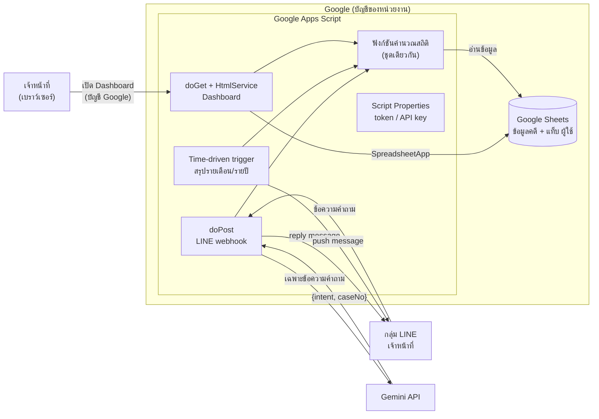
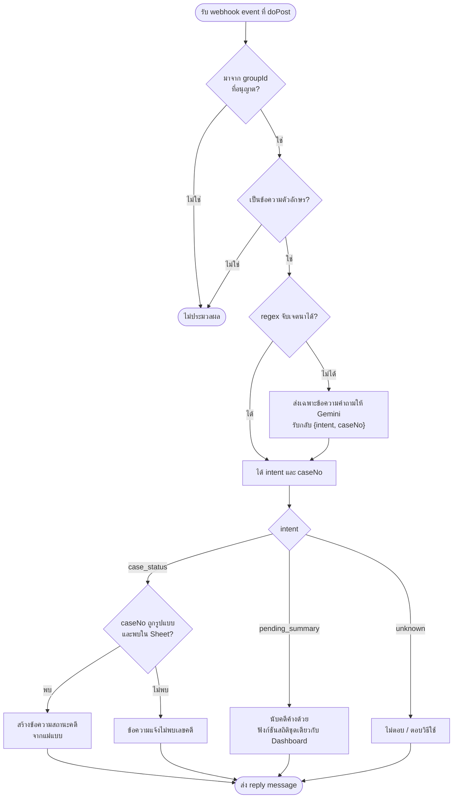

# บทที่ 3 การออกแบบระบบ

บทนี้อธิบายการออกแบบระบบ Dashboard และแชตบอต AI สำหรับติดตามและสรุปสถานะคดีส่งตรวจพิสูจน์ DNA ประกอบด้วย สถาปัตยกรรมระบบ โครงสร้างข้อมูล การออกแบบส่วนแสดงผล Dashboard การควบคุมสิทธิ์ การออกแบบแชตบอต LINE การออกแบบรายงานสรุปอัตโนมัติ และการออกแบบด้านความปลอดภัยและการคุ้มครองข้อมูลส่วนบุคคล โครงงานนี้เป็นงานด้านซอฟต์แวร์ทั้งหมด ไม่มีส่วนฮาร์ดแวร์ ภาพหน้าจอและตัวอย่างข้อความทั้งหมดในบทนี้สร้างจากข้อมูลจำลอง ไม่มีข้อมูลคดีจริง

> หมายเหตุสำหรับบรรณาธิการ: การอ้างอิงในบทนี้เขียนเป็น `[อ้างอิง: ...]` ชั่วคราว รอจัดเลขลำดับต่อจากบทที่ 1–2 รายการแหล่งอ้างอิงอยู่ท้ายไฟล์

## 3.1 ภาพรวมและสถาปัตยกรรมระบบ

ระบบออกแบบให้ทำงานบนบริการของ Google ทั้งหมดโดยไม่มีค่าใช้จ่าย และไม่ต้องมีเครื่องแม่ข่ายของหน่วยงานเอง องค์ประกอบหลักมี 5 ส่วน ดังนี้

1) **Google Sheets (แหล่งเก็บข้อมูล)** เป็นที่เก็บข้อมูลคดีเพียงแห่งเดียวของระบบ เจ้าหน้าที่ยังคงบันทึกข้อมูลลงตารางในรูปแบบเดิม ระบบเพิ่มเพียงแท็บ "ผู้ใช้" สำหรับควบคุมสิทธิ์ (หัวข้อ 3.2) Sheet ตั้งค่าเป็นแบบส่วนตัว ไม่เปิดให้ "ทุกคนที่มีลิงก์" อ่านได้

2) **Dashboard (Apps Script web app)** หน้าเว็บแสดงผลเสิร์ฟผ่าน `HtmlService` ของ Google Apps Script โดยมีฟังก์ชัน `doGet` เป็นจุดรับคำขอ [อ้างอิง: Google, "Web apps," Apps Script guides — https://developers.google.com/apps-script/guides/web] ข้อมูลอ่านจาก Sheet ฝั่งเซิร์ฟเวอร์ด้วย `SpreadsheetApp` แทนการให้เบราว์เซอร์ดึงข้อมูลเอง จึงไม่ต้องเปิด Sheet เป็นสาธารณะ

3) **LINE bot (webhook)** รับข้อความจากกลุ่ม LINE ของเจ้าหน้าที่ผ่าน LINE Messaging API ซึ่งส่งเหตุการณ์ (webhook event) มาเป็นคำขอ HTTP POST [อ้างอิง: LY Corporation, "Receive messages (webhook)," LINE Developers — https://developers.line.biz/en/docs/messaging-api/receiving-messages/] ปลายทางของ webhook คือฟังก์ชัน `doPost` ของ Apps Script web app เดียวกัน

4) **Time-driven trigger** ตัวตั้งเวลาของ Apps Script เรียกฟังก์ชันสรุปรายเดือนและรายปี แล้วส่งข้อความเข้ากลุ่ม LINE ด้วย push message ตัวตั้งเวลาแบบรายเดือนกำหนดวันที่ของเดือน ชั่วโมง และเขตเวลาได้ [อ้างอิง: Google, "Class ClockTriggerBuilder," Apps Script reference — https://developers.google.com/apps-script/reference/script/clock-trigger-builder]

5) **Gemini API (เฉพาะการแยกเจตนา)** ใช้เป็นตัวช่วยเมื่อกฎแบบ regular expression จับคำถามไม่ได้ ระบบส่งให้ Gemini **เฉพาะข้อความคำถามของผู้ใช้** และรับกลับเพียงเจตนา (intent) กับเลขคดี ไม่ส่งข้อมูลคดีจาก Sheet ไปยังบริการ AI



[รูปที่ 3.1: สถาปัตยกรรมระบบและเส้นทางการไหลของข้อมูล]

### 3.1.1 การไหลของข้อมูล

หลักการสำคัญของสถาปัตยกรรมคือ **ข้อมูลคดีไม่ออกนอก Google Apps Script ไปยังบริการ AI** เส้นทางข้อมูลแบ่งได้ 3 กรณี

1) **Dashboard** ผู้ใช้เปิดลิงก์ web app ด้วยบัญชี Google สคริปต์ตรวจสิทธิ์ แล้วอ่านข้อมูลจาก Sheet และคำนวณสถิติฝั่งเซิร์ฟเวอร์ ส่งเฉพาะผลที่ต้องแสดงกลับไปยังเบราว์เซอร์ของผู้ใช้ที่มีสิทธิ์

2) **คำถามในกลุ่ม LINE** ข้อความเดินทางจาก LINE Platform มาที่ `doPost` ถ้าต้องใช้ AI จะส่งเฉพาะข้อความคำถาม (เช่น "คดี 123/2568 ถึงไหนแล้ว") ไปยัง Gemini ข้อมูลที่ได้กลับมามีเพียงเจตนาและเลขคดี จากนั้นโค้ดของระบบเป็นผู้ค้นข้อมูลใน Sheet และประกอบข้อความตอบเอง ข้อความตอบจึงเดินทางกลับไปที่กลุ่ม LINE เท่านั้น

3) **สรุปตามเวลา** ตัวตั้งเวลาเรียกฟังก์ชันคำนวณสถิติ แล้วส่งข้อความสรุปที่เป็นตัวเลขรวม (ไม่มีเลขคดีหรือรายละเอียดรายคดี) เข้ากลุ่ม LINE ขั้นตอนนี้ไม่ใช้ AI

เหตุผลที่ไม่ส่งข้อมูลคดีให้ AI คือ ข้อกำหนดของ Gemini API ระบุว่าข้อมูลที่ส่งผ่านบริการแบบไม่เสียค่าใช้จ่าย (Unpaid Services) อาจถูกนำไปปรับปรุงผลิตภัณฑ์และอาจมีผู้ตรวจที่เป็นมนุษย์อ่าน รวมถึงแนะนำว่าไม่ควรส่งข้อมูลอ่อนไหว ข้อมูลลับ หรือข้อมูลส่วนบุคคลเข้าสู่บริการดังกล่าว [อ้างอิง: Google, "Gemini API Additional Terms of Service" — https://ai.google.dev/gemini-api/terms] การออกแบบให้ AI เห็นเพียงข้อความคำถามจึงลดความเสี่ยงนี้ แม้ข้อความคำถามจะมีเลขคดี แต่เลขคดีเพียงอย่างเดียวไม่ระบุตัวบุคคลและไม่บอกผลการตรวจ

## 3.2 การออกแบบโครงสร้างข้อมูล

ระบบใช้โครงสร้างตารางเดิมที่เจ้าหน้าที่ใช้อยู่ เพื่อไม่ให้เปลี่ยนวิธีทำงาน โครงสร้างได้จากการอ่านชื่อคอลัมน์ของไฟล์ต้นฉบับ (ไม่ได้คัดลอกค่าข้อมูล) และบันทึกไว้ที่ `docs/data-schema.md` ข้อมูลจำลองสำหรับพัฒนาและทดสอบสร้างให้มีโครงสร้างเดียวกันทุกคอลัมน์

### 3.2.1 แท็บข้อมูลคดี

แท็บ "ข้อมูลคดี" เป็นตารางหลัก หนึ่งแถวคือหนึ่งคดี คอลัมน์แรกต้องเป็น "เลข บก." ตารางที่ 3.1 แสดงคอลัมน์ตามลำดับ

ตารางที่ 3.1 คอลัมน์ในแท็บข้อมูลคดี

| คอลัมน์ | ชนิดข้อมูล | ความหมาย / การใช้งาน |
|---|---|---|
| เลข บก. | ข้อความ | เลขคดีรูปแบบ `ลำดับ/ปี พ.ศ.` เช่น `123/2568` ใช้เป็นคีย์ที่แชตบอตค้นหา |
| เลขรายงาน | ข้อความ | รูปแบบ `NN-YY-NNNNN` |
| สภ. (ท้องที่) | ข้อความ | สถานีตำรวจที่ส่งตรวจ |
| จังหวัด | ข้อความ | จังหวัดของสถานีที่ส่งตรวจ |
| เลขหนังสือนำส่ง | ข้อความ | เลขที่หนังสือนำส่งของกลาง |
| ลงวันที่ | วันที่ | วันที่ของหนังสือนำส่ง |
| วันที่รับ | วันที่ | วันที่รับคดี ใช้กำหนดเดือนและปีของคดีในสถิติและสรุป |
| วันที่ตรวจเสร็จ | วันที่ | ใช้คำนวณระยะเวลาตรวจ |
| วันที่มารับผล | วันที่ | ใช้คำนวณระยะเวลารอรับผล |
| สถานะ | ข้อความ | ค่าที่กำหนด 3 ค่า (หัวข้อ 3.2.3) |
| ประเภทคดี (เลือก) | ข้อความ (dropdown) | เช่น ทรัพย์ พ.ร.บ.อาวุธปืน เพศ |
| ผู้ตรวจ (เลือก) | ข้อความ (dropdown) | ชื่อเจ้าหน้าที่ผู้ตรวจ — ข้อมูลส่วนบุคคล |
| ของกลาง (ชิ้น) | ตัวเลข | จำนวนของกลางของคดี |
| เดือนที่รับ | วันที่ | คอลัมน์คำนวณ |
| ปี พ.ศ. (รับ) | ตัวเลข | คอลัมน์คำนวณ |
| นับในสถิติ | ตัวเลข 0/1 | คอลัมน์คำนวณ แถวที่เป็น 0 ไม่นับในสถิติ |
| ข้อสังเกต (ผิดปกติ) | ข้อความ | คอลัมน์คำนวณ ระบุเหตุผลที่แถวควรตรวจสอบ |
| ปีเลขรายงาน, ลำดับเลขรายงาน | ตัวเลข | คอลัมน์คำนวณ |
| User ID (LINE) | ข้อความ | LINE userId — ข้อมูลส่วนบุคคล ระบบไม่อ่านคอลัมน์นี้ |
| อันดับ (ช่วยคำนวณ), ตั้งค่า, เกณฑ์ของกลางผิดปกติ (ชิ้น) | — | ช่วยคำนวณและตั้งค่า เช่น เกณฑ์จำนวนของกลางที่ถือว่าสูงผิดปกติ |

ในไฟล์เดิมยังมีแท็บสรุปอื่น ได้แก่ "Dashboard" "สภ.และประเภทคดี" และ "ผู้ตรวจ" ซึ่งเป็นสูตรสรุปของ Excel ระบบนี้ไม่อ่านแท็บเหล่านี้ แต่คำนวณสถิติใหม่จากแท็บข้อมูลคดีโดยตรง

นอกจากข้อมูลรายคดี Dashboard ต้นแบบยังรองรับไฟล์ข้อมูลห้องปฏิบัติการ (แท็บ "ข้อมูลเคส" "ข้อมูลงบ" "ข้อมูล Lot" และ "หมายเหตุ") ซึ่งเป็นสถิติรายเดือนระดับห้องปฏิบัติการ ไม่มีข้อมูลรายคดี รายละเอียดคอลัมน์อยู่ใน `docs/data-schema.md`

### 3.2.2 แท็บผู้ใช้

แท็บ "ผู้ใช้" เป็นแท็บที่เพิ่มขึ้นใหม่ ใช้เป็นรายชื่อผู้มีสิทธิ์เปิด Dashboard

ตารางที่ 3.2 คอลัมน์ในแท็บผู้ใช้

| คอลัมน์ | ชนิดข้อมูล | ความหมาย |
|---|---|---|
| อีเมล | ข้อความ | อีเมลบัญชี Google ที่อนุญาตให้เปิด Dashboard |
| ชื่อ | ข้อความ | ชื่อผู้ใช้ เพื่อให้ผู้ดูแลจำได้ |
| หมายเหตุ | ข้อความ | เช่น ตำแหน่ง หรือวันที่เพิ่มสิทธิ์ |

การเพิ่มหรือถอนสิทธิ์ทำได้โดยแก้แถวในแท็บนี้ ไม่ต้องแก้โค้ด

### 3.2.3 ค่าสถานะคดี

คอลัมน์สถานะมีค่าที่กำหนด 3 ค่า เรียงตามลำดับงาน

1) **กำลังดำเนินการ** รับคดีแล้ว ยังตรวจไม่เสร็จ
2) **เสร็จแล้ว รอรับผล** ตรวจเสร็จแล้ว รอพนักงานสอบสวนมารับผล
3) **รับผลไปแล้ว** ปิดงานของคดี

"คดีค้าง" ในระบบหมายถึงคดีที่ยังไม่อยู่ในสถานะ "รับผลไปแล้ว" คือรวมสถานะที่ 1 และ 2 ความหมายนี้ใช้ตรงกันทั้งใน Dashboard (เมนูระยะเวลาและงานค้าง) และในคำสั่งสรุปคดีค้างของแชตบอต

### 3.2.4 ข้อมูลส่วนบุคคลและการจัดการ

คอลัมน์ที่เป็นข้อมูลส่วนบุคคลและวิธีจัดการแสดงในตารางที่ 3.3

ตารางที่ 3.3 คอลัมน์ที่เป็นข้อมูลส่วนบุคคลและการจัดการ

| คอลัมน์ | การจัดการในระบบ |
|---|---|
| ผู้ตรวจ (เลือก) | แสดงใน Dashboard เฉพาะผู้มีสิทธิ์ ในสรุปอัตโนมัติแสดงเป็นจำนวนคดีต่อคน แยกตามประเภท ไม่แสดงเลขคดี ไม่ส่งให้ AI |
| User ID (LINE) | ไม่อ่านและไม่แสดง Dashboard ต้นแบบกรองคอลัมน์ที่ชื่อเข้าข่าย เช่น "line" "user id" "เบอร์" "โทร" "บัตร" "เลขประจำตัว" ออกตั้งแต่ขั้นอ่านข้อมูล |
| อีเมลและชื่อในแท็บผู้ใช้ | ใช้ตรวจสิทธิ์ฝั่งเซิร์ฟเวอร์เท่านั้น ไม่แสดงบนหน้า Dashboard |

ข้อมูลที่ใช้พัฒนาและทดสอบเป็นข้อมูลจำลองทั้งหมด เช่น ชื่อเจ้าหน้าที่ "เจ้าหน้าที่ ก" ถึง "เจ้าหน้าที่ จ" สถานี "สภ.ตัวอย่าง1" ถึง "สภ.ตัวอย่าง15" อีเมลโดเมน `@example.com` และ LINE userId ขึ้นต้นด้วย `U-mock-` สร้างด้วยสคริปต์ `tools/make_mock_data.py` ซึ่งกำหนด seed คงที่ ทำให้สร้างซ้ำได้ผลเหมือนเดิมทุกครั้ง ระบบไม่มีคอลัมน์และไม่แสดง DNA profile

ข้อสังเกตด้านคุณภาพข้อมูล ณ วันที่ได้รับโครงสร้างไฟล์ คอลัมน์ "ประเภทคดี (เลือก)" และ "ผู้ตรวจ (เลือก)" ยังกรอกไว้เพียงส่วนน้อย สถิติแยกประเภทและแยกผู้ตรวจจึงออกแบบให้แสดงกลุ่ม "ยังไม่ระบุ" ไว้ชัดเจน แทนการตัดแถวทิ้ง

## 3.3 การออกแบบส่วนแสดงผล Dashboard

Dashboard ต้นแบบพัฒนาเป็นไฟล์ HTML ไฟล์เดียว (`dashboard/index.html`) วาดกราฟด้วย SVG ที่เขียนเอง ไม่พึ่งไลบรารีกราฟภายนอก และใช้ไลบรารี JSZip อ่านไฟล์ .xlsx ในเบราว์เซอร์ ในขั้นถัดไปหน้าเว็บนี้จะย้ายไปเสิร์ฟผ่าน Apps Script `HtmlService` และเปลี่ยนแหล่งข้อมูลเป็นการอ่าน Sheet ฝั่งเซิร์ฟเวอร์ (หัวข้อ 3.4) ส่วนการจัดหน้า เมนู และกราฟที่อธิบายต่อไปนี้เป็นของต้นแบบ

### 3.3.1 โครงหน้าจอและเมนู

หน้าจอแบ่งเป็นแถบเมนูด้านซ้ายและพื้นที่เนื้อหาด้านขวา ส่วนหัวมีชื่อ Dashboard ตัวเลือกแหล่งข้อมูล ป้ายสถานะการเชื่อมต่อ (เช่น "เชื่อมสด · Google Sheet · อัปเดต ...") และปุ่มสลับโหมดมืด/สว่าง ใต้ส่วนหัวมีแถบปุ่มเลือกปี (chip) สำหรับกรองข้อมูล Dashboard ตรวจรูปแบบข้อมูลจากชื่อแท็บและหัวคอลัมน์ แล้วเลือกชุดเมนูให้ตรงกับข้อมูลโดยอัตโนมัติ

ตารางที่ 3.4 เมนูของ Dashboard แยกตามรูปแบบข้อมูล

| รูปแบบข้อมูล | เมนู | ตัวกรองปี |
|---|---|---|
| คดีส่งตรวจ DNA (รายคดี) | ภาพรวม, พื้นที่และประเภทคดี, ประเภท/ผู้ตรวจรายเดือน, ระยะเวลาและงานค้าง, ตรวจสอบข้อมูล | ปีที่รับคดี (พ.ศ.) หรือ "ทั้งหมด" |
| งานตรวจ · Lot · งบประมาณ | ภาพรวม, งบประมาณ, Lot พัสดุ | ปีงบประมาณ (พ.ศ.) นับ ต.ค. – ก.ย. |
| ทุกรูปแบบ | แหล่งข้อมูล | — |

สถิติรายคดีนับตามวันที่รับคดี และนับเฉพาะแถวที่คอลัมน์ "นับในสถิติ" ไม่เป็น 0

[รูปที่ 3.2: โครงหน้าจอ Dashboard แถบเมนูด้านซ้าย ส่วนหัว และแถบเลือกปี — ภาพจากข้อมูลจำลอง]

### 3.3.2 หน้าภาพรวม (ข้อมูลคดี)

หน้าภาพรวมมีการ์ดตัวชี้วัด (KPI card) 6 ใบ ได้แก่ คดีทั้งหมด, ของกลางรวม (ชิ้น), ของกลางเฉลี่ยต่อคดี (พร้อมค่ามัธยฐาน), คดีเดือนล่าสุด (เทียบกับเดือนก่อน), แถวที่ควรตรวจสอบ และอยู่ระหว่างดำเนินการ (พร้อมจำนวนที่เสร็จแล้ว รอรับผล) ถ้ามีคดีที่ของกลางเกินเกณฑ์ที่ตั้งไว้ในชีต ระบบแสดงแถบหมายเหตุด้านบน

ส่วนกราฟและตารางประกอบด้วย กราฟแท่งจำนวนคดีรายเดือน กราฟแท่งของกลางรายเดือน (ชิ้น) รายการจุดเด่น (เดือนที่มีคดีมากที่สุด คดีเฉลี่ยต่อเดือน จังหวัดที่ส่งตรวจมากที่สุด และมัธยฐานระยะเวลารับถึงตรวจเสร็จ) ตารางสถิติรายปีที่คลิกแถวเพื่อกรองปีได้ ตารางสถิติรายเดือน และตาราง 10 คดีที่มีของกลางมากที่สุด

[รูปที่ 3.3: หน้าภาพรวมของ Dashboard ข้อมูลคดี — ภาพจากข้อมูลจำลอง]

### 3.3.3 หน้าพื้นที่และประเภทคดี

มีการ์ดตัวชี้วัด 4 ใบ ได้แก่ จำนวนจังหวัดที่ส่งตรวจ จำนวน สภ. ที่ส่งตรวจ คดีที่ระบุประเภทแล้ว และคดีที่ระบุผู้ตรวจแล้ว (แสดงร้อยละของคดีทั้งหมด) ตามด้วยกราฟแท่งแนวนอน 4 ชุด คือ จำนวนคดีแยกตามจังหวัด, สภ. ที่ส่งตรวจมากที่สุด 15 อันดับ, ประเภทคดี และผู้ตรวจ

[รูปที่ 3.4: หน้าพื้นที่และประเภทคดี — ภาพจากข้อมูลจำลอง]

### 3.3.4 หน้าประเภท/ผู้ตรวจรายเดือน

หน้านี้มีตัวเลือกเดือนที่รับคดี และตัวเลือกซ่อนกลุ่มที่ยังไม่ระบุ องค์ประกอบได้แก่ กราฟแท่งซ้อนประเภทคดีรายเดือน (แสดง 5 ประเภทที่มากที่สุด ที่เหลือรวมเป็น "อื่นๆ") ตารางประเภทคดีที่มากที่สุดในแต่ละเดือน ตารางจำนวนคดีแยกประเภทรายเดือน ตารางไขว้จังหวัด × ประเภทคดี และผู้ตรวจ × ประเภทคดี ที่คลิกแถวเพื่อดูรายการคดีได้ และตารางไขว้จังหวัด × เดือน กับผู้ตรวจ × เดือน ถ้าคดีที่ระบุประเภทหรือผู้ตรวจมีน้อยกว่าครึ่งหนึ่ง ระบบแสดงกล่องเตือนว่าข้อมูลส่วนนี้ยังน้อย

[รูปที่ 3.5: หน้าประเภทคดีและผู้ตรวจรายเดือน — ภาพจากข้อมูลจำลอง]

### 3.3.5 หน้าระยะเวลาและงานค้าง

มีการ์ดตัวชี้วัด 4 ใบ ได้แก่ ระยะเวลาเฉลี่ยจากรับถึงตรวจเสร็จ (วัน) ค่ามัธยฐาน (พร้อมค่าเร็วสุดและนานสุด) มัธยฐานระยะเวลาจากตรวจเสร็จถึงมารับผล และคดีที่ยังไม่รับผล ส่วนกราฟประกอบด้วย กราฟเส้นระยะเวลาตรวจเฉลี่ยรายเดือน แถบสถานะคดีทั้ง 3 ค่า และการกระจายของระยะเวลาตรวจเป็นช่วง (ไม่เกิน 14 วัน, 15–21, 22–28, 29–35 และมากกว่า 35 วัน) ด้านล่างเป็นตารางคดีที่ยังไม่รับผล เรียงจากค้างนานที่สุด กรองตามสถานะได้ และแสดงทีละ 25 แถวพร้อมปุ่มแสดงเพิ่ม

[รูปที่ 3.6: หน้าระยะเวลาและงานค้าง — ภาพจากข้อมูลจำลอง]

### 3.3.6 หน้าตรวจสอบข้อมูลและหน้าข้อมูลห้องปฏิบัติการ

หน้าตรวจสอบข้อมูลรวบรวมแถวที่คอลัมน์ "ข้อสังเกต (ผิดปกติ)" มีค่า แสดงการ์ดตัวชี้วัด กราฟสรุปตามเหตุผล และตารางรายการที่ควรตรวจสอบกับต้นฉบับ หน้านี้ช่วยให้เจ้าหน้าที่แก้ข้อมูลต้นทางก่อนนำตัวเลขไปใช้

สำหรับข้อมูลห้องปฏิบัติการ หน้าภาพรวมแสดงตัวชี้วัด 6 ใบ (ตัวอย่างตรวจ ของกลาง เฉลี่ยตัวอย่างต่อเดือน งบประมาณรวม บาทต่อตัวอย่าง และ Lot พัสดุ) พร้อมกราฟเทียบปีงบประมาณก่อนหน้า หน้างบประมาณแสดงกราฟแท่งซ้อนงบรายปีแยกหมวดและกราฟเส้นต้นทุนวัสดุตรวจต่อตัวอย่าง หน้า Lot พัสดุแสดงจำนวนตัวอย่างรายรอบ 26–25 ของเดือน และเทียบกับรายงานรายเดือน

[รูปที่ 3.7: หน้าตรวจสอบข้อมูล — ภาพจากข้อมูลจำลอง]

### 3.3.7 หลักการออกแบบส่วนแสดงผล

1) **ภาษาไทยทั้งหมด** ชื่อเมนู หัวกราฟ คำอธิบาย และข้อความแจ้งเตือนเป็นภาษาไทย ปีแสดงเป็น พ.ศ.
2) **รองรับอุปกรณ์เคลื่อนที่** ที่ความกว้างไม่เกิน 900 พิกเซล เมนูย้ายจากแถบซ้ายเป็นแถบเลื่อนแนวนอนด้านบน การ์ดตัวชี้วัดลดเหลือ 3 และ 2 คอลัมน์ตามความกว้างจอ และบนจอสัมผัสปุ่มมีความสูงอย่างน้อย 44 พิกเซล
3) **โหมดมืด** ใช้ตามการตั้งค่าของระบบปฏิบัติการโดยอัตโนมัติ และสลับเองได้ด้วยปุ่มที่ส่วนหัว สีทั้งหมดกำหนดเป็นตัวแปรที่มีค่าสำหรับทั้งสองโหมด
4) **ค่าที่ขาดหาย** ถ้าคอลัมน์จังหวัดหรือ สภ. ว่าง ระบบจัดเป็นกลุ่ม "ไม่ระบุ" ถ้าประเภทคดีหรือผู้ตรวจว่าง จัดเป็น "ยังไม่ระบุ" (หรือ "ยังไม่ระบุผู้ตรวจ") ตัวชี้วัดที่คำนวณไม่ได้แสดงเป็น "—" พร้อมเหตุผล เช่น "คำนวณเมื่อครบ 12 เดือน"
5) **อ่านได้ทั้งแบบกราฟและตาราง** การ์ดกราฟทุกใบมีปุ่ม "ดูเป็นตาราง" กราฟมีคำอธิบายสำหรับโปรแกรมอ่านหน้าจอ (`aria-label`) มีลิงก์ข้ามไปยังเนื้อหา และงดภาพเคลื่อนไหวเมื่อผู้ใช้ตั้งค่าลดการเคลื่อนไหว
6) **ข้อมูลเป็นปัจจุบัน** เมื่อเชื่อมกับ Google Sheet ต้นแบบดึงข้อมูลซ้ำตามรอบเวลา (ค่าเริ่มต้น 30 วินาที) และวาดใหม่เฉพาะเมื่อข้อมูลเปลี่ยน การ์ดที่ตัวเลขเปลี่ยนจะกะพริบให้เห็น

## 3.4 การควบคุมสิทธิ์และการทำงานฝั่งเซิร์ฟเวอร์

[รอใส่: รอผลการออกแบบจาก dashboard-dev — วิธีตรวจสอบสิทธิ์ผู้ใช้ และการอ่านข้อมูลด้วย Apps Script]

## 3.5 การออกแบบแชตบอต LINE

หัวข้อนี้เป็นการออกแบบ ส่วนการพัฒนาแชตบอตอยู่ในขั้นตอนที่ 3 ของแผนการดำเนินงาน ยังไม่ได้สร้าง รายละเอียดอาจปรับเมื่อพัฒนาจริง

### 3.5.1 ขอบเขตการใช้งานและคำสั่ง

แชตบอตใช้ในกลุ่ม LINE ของเจ้าหน้าที่กลุ่มเดียว และตอบคำถาม 2 แบบ

1) **สถานะคดีจากเลข บก.** เช่น "คดี 123/2568 ถึงไหนแล้ว" ระบบค้นแถวที่เลข บก. ตรงกัน แล้วตอบสถานะและวันที่ที่เกี่ยวข้องกับงาน (วันที่รับ วันที่ตรวจเสร็จ วันที่มารับผล ถ้ามี) ไม่ตอบชื่อผู้ตรวจ LINE userId หรือผลการตรวจ ถ้าไม่พบเลขคดีจะแจ้งว่าไม่พบ
2) **สรุปคดีค้าง** เช่น "มีคดีค้างกี่คดี" ระบบตอบจำนวนคดีที่ยังไม่รับผล แยกเป็น "กำลังดำเนินการ" และ "เสร็จแล้ว รอรับผล" ตามนิยามในหัวข้อ 3.2.3

ข้อความที่ไม่เข้าข่ายทั้งสองแบบ ระบบไม่ตอบ หรือตอบข้อความแนะนำวิธีใช้สั้น ๆ [รอใส่: ข้อสรุปจาก linebot-dev/เจ้าของโครงงาน ว่าจะเงียบหรือตอบวิธีใช้]

### 3.5.2 การแยกเจตนาแบบผสม

การแยกเจตนา (intent) ออกแบบเป็น 2 ชั้น เพื่อให้คำถามรูปแบบที่พบบ่อยไม่ต้องเรียก AI เลย

1) **ชั้นที่ 1 กฎ (regular expression)** ตรวจหาเลขคดีรูปแบบ `ตัวเลข/ปี พ.ศ. 4 หลัก` และคำสำคัญ เช่น "ค้าง" ถ้าจับได้ชัดเจนก็ได้เจตนาและเลขคดีทันที
2) **ชั้นที่ 2 Gemini API** ใช้เฉพาะเมื่อกฎจับไม่ได้ ระบบส่งข้อความคำถามของผู้ใช้เพียงอย่างเดียว และกำหนดให้โมเดลตอบเป็น JSON ตาม schema ที่กำหนด [อ้างอิง: Google, "Structured outputs," Gemini API documentation — https://ai.google.dev/gemini-api/docs/structured-output] ในรูป `{"intent": "case_status" | "pending_summary" | "unknown", "caseNo": "123/2568" | null}`
3) **สร้างคำตอบด้วยโค้ด** เมื่อได้เจตนาแล้ว โค้ดตรวจรูปแบบเลขคดีซ้ำอีกครั้ง ค้นข้อมูลจาก Sheet และประกอบข้อความตอบจากแม่แบบข้อความที่กำหนดไว้ AI ไม่ได้เห็นข้อมูลใน Sheet และไม่ได้เป็นผู้เขียนคำตอบ จึงไม่มีโอกาสที่ AI จะแต่งสถานะคดีขึ้นเอง

### 3.5.3 การจำกัดกลุ่มและการส่งข้อความ

เหตุการณ์ที่มาจากกลุ่มมีรหัสกลุ่ม (`source.groupId`) ระบบเก็บรหัสกลุ่มที่อนุญาตไว้ใน Script Properties และตอบเฉพาะเหตุการณ์ที่มาจากกลุ่มนั้น ข้อความจากแชตส่วนตัวหรือกลุ่มอื่นไม่ถูกประมวลผล

การส่งข้อความแบ่งเป็น 2 แบบ [อ้างอิง: LY Corporation, "Send messages," LINE Developers — https://developers.line.biz/en/docs/messaging-api/sending-messages/]

1) **Reply message** ใช้ตอบคำถาม ต้องใช้ reply token ที่มากับ webhook event และไม่นับรวมในจำนวนข้อความของโควตา [อ้างอิง: LY Corporation, "Messaging API pricing," LINE Developers — https://developers.line.biz/en/docs/messaging-api/pricing/]
2) **Push message** ใช้เฉพาะสรุปตามเวลา (หัวข้อ 3.6) ส่งได้โดยไม่ต้องมีคำถามนำ แต่นับรวมในโควตาตามจำนวนผู้รับ เมื่อส่งเข้ากลุ่ม จำนวนข้อความที่นับจึงเท่ากับจำนวนสมาชิกในกลุ่ม [รอใส่: จำนวนสมาชิกกลุ่มและโควตาฟรีของแพ็กเกจที่ใช้ในประเทศไทย เพื่อคำนวณว่าสรุปปีละ 13 ครั้งอยู่ในโควตา]

LINE แนะนำให้ตรวจลายเซ็นในส่วนหัวของคำขอ webhook ก่อนประมวลผล [อ้างอิง: LY Corporation, "Receive messages (webhook)" — https://developers.line.biz/en/docs/messaging-api/receiving-messages/] แต่เอกสารของ Apps Script ระบุฟิลด์ของออบเจ็กต์เหตุการณ์ใน `doPost` (เช่น `parameter` และ `postData`) โดยไม่มีส่วนหัวของคำขอ [อ้างอิง: Google, "Web apps" — https://developers.google.com/apps-script/guides/web] [รอใส่: แนวทางชดเชยจาก linebot-dev เช่น การตรวจ groupId ร่วมกับการตรวจรูปแบบเหตุการณ์]

### 3.5.4 ผังการทำงานของแชตบอต



[รูปที่ 3.8: ผังการทำงานของแชตบอต LINE (การออกแบบ)]

## 3.6 การออกแบบรายงานสรุปอัตโนมัติ

### 3.6.1 รอบเวลาและช่วงข้อมูล

รายงานสรุปสร้างโดย time-driven trigger ของ Apps Script ตั้งเวลาด้วยวันที่ของเดือนและเขตเวลา Asia/Bangkok แบ่งเป็น 2 รอบ

1) **รายเดือน** ทำงานวันที่ 1 ของทุกเดือน สรุปข้อมูลของ**เดือนปฏิทินก่อนหน้า** เช่น วันที่ 1 พฤศจิกายน สรุปเดือนตุลาคม
2) **รายปี** ทำงานวันที่ 1 มกราคม สรุปข้อมูลของ**ปีปฏิทินก่อนหน้า** (มกราคม–ธันวาคม) วันที่ 1 มกราคมจึงส่งทั้งสรุปเดือนธันวาคมและสรุปทั้งปี

คดีจัดเข้าเดือนและปีตาม "วันที่รับ" และนับเฉพาะแถวที่ "นับในสถิติ" ไม่เป็น 0 ซึ่งเป็นเกณฑ์เดียวกับ Dashboard

### 3.6.2 เนื้อหาของรายงาน

1) จำนวนคดีในช่วงเวลา
2) จำนวนของกลางรวม (ชิ้น)
3) จำนวนคดีแยกตามประเภทคดี (รวมกลุ่ม "ยังไม่ระบุ")
4) จำนวนคดีของเจ้าหน้าที่แต่ละคนแยกตามประเภทคดี แสดงเป็นจำนวนเท่านั้น ไม่แสดงเลขคดี
5) ลิงก์ Dashboard สำหรับดูรายละเอียด ซึ่งเปิดได้เฉพาะผู้มีสิทธิ์

รายงานไม่มีเลขคดี ชื่อสถานี หรือรายละเอียดรายคดี เพราะข้อความใน LINE อาจถูกส่งต่อออกนอกกลุ่มได้ง่าย

### 3.6.3 ตัวอย่างข้อความ

ตัวอย่างต่อไปนี้ใช้ค่าสมมติทั้งหมด ไม่ได้มาจากข้อมูลจริง รูปแบบสุดท้ายอาจปรับระหว่างการพัฒนา

```text
สรุปคดีส่งตรวจ DNA เดือนตุลาคม 2569
(นับตามวันที่รับคดี)

คดีทั้งหมด: 12 คดี
ของกลางรวม: 48 ชิ้น

แยกตามประเภทคดี
• ทรัพย์ 5
• เพศ 3
• พ.ร.บ.อาวุธปืน 2
• ยังไม่ระบุ 2

แยกตามผู้ตรวจ
• เจ้าหน้าที่ ก: ทรัพย์ 3, เพศ 1
• เจ้าหน้าที่ ข: ทรัพย์ 2, พ.ร.บ.อาวุธปืน 2
• เจ้าหน้าที่ ค: เพศ 2
• ยังไม่ระบุผู้ตรวจ: 2

ดูรายละเอียด: <ลิงก์ Dashboard>
```

[รูปที่ 3.9: ตัวอย่างข้อความสรุปรายเดือนในกลุ่ม LINE — ภาพจากข้อมูลจำลอง]

### 3.6.4 ความสอดคล้องกับ Dashboard

ตัวเลขในรายงานต้องตรงกับตัวเลขที่ผู้ใช้เห็นใน Dashboard เมื่อเลือกช่วงเวลาเดียวกัน ระบบจึงออกแบบให้ Dashboard คำสั่งสรุปคดีค้างของแชตบอต และรายงานอัตโนมัติ เรียกใช้**ฟังก์ชันคำนวณสถิติชุดเดียวกัน**ฝั่ง Apps Script ทั้งการกรองแถวที่นับในสถิติ การจัดเดือนตามวันที่รับ และการจัดกลุ่ม "ยังไม่ระบุ" ทำให้แก้เกณฑ์ที่จุดเดียวแล้วมีผลทุกช่องทาง

## 3.7 การออกแบบด้านความปลอดภัยและ PDPA

ข้อมูลคดีมีข้อมูลส่วนบุคคล เช่น ชื่อเจ้าหน้าที่ผู้ตรวจและ LINE userId จึงต้องจัดการตามพระราชบัญญัติคุ้มครองข้อมูลส่วนบุคคล พ.ศ. 2562 [อ้างอิง: พระราชบัญญัติคุ้มครองข้อมูลส่วนบุคคล พ.ศ. 2562, ราชกิจจานุเบกษา เล่ม 136 ตอนที่ 69 ก, 27 พฤษภาคม 2562 — รอใส่ URL ที่ตรวจแล้ว] การออกแบบใช้หลักการต่อไปนี้

1) **สิทธิ์น้อยที่สุด (least privilege)** Sheet เป็นแบบส่วนตัว Dashboard เปิดได้เฉพาะอีเมลในแท็บผู้ใช้ แชตบอตตอบเฉพาะกลุ่มที่อนุญาต และตอบเฉพาะข้อมูลที่จำเป็นต่อคำถาม
2) **ใช้ข้อมูลเท่าที่จำเป็น (data minimisation)** ส่งให้ AI เพียงข้อความคำถาม ไม่ส่งข้อมูลคดี คอลัมน์ LINE userId และคอลัมน์ที่เข้าข่ายข้อมูลระบุตัวตนไม่ถูกอ่าน สรุปอัตโนมัติแสดงเป็นจำนวนรวม ไม่แสดงเลขคดี
3) **เก็บความลับไว้นอกโค้ด** LINE channel access token, Gemini API key, รหัส Sheet และรหัสกลุ่มที่อนุญาต เก็บใน Script Properties ซึ่งเป็นที่เก็บค่าตั้งค่าระดับสคริปต์ [อ้างอิง: Google, "Properties Service," Apps Script guides — https://developers.google.com/apps-script/guides/properties] โค้ดใน repository จึงไม่มีค่าความลับ
4) **พัฒนาด้วยข้อมูลจำลอง** การพัฒนา การทดสอบ และภาพหน้าจอในเล่มใช้ข้อมูลจำลองเท่านั้น ไม่นำข้อมูลจริงเข้า repository การนำโค้ดขึ้นใช้กับ Sheet จริงต้องให้เจ้าของโครงงานตรวจก่อน
5) **ไม่มี DNA profile** ระบบติดตามเฉพาะสถานะและสถิติของงาน ไม่เก็บ ไม่ประมวลผล และไม่แสดง DNA profile หรือผลการตรวจพิสูจน์ในส่วนใดของระบบ

[รอใส่: มาตราของ พ.ร.บ.คุ้มครองข้อมูลส่วนบุคคล ที่เกี่ยวข้องกับหลักการแต่ละข้อ — ต้องตรวจจากต้นฉบับราชกิจจานุเบกษาก่อนอ้าง]

---

## แหล่งอ้างอิงของบทที่ 3 (รอจัดเลขลำดับ IEEE)

ทุกรายการเปิดตรวจแล้วเมื่อวันที่ 3 พฤศจิกายน 2569 ยกเว้นรายการที่มีเครื่องหมาย [รอใส่]

- Google, "Web apps," *Google Apps Script Guides*. [Online]. Available: https://developers.google.com/apps-script/guides/web
- Google, "Class ClockTriggerBuilder," *Google Apps Script Reference*. [Online]. Available: https://developers.google.com/apps-script/reference/script/clock-trigger-builder
- Google, "Properties Service," *Google Apps Script Guides*. [Online]. Available: https://developers.google.com/apps-script/guides/properties
- Google, "Structured outputs," *Gemini API Documentation*. [Online]. Available: https://ai.google.dev/gemini-api/docs/structured-output (เปิดแล้วถูกเปลี่ยนเส้นทางไปที่ https://aistudio.google.com/docs/structured-output)
- Google, "Gemini API Additional Terms of Service," มีผลวันที่ 23 มีนาคม 2026. [Online]. Available: https://ai.google.dev/gemini-api/terms (เปิดแล้วถูกเปลี่ยนเส้นทางไปที่ https://aistudio.google.com/docs/terms)
- LY Corporation, "Receive messages (webhook)," *LINE Developers*. [Online]. Available: https://developers.line.biz/en/docs/messaging-api/receiving-messages/
- LY Corporation, "Send messages," *LINE Developers*. [Online]. Available: https://developers.line.biz/en/docs/messaging-api/sending-messages/
- LY Corporation, "Messaging API pricing," *LINE Developers*. [Online]. Available: https://developers.line.biz/en/docs/messaging-api/pricing/
- พระราชบัญญัติคุ้มครองข้อมูลส่วนบุคคล พ.ศ. 2562, ราชกิจจานุเบกษา เล่ม 136 ตอนที่ 69 ก, 27 พฤษภาคม 2562. [รอใส่: URL ต้นฉบับราชกิจจานุเบกษา — เว็บไซต์ปฏิเสธการเข้าถึงจากเครื่องที่ใช้ร่าง ต้องให้เจ้าของโครงงานเปิดตรวจเลขเล่ม/ตอน/หน้า]
