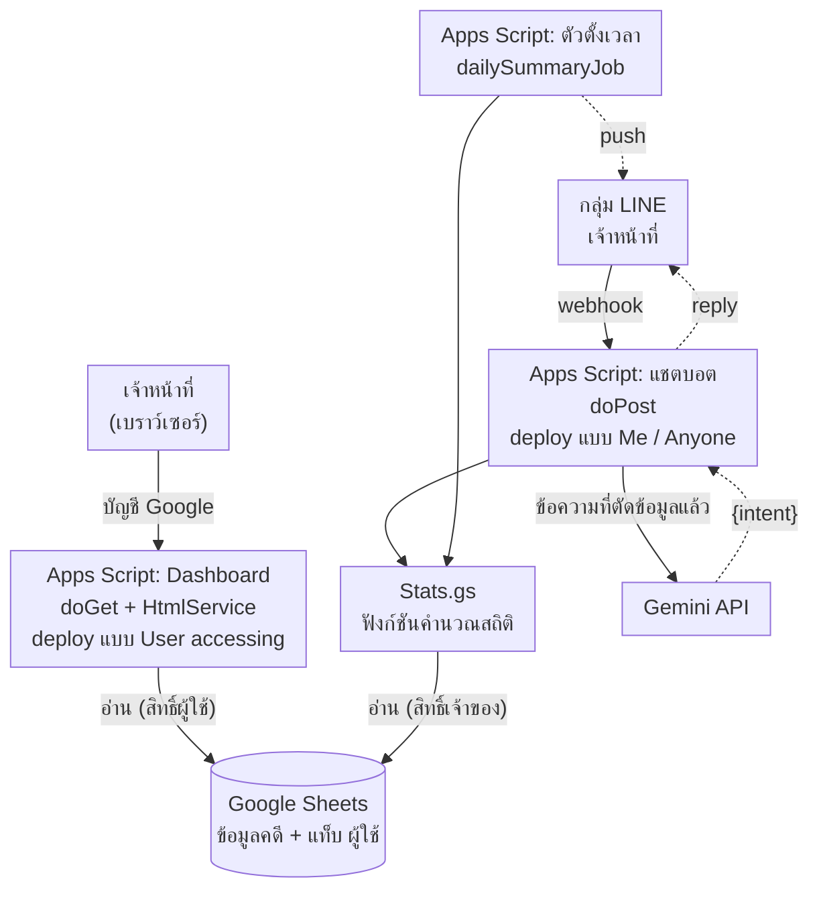
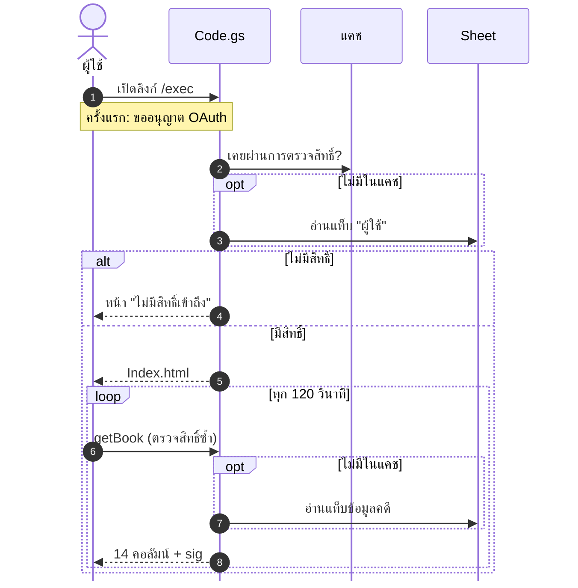
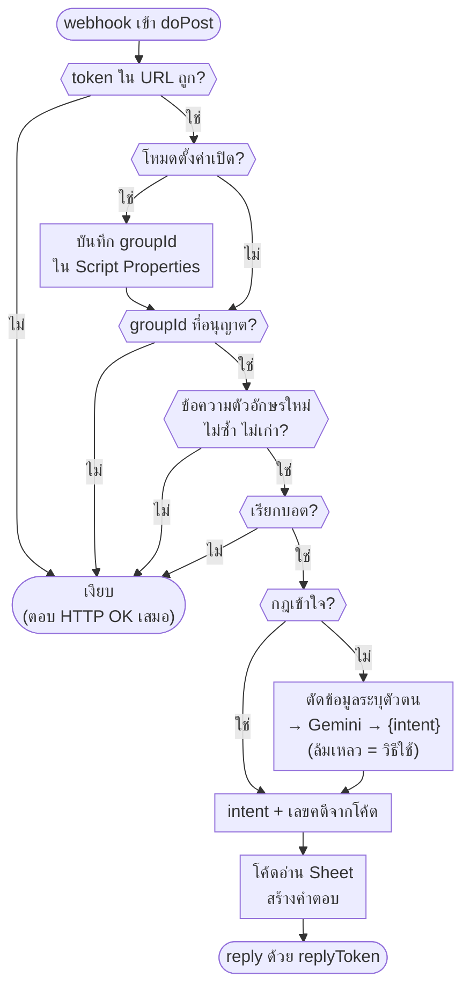

# บทที่ 3 การออกแบบระบบ

บทนี้อธิบายการออกแบบระบบ Dashboard และแชตบอต AI สำหรับติดตามและสรุปสถานะคดีส่งตรวจพิสูจน์ DNA ประกอบด้วย สถาปัตยกรรมระบบ โครงสร้างข้อมูล การออกแบบส่วนแสดงผล Dashboard การควบคุมสิทธิ์ การออกแบบแชตบอต LINE การออกแบบรายงานสรุปอัตโนมัติ และการออกแบบด้านความปลอดภัยและการคุ้มครองข้อมูลส่วนบุคคล โครงงานนี้เป็นงานด้านซอฟต์แวร์ทั้งหมด ไม่มีส่วนฮาร์ดแวร์ ภาพหน้าจอและตัวอย่างข้อความทั้งหมดในบทนี้สร้างจากข้อมูลจำลอง ไม่มีข้อมูลคดีจริง

> ร่างโดย thesis-writer — เลขอ้างอิงต่อเนื่องจากบทที่ 2 (ข้อ [1]–[36] อยู่ท้ายไฟล์ `01-บทนำ.md` และ `02-ทฤษฎี.md` ข้อ [37]–[47] อยู่ท้ายไฟล์นี้)

## 3.1 ภาพรวมและสถาปัตยกรรมระบบ

ระบบออกแบบให้ทำงานบนบริการของ Google ทั้งหมดโดยไม่มีค่าใช้จ่าย และไม่ต้องมีเครื่องแม่ข่ายของหน่วยงานเอง Dashboard แชตบอต LINE และรายงานสรุปอัตโนมัติอยู่ในโปรเจกต์ Google Apps Script เดียวกัน (เจ้าของโครงงานเป็นผู้ตัดสินใจ) เพื่อใช้ไฟล์ `Stats.gs` ซึ่งเป็นฟังก์ชันคำนวณสถิติร่วมกัน แต่ deploy เป็นเว็บแอป 2 รายการที่ตั้งค่าต่างกัน (หัวข้อ 3.4.8) องค์ประกอบหลักมี 5 ส่วน ดังนี้

1) **Google Sheets (แหล่งเก็บข้อมูล)** เป็นที่เก็บข้อมูลคดีเพียงแห่งเดียวของระบบ เจ้าหน้าที่ยังคงบันทึกข้อมูลลงตารางในรูปแบบเดิม ระบบเพิ่มเพียงแท็บ “ผู้ใช้” สำหรับควบคุมสิทธิ์ (หัวข้อ 3.2) ไฟล์ไม่เปิดให้ “ทุกคนที่มีลิงก์” อ่านได้ แต่แชร์แบบผู้มีสิทธิ์อ่าน (Viewer) เฉพาะบัญชีที่อยู่ในแท็บ “ผู้ใช้” (หัวข้อ 3.4)

2) **Dashboard (เว็บแอป รายการที่ 1)** หน้าเว็บแสดงผลเสิร์ฟผ่าน `HtmlService` ของ Google Apps Script โดยมีฟังก์ชัน `doGet` เป็นจุดรับคำขอ [15] ข้อมูลอ่านจาก Sheet ฝั่งเซิร์ฟเวอร์ด้วย `SpreadsheetApp` แทนการให้เบราว์เซอร์ดึงข้อมูลเอง จึงไม่ต้องเปิด Sheet เป็นสาธารณะ และตรวจสิทธิ์ผู้ใช้ทุกครั้งที่ขอข้อมูล (หัวข้อ 3.4)

3) **แชตบอต LINE (เว็บแอป รายการที่ 2)** รับข้อความจากกลุ่ม LINE ของเจ้าหน้าที่ผ่าน LINE Messaging API ซึ่งส่งเหตุการณ์ (webhook event) มาเป็นคำขอ HTTP POST [37] ปลายทางของ webhook คือฟังก์ชัน `doPost` ใน `LineBot.gs` ซึ่ง deploy แยกจาก Dashboard แบบ Execute as: Me และ Who has access: Anyone เพราะ LINE Platform เรียก webhook โดยไม่มีบัญชี Google (หัวข้อ 3.4.8 และ 3.5)

4) **ตัวตั้งเวลา (time-driven trigger)** ตัวตั้งเวลารายวันของ Apps Script เรียกฟังก์ชัน `dailySummaryJob` ใน `Summary.gs` ทุกเช้า ฟังก์ชันตรวจว่าวันนั้นมีงวดสรุปรายเดือนหรือรายปีที่ต้องส่งหรือไม่ แล้วส่งข้อความเข้ากลุ่ม LINE ด้วย push message ตัวตั้งเวลากำหนดชั่วโมงและเขตเวลาได้ [38] (หัวข้อ 3.6)

5) **Gemini API (เฉพาะการแยกเจตนา)** ใช้เป็นตัวช่วยเฉพาะเมื่อผู้ใช้เรียกบอตแล้วแต่กฎที่เขียนไว้ในโค้ดเข้าใจคำถามไม่ได้ ระบบส่งให้ Gemini **เฉพาะข้อความคำถามที่ตัดตัวเลขทั้งหมด ชื่อที่มีคำนำหน้า อีเมล ลิงก์ การกล่าวถึงผู้ใช้ และชื่อหน่วยออกแล้ว** และรับกลับเพียงเจตนา (intent) เลขคดีดึงด้วยโค้ดของระบบเอง ไม่ส่งข้อมูลคดีจาก Sheet ไปยังบริการ AI (หัวข้อ 3.5.2)

ความสัมพันธ์ขององค์ประกอบทั้ง 5 ส่วนและทิศทางของข้อมูลแสดงในรูปที่ 3.1 เส้นทึบคือการส่งคำขอหรืออ่านข้อมูล เส้นประคือข้อความหรือผลที่ส่งกลับ ค่าความลับ เช่น channel access token ของ LINE และ API key ของ Gemini เก็บใน Script Properties ของโปรเจกต์ [13] จึงไม่ปรากฏในรูป



[รูปที่ 3.1: สถาปัตยกรรมระบบและเส้นทางการไหลของข้อมูล]

### 3.1.1 การไหลของข้อมูล

หลักการสำคัญของสถาปัตยกรรมคือ **ข้อมูลคดีไม่ออกนอก Google Apps Script ไปยังบริการ AI** เส้นทางข้อมูลแบ่งได้ 3 กรณี

1) **Dashboard** ผู้ใช้เปิดลิงก์เว็บแอปด้วยบัญชี Google สคริปต์ตรวจสิทธิ์ แล้วอ่านข้อมูลจาก Sheet ฝั่งเซิร์ฟเวอร์ด้วยสิทธิ์ของผู้ใช้คนนั้น และส่งเฉพาะคอลัมน์ที่ Dashboard ใช้กลับไปยังเบราว์เซอร์ เบราว์เซอร์เป็นผู้คำนวณสถิติและวาดกราฟ (หัวข้อ 3.4)

2) **คำถามในกลุ่ม LINE** ข้อความเดินทางจาก LINE Platform มาที่ `doPost` ระบบตรวจรหัสลับใน URL และรหัสกลุ่มก่อน แล้วตรวจว่าข้อความนั้นเป็นการเรียกบอตหรือไม่ ข้อความสนทนาทั่วไปถูกทิ้งโดยไม่อ่าน Sheet และไม่เรียก Gemini ถ้าเป็นการเรียกบอต โค้ดแยกเจตนาและดึงเลขคดีด้วยกฎของตัวเองก่อน และเรียก Gemini เฉพาะเมื่อกฎไม่เข้าใจ โดยส่งข้อความที่ตัดข้อมูลแล้วเท่านั้น ข้อมูลที่ได้กลับมามีเพียงเจตนา จากนั้นโค้ดของระบบเป็นผู้ค้นข้อมูลใน Sheet และประกอบข้อความตอบเอง ข้อความตอบส่งด้วย reply token จึงไปถึงเฉพาะกลุ่มที่ถาม และไม่อยู่ในคำตอบ HTTP ของ `doPost`

3) **สรุปตามเวลา** ตัวตั้งเวลาเรียกฟังก์ชันคำนวณสถิติ แล้วส่งข้อความสรุปที่เป็นตัวเลขรวม (ไม่มีเลขคดีหรือรายละเอียดรายคดี) เข้ากลุ่ม LINE ขั้นตอนนี้ไม่ใช้ AI

เหตุผลที่ไม่ส่งข้อมูลคดีให้ AI คือ ข้อกำหนดเพิ่มเติมของ Gemini API (มีผลวันที่ 23 มีนาคม ค.ศ. 2026) ระบุว่าข้อมูลที่ส่งผ่านบริการแบบไม่เสียค่าใช้จ่าย (Unpaid Services) อาจถูกนำไปปรับปรุงผลิตภัณฑ์และอาจมีผู้ตรวจที่เป็นมนุษย์อ่าน รวมถึงห้ามส่งข้อมูลอ่อนไหว ข้อมูลลับ หรือข้อมูลส่วนบุคคลเข้าสู่บริการดังกล่าว [8] การออกแบบให้ AI เห็นเพียงข้อความคำถามที่ตัดข้อมูลออกแล้วจึงลดความเสี่ยงนี้ แม้เลขคดีเพียงอย่างเดียวจะไม่บอกผลการตรวจ เจ้าของโครงงานตัดสินใจไม่ส่งเลขคดีให้ Gemini เพื่อไม่ให้ข้อความที่ผู้ตรวจของ Google อาจอ่านเชื่อมโยงกลับไปยังคดีใดคดีหนึ่งได้

## 3.2 การออกแบบโครงสร้างข้อมูล

ระบบใช้โครงสร้างตารางเดิมที่เจ้าหน้าที่ใช้อยู่ เพื่อไม่ให้เปลี่ยนวิธีทำงาน โครงสร้างได้จากการอ่านชื่อคอลัมน์ของไฟล์ต้นฉบับ (ไม่ได้คัดลอกค่าข้อมูล) และบันทึกไว้ที่ `docs/data-schema.md` ข้อมูลจำลองสำหรับพัฒนาและทดสอบสร้างให้มีโครงสร้างเดียวกันทุกคอลัมน์

### 3.2.1 แท็บข้อมูลคดี

แท็บ “ข้อมูลคดี” เป็นตารางหลัก หนึ่งแถวคือหนึ่งคดี คอลัมน์แรกต้องเป็น “เลข บก.” ตารางที่ 3.1 แสดงคอลัมน์ตามลำดับ

ตารางที่ 3.1 คอลัมน์ในแท็บข้อมูลคดี

| คอลัมน์ | ชนิดข้อมูล | ความหมาย / การใช้งาน |
|---|---|---|
| เลข บก. | ข้อความ | เลขคดีรูปแบบ `ลำดับ/ปี พ.ศ.` เช่น `123/2568` ใช้เป็นคีย์ที่แชตบอตค้นหา |
| เลขรายงาน | ข้อความ | รูปแบบ `NN-YY-NNNNN` |
| สภ. (ท้องที่) | ข้อความ | สถานีตำรวจที่ส่งตรวจ |
| จังหวัด | ข้อความ | จังหวัดของสถานีที่ส่งตรวจ |
| เลขหนังสือนำส่ง | ข้อความ | เลขที่หนังสือนำส่งของกลาง |
| ลงวันที่ | วันที่ | วันที่ของหนังสือนำส่ง |
| วันที่รับ | วันที่ | วันที่รับคดี ใช้กำหนดเดือนและปีของคดีในสถิติและสรุป |
| วันที่ตรวจเสร็จ | วันที่ | ใช้คำนวณระยะเวลาตรวจ |
| วันที่มารับผล | วันที่ | ใช้คำนวณระยะเวลารอรับผล |
| สถานะ | ข้อความ | ค่าที่กำหนด 3 ค่า (หัวข้อ 3.2.3) |
| ประเภทคดี (เลือก) | ข้อความ (dropdown) | เช่น ทรัพย์ พ.ร.บ.อาวุธปืน เพศ |
| ผู้ตรวจ (เลือก) | ข้อความ (dropdown) | ชื่อเจ้าหน้าที่ผู้ตรวจ — ข้อมูลส่วนบุคคล |
| ของกลาง (ชิ้น) | ตัวเลข | จำนวนของกลางของคดี |
| เดือนที่รับ | วันที่ | คอลัมน์คำนวณ |
| ปี พ.ศ. (รับ) | ตัวเลข | คอลัมน์คำนวณ |
| นับในสถิติ | ตัวเลข 0/1 | คอลัมน์คำนวณ แถวที่เป็น 0 ไม่นับในสถิติ |
| ข้อสังเกต (ผิดปกติ) | ข้อความ | คอลัมน์คำนวณ ระบุเหตุผลที่แถวควรตรวจสอบ |
| ปีเลขรายงาน, ลำดับเลขรายงาน | ตัวเลข | คอลัมน์คำนวณ |
| อันดับ (ช่วยคำนวณ), ตั้งค่า, เกณฑ์ของกลางผิดปกติ (ชิ้น) | — | ช่วยคำนวณและตั้งค่า เช่น เกณฑ์จำนวนของกลางที่ถือว่าสูงผิดปกติ |

ไฟล์ต้นฉบับเดิมมีคอลัมน์ “User ID (LINE)” ซึ่งเป็นข้อมูลส่วนบุคคลและไม่จำเป็นต่อการติดตามคดี เจ้าของโครงงานจึงลบคอลัมน์นี้ออกจาก Sheet จริงตามหลักการใช้ข้อมูลเท่าที่จำเป็น (data minimisation) ระบบไม่อ่านและไม่พึ่งคอลัมน์นี้

ในไฟล์เดิมยังมีแท็บสรุปอื่น ได้แก่ “Dashboard” “สภ.และประเภทคดี” และ “ผู้ตรวจ” ซึ่งเป็นสูตรสรุปของ Excel ระบบนี้ไม่อ่านแท็บเหล่านี้ แต่คำนวณสถิติใหม่จากแท็บข้อมูลคดีโดยตรง

นอกจากข้อมูลรายคดี Dashboard ต้นแบบยังรองรับไฟล์ข้อมูลห้องปฏิบัติการ (แท็บ “ข้อมูลเคส” “ข้อมูลงบ” “ข้อมูล Lot” และ “หมายเหตุ”) ซึ่งเป็นสถิติรายเดือนระดับห้องปฏิบัติการ ไม่มีข้อมูลรายคดี รายละเอียดคอลัมน์อยู่ใน `docs/data-schema.md`

### 3.2.2 แท็บผู้ใช้

แท็บ “ผู้ใช้” เป็นแท็บที่เพิ่มขึ้นใหม่ ใช้เป็นรายชื่อผู้มีสิทธิ์เปิด Dashboard มีคอลัมน์ดังตารางที่ 3.2

ตารางที่ 3.2 คอลัมน์ในแท็บผู้ใช้

| คอลัมน์ | ชนิดข้อมูล | ความหมาย |
|---|---|---|
| อีเมล | ข้อความ | อีเมลบัญชี Google ที่อนุญาตให้เปิด Dashboard |
| ชื่อ | ข้อความ | ชื่อผู้ใช้ เพื่อให้ผู้ดูแลจำได้ |
| หมายเหตุ | ข้อความ | เช่น ตำแหน่ง หรือวันที่เพิ่มสิทธิ์ |

การเพิ่มหรือถอนสิทธิ์ทำได้โดยแก้แถวในแท็บนี้ ไม่ต้องแก้โค้ด

### 3.2.3 ค่าสถานะคดี

คอลัมน์สถานะมีค่าที่กำหนด 3 ค่า เรียงตามลำดับงาน

1) **กำลังดำเนินการ** รับคดีแล้ว ยังตรวจไม่เสร็จ
2) **เสร็จแล้ว รอรับผล** ตรวจเสร็จแล้ว รอพนักงานสอบสวนมารับผล
3) **รับผลไปแล้ว** ปิดงานของคดี

“คดีค้าง” ในระบบหมายถึงคดีที่ยังไม่อยู่ในสถานะ “รับผลไปแล้ว” (เฉพาะแถวที่นับในสถิติ) และ**รายงานแยกเป็น 2 กลุ่มเสมอ** คือ “กำลังดำเนินการ” (งานที่ยังอยู่ในห้องปฏิบัติการ) และ “เสร็จแล้ว รอรับผล” (งานที่รอหน่วยงานผู้ส่งมารับ) เพราะทั้งสองกลุ่มมีความหมายต่อการบริหารต่างกัน การจัดกลุ่มใช้กติกาเดียวกับ Dashboard (เมนูระยะเวลาและงานค้าง) ดังนี้

1) สถานะ “รับผลไปแล้ว” ไม่นับเป็นคดีค้าง
2) สถานะที่มีคำว่า “รอรับผล” นับเป็นกลุ่ม “เสร็จแล้ว รอรับผล”
3) สถานะอื่นทั้งหมด **รวมถึงช่องสถานะว่างหรือสะกดต่างจาก 3 ค่าข้างต้น** นับเป็นกลุ่ม “กำลังดำเนินการ” เพื่อไม่ให้คดีที่ข้อมูลไม่ครบหายไปจากรายการคดีค้าง

ฟังก์ชัน `Stats.pendingCases` ใน `Stats.gs` คืนจำนวนแยกตามกลุ่ม จำนวนแถวที่ช่องสถานะว่าง และรายการคดีค้างเรียงจากวันที่รับเก่าที่สุด ส่วน `Stats.pendingByStatus` ซึ่งแชตบอตใช้ (หัวข้อ 3.5.3) คืนจำนวนของแต่ละกลุ่มพร้อมเลข บก. ที่ค้างนานที่สุดกลุ่มละ 3 คดี โดยกลุ่ม “กำลังดำเนินการ” นับจำนวนวันจากวันที่รับ และกลุ่ม “เสร็จแล้ว รอรับผล” นับจากวันที่ตรวจเสร็จ (ถ้าไม่มีวันที่ตรวจเสร็จใช้วันที่รับแทน) ข้อความตอบของแชตบอตบอกจำนวนแถวที่ช่องสถานะว่างไว้ด้วย เพื่อให้เจ้าหน้าที่ตามกรอกข้อมูล

### 3.2.4 ข้อมูลส่วนบุคคลและการจัดการ

คอลัมน์ที่เป็นข้อมูลส่วนบุคคลและวิธีจัดการแสดงในตารางที่ 3.3

ตารางที่ 3.3 คอลัมน์ที่เป็นข้อมูลส่วนบุคคลและการจัดการ

| คอลัมน์ | การจัดการในระบบ |
|---|---|
| ผู้ตรวจ (เลือก) | แสดงใน Dashboard เฉพาะผู้มีสิทธิ์ ในสรุปอัตโนมัติแสดงเป็นจำนวนคดีต่อคน แยกตามประเภท ไม่แสดงเลขคดี ไม่ส่งให้ AI |
| User ID (LINE) | ลบออกจาก Sheet จริงแล้ว (หัวข้อ 3.2.1) ถ้ายังมีอยู่ในไฟล์ใด ระบบก็ไม่ส่งออกจากเซิร์ฟเวอร์ เพราะเลือกส่งเฉพาะคอลัมน์ที่กำหนด (หัวข้อ 3.4.5) และ Dashboard ต้นแบบกรองคอลัมน์ที่ชื่อเข้าข่าย เช่น “line” “user id” “เบอร์” “โทร” “บัตร” “เลขประจำตัว” ออกตั้งแต่ขั้นอ่านไฟล์ |
| อีเมลและชื่อในแท็บผู้ใช้ | ใช้ตรวจสิทธิ์ฝั่งเซิร์ฟเวอร์เท่านั้น ไม่แสดงบนหน้า Dashboard |
| `userId` ของผู้ส่งข้อความใน LINE | มากับ webhook event ระบบไม่เก็บ ไม่บันทึก และไม่ส่งให้ Gemini (หัวข้อ 3.7) |

ข้อมูลที่ใช้พัฒนาและทดสอบเป็นข้อมูลจำลองทั้งหมด เช่น ชื่อเจ้าหน้าที่ “เจ้าหน้าที่ ก” ถึง “เจ้าหน้าที่ จ” สถานี “สภ.ตัวอย่าง1” ถึง “สภ.ตัวอย่าง15” และอีเมลโดเมน `@example.com` ข้อมูลจำลองสร้างด้วยสคริปต์ `tools/make_mock_data.py` ซึ่งกำหนด seed คงที่ ทำให้สร้างซ้ำได้ผลเหมือนเดิมทุกครั้ง ระบบไม่มีคอลัมน์และไม่แสดง DNA profile

ข้อสังเกตด้านคุณภาพข้อมูล ณ วันที่ได้รับโครงสร้างไฟล์ คอลัมน์ “ประเภทคดี (เลือก)” และ “ผู้ตรวจ (เลือก)” ยังกรอกไว้เพียงส่วนน้อย สถิติแยกประเภทและแยกผู้ตรวจจึงออกแบบให้แสดงกลุ่ม “ยังไม่ระบุ” ไว้ชัดเจน แทนการตัดแถวทิ้ง

## 3.3 การออกแบบส่วนแสดงผล Dashboard

Dashboard ต้นแบบพัฒนาเป็นไฟล์ HTML ไฟล์เดียว (`dashboard/index.html`) วาดกราฟด้วย SVG ที่เขียนเอง ไม่พึ่งไลบรารีกราฟภายนอก และใช้ไลบรารี JSZip อ่านไฟล์ .xlsx ในเบราว์เซอร์ หน้าเว็บนี้ย้ายไปเสิร์ฟผ่าน Apps Script `HtmlService` แล้ว (`apps-script/Index.html` สร้างจากต้นแบบด้วยสคริปต์ `apps-script/test/build_index.py`) โดยเปลี่ยนแหล่งข้อมูลเป็นการขอข้อมูลจากเซิร์ฟเวอร์ (หัวข้อ 3.4) และตัดปุ่มเพิ่มลิงก์ Google Sheets ออก การจัดหน้า เมนู และกราฟที่อธิบายต่อไปนี้ใช้ร่วมกันทั้งสองรุ่น

### 3.3.1 โครงหน้าจอและเมนู

หน้าจอแบ่งเป็นแถบเมนูด้านซ้ายและพื้นที่เนื้อหาด้านขวา ส่วนหัวมีชื่อ Dashboard ตัวเลือกแหล่งข้อมูล ป้ายสถานะการเชื่อมต่อ (เช่น “เชื่อมสด · Google Sheet · อัปเดต ...”) และปุ่มสลับโหมดมืด/สว่าง ใต้ส่วนหัวมีแถบปุ่มเลือกปี (chip) สำหรับกรองข้อมูล Dashboard ตรวจรูปแบบข้อมูลจากชื่อแท็บและหัวคอลัมน์ แล้วเลือกชุดเมนูให้ตรงกับข้อมูลโดยอัตโนมัติ ดังตารางที่ 3.4 โครงหน้าจอแสดงในรูปที่ 3.2

ตารางที่ 3.4 เมนูของ Dashboard แยกตามรูปแบบข้อมูล

| รูปแบบข้อมูล | เมนู | ตัวกรองปี |
|---|---|---|
| คดีส่งตรวจ DNA (รายคดี) | ภาพรวม, พื้นที่และประเภทคดี, ประเภท/ผู้ตรวจรายเดือน, ระยะเวลาและงานค้าง, ตรวจสอบข้อมูล | ปีที่รับคดี (พ.ศ.) หรือ “ทั้งหมด” |
| งานตรวจ · Lot · งบประมาณ | ภาพรวม, งบประมาณ, Lot พัสดุ | ปีงบประมาณ (พ.ศ.) นับ ต.ค. – ก.ย. |
| ทุกรูปแบบ | แหล่งข้อมูล | — |

สถิติรายคดีนับตามวันที่รับคดี และนับเฉพาะแถวที่คอลัมน์ “นับในสถิติ” ไม่เป็น 0

[รูปที่ 3.2: โครงหน้าจอ Dashboard แถบเมนูด้านซ้าย ส่วนหัว และแถบเลือกปี — ภาพจากข้อมูลจำลอง]

### 3.3.2 หน้าภาพรวม (ข้อมูลคดี)

หน้าภาพรวมมีการ์ดตัวชี้วัด (KPI card) 6 ใบ ได้แก่ คดีทั้งหมด, ของกลางรวม (ชิ้น), ของกลางเฉลี่ยต่อคดี (พร้อมค่ามัธยฐาน), คดีเดือนล่าสุด (เทียบกับเดือนก่อน), แถวที่ควรตรวจสอบ และอยู่ระหว่างดำเนินการ (พร้อมจำนวนที่เสร็จแล้ว รอรับผล) ถ้ามีคดีที่ของกลางเกินเกณฑ์ที่ตั้งไว้ในชีต ระบบแสดงแถบหมายเหตุด้านบน

ดังแสดงในรูปที่ 3.3 ส่วนกราฟและตารางประกอบด้วย กราฟแท่งจำนวนคดีรายเดือน กราฟแท่งของกลางรายเดือน (ชิ้น) รายการจุดเด่น (เดือนที่มีคดีมากที่สุด คดีเฉลี่ยต่อเดือน จังหวัดที่ส่งตรวจมากที่สุด และมัธยฐานระยะเวลารับถึงตรวจเสร็จ) ตารางสถิติรายปีที่คลิกแถวเพื่อกรองปีได้ ตารางสถิติรายเดือน และตาราง 10 คดีที่มีของกลางมากที่สุด

[รูปที่ 3.3: หน้าภาพรวมของ Dashboard ข้อมูลคดี — ภาพจากข้อมูลจำลอง]

### 3.3.3 หน้าพื้นที่และประเภทคดี

มีการ์ดตัวชี้วัด 4 ใบ ได้แก่ จำนวนจังหวัดที่ส่งตรวจ จำนวน สภ. ที่ส่งตรวจ คดีที่ระบุประเภทแล้ว และคดีที่ระบุผู้ตรวจแล้ว (แสดงร้อยละของคดีทั้งหมด) ตามด้วยกราฟแท่งแนวนอน 4 ชุด คือ จำนวนคดีแยกตามจังหวัด, สภ. ที่ส่งตรวจมากที่สุด 15 อันดับ, ประเภทคดี และผู้ตรวจ ดังแสดงในรูปที่ 3.4

[รูปที่ 3.4: หน้าพื้นที่และประเภทคดี — ภาพจากข้อมูลจำลอง]

### 3.3.4 หน้าประเภท/ผู้ตรวจรายเดือน

หน้านี้มีตัวเลือกเดือนที่รับคดี และตัวเลือกซ่อนกลุ่มที่ยังไม่ระบุ องค์ประกอบได้แก่ กราฟแท่งซ้อนประเภทคดีรายเดือน (แสดง 5 ประเภทที่มากที่สุด ที่เหลือรวมเป็นกลุ่มที่หน้าจอแสดงว่า “อื่นๆ”) ตารางประเภทคดีที่มากที่สุดในแต่ละเดือน ตารางจำนวนคดีแยกประเภทรายเดือน ตารางไขว้จังหวัด × ประเภทคดี และผู้ตรวจ × ประเภทคดี ที่คลิกแถวเพื่อดูรายการคดีได้ และตารางไขว้จังหวัด × เดือน กับผู้ตรวจ × เดือน ถ้าคดีที่ระบุประเภทหรือผู้ตรวจมีน้อยกว่าครึ่งหนึ่ง ระบบแสดงกล่องเตือนว่าข้อมูลส่วนนี้ยังน้อย หน้าจอนี้แสดงในรูปที่ 3.5

[รูปที่ 3.5: หน้าประเภทคดีและผู้ตรวจรายเดือน — ภาพจากข้อมูลจำลอง]

### 3.3.5 หน้าระยะเวลาและงานค้าง

มีการ์ดตัวชี้วัด 4 ใบ ได้แก่ ระยะเวลาเฉลี่ยจากรับถึงตรวจเสร็จ (วัน) ค่ามัธยฐาน (พร้อมค่าเร็วสุดและนานสุด) มัธยฐานระยะเวลาจากตรวจเสร็จถึงมารับผล และคดีที่ยังไม่รับผล ส่วนกราฟประกอบด้วย กราฟเส้นระยะเวลาตรวจเฉลี่ยรายเดือน แถบสถานะคดีทั้ง 3 ค่า และการกระจายของระยะเวลาตรวจเป็นช่วง (ไม่เกิน 14 วัน, 15–21, 22–28, 29–35 และมากกว่า 35 วัน) ด้านล่างเป็นตารางคดีที่ยังไม่รับผล เรียงจากค้างนานที่สุด กรองตามสถานะได้ และแสดงทีละ 25 แถวพร้อมปุ่มแสดงเพิ่ม ดังแสดงในรูปที่ 3.6

[รูปที่ 3.6: หน้าระยะเวลาและงานค้าง — ภาพจากข้อมูลจำลอง]

### 3.3.6 หน้าตรวจสอบข้อมูลและหน้าข้อมูลห้องปฏิบัติการ

หน้าตรวจสอบข้อมูลรวบรวมแถวที่คอลัมน์ “ข้อสังเกต (ผิดปกติ)” มีค่า แสดงการ์ดตัวชี้วัด กราฟสรุปตามเหตุผล และตารางรายการที่ควรตรวจสอบกับต้นฉบับ หน้านี้ช่วยให้เจ้าหน้าที่แก้ข้อมูลต้นทางก่อนนำตัวเลขไปใช้ ดังแสดงในรูปที่ 3.7

สำหรับข้อมูลห้องปฏิบัติการ หน้าภาพรวมแสดงตัวชี้วัด 6 ใบ (ตัวอย่างตรวจ ของกลาง เฉลี่ยตัวอย่างต่อเดือน งบประมาณรวม บาทต่อตัวอย่าง และ Lot พัสดุ) พร้อมกราฟเทียบปีงบประมาณก่อนหน้า หน้างบประมาณแสดงกราฟแท่งซ้อนงบรายปีแยกหมวดและกราฟเส้นต้นทุนวัสดุตรวจต่อตัวอย่าง หน้า Lot พัสดุแสดงจำนวนตัวอย่างรายรอบ 26–25 ของเดือน และเทียบกับรายงานรายเดือน

[รูปที่ 3.7: หน้าตรวจสอบข้อมูล — ภาพจากข้อมูลจำลอง]

### 3.3.7 หลักการออกแบบส่วนแสดงผล

1) **ภาษาไทยทั้งหมด** ชื่อเมนู หัวกราฟ คำอธิบาย และข้อความแจ้งเตือนเป็นภาษาไทย ปีแสดงเป็น พ.ศ.
2) **รองรับอุปกรณ์เคลื่อนที่** ที่ความกว้างไม่เกิน 900 พิกเซล เมนูย้ายจากแถบซ้ายเป็นแถบเลื่อนแนวนอนด้านบน การ์ดตัวชี้วัดลดเหลือ 3 และ 2 คอลัมน์ตามความกว้างจอ และบนจอสัมผัสปุ่มมีความสูงอย่างน้อย 44 พิกเซล
3) **โหมดมืด** ใช้ตามการตั้งค่าของระบบปฏิบัติการโดยอัตโนมัติ และสลับเองได้ด้วยปุ่มที่ส่วนหัว สีทั้งหมดกำหนดเป็นตัวแปรที่มีค่าสำหรับทั้งสองโหมด
4) **ค่าที่ขาดหาย** ถ้าคอลัมน์จังหวัดหรือ สภ. ว่าง ระบบจัดเป็นกลุ่ม “ไม่ระบุ” ถ้าประเภทคดีหรือผู้ตรวจว่าง จัดเป็น “ยังไม่ระบุ” (หรือ “ยังไม่ระบุผู้ตรวจ”) ตัวชี้วัดที่คำนวณไม่ได้แสดงเป็น “—” พร้อมเหตุผล เช่น “คำนวณเมื่อครบ 12 เดือน”
5) **อ่านได้ทั้งแบบกราฟและตาราง** การ์ดกราฟทุกใบมีปุ่ม “ดูเป็นตาราง” กราฟมีคำอธิบายสำหรับโปรแกรมอ่านหน้าจอ (`aria-label`) มีลิงก์ข้ามไปยังเนื้อหา และงดภาพเคลื่อนไหวเมื่อผู้ใช้ตั้งค่าลดการเคลื่อนไหว
6) **ข้อมูลเป็นปัจจุบัน** หน้าเว็บขอข้อมูลซ้ำตามรอบเวลา (ต้นแบบที่อ่าน Google Sheets เอง 30 วินาที รุ่น Apps Script 120 วินาทีเท่ากับอายุแคชฝั่งเซิร์ฟเวอร์ หัวข้อ 3.4.4) และวาดใหม่เฉพาะเมื่อข้อมูลเปลี่ยน การ์ดที่ตัวเลขเปลี่ยนจะกะพริบให้เห็น

## 3.4 การควบคุมสิทธิ์และการทำงานฝั่งเซิร์ฟเวอร์

หัวข้อนี้อธิบายการทำงานของ Dashboard รุ่น Apps Script ตามโค้ดที่พัฒนาแล้วใน `apps-script/` ได้แก่ `Code.gs` (หน้าเว็บ การตรวจสิทธิ์ และการอ่านข้อมูล) `Stats.gs` (ฟังก์ชันคำนวณสถิติที่ใช้ร่วมกับแชตบอต) `Index.html` (หน้า Dashboard) และ `appsscript.json` (การตั้งค่าโปรเจกต์) ค่าที่ไม่ควรอยู่ในโค้ดเก็บใน Script Properties ได้แก่ `CASES_SHEET_ID` (รหัส Sheet ข้อมูลคดี) `LAB_SHEET_ID` (รหัส Sheet ข้อมูลห้องปฏิบัติการ ไม่บังคับ) และ `ADMIN_CONTACT` (ข้อความบอกผู้ไม่มีสิทธิ์ว่าให้ติดต่อใคร ไม่บังคับ)

### 3.4.1 ปัญหาของการ deploy แบบ “Execute as: Me”

การตรวจสิทธิ์ตามรายชื่อต้องรู้อีเมลของผู้ที่เปิด Dashboard เพื่อนำไปเทียบกับแท็บ “ผู้ใช้” Apps Script ให้ค่านี้ผ่าน `Session.getActiveUser().getEmail()` แต่เอกสารของ Google ระบุว่าเมธอดนี้คืนค่าเป็นสตริงว่างเมื่อนโยบายความปลอดภัยไม่อนุญาตให้เข้าถึงตัวตนของผู้ใช้ ซึ่งรวมถึงเว็บแอปที่ deploy แบบ “execute as me” (สคริปต์ได้รับอนุญาตจากผู้พัฒนา ไม่ใช่จากผู้ใช้) ข้อจำกัดนี้จะผ่อนลงเฉพาะเมื่อผู้พัฒนาและผู้ใช้อยู่ในโดเมน Google Workspace เดียวกัน [12] (ดูบทที่ 2 หัวข้อ 2.3.2 ข้อ 3)

ผู้ใช้ที่ใช้บัญชี Gmail ทั่วไปไม่อยู่ในโดเมน Workspace ของเจ้าของสคริปต์ ถ้า deploy แบบ Execute as: Me ระบบจะได้อีเมลว่างสำหรับผู้ใช้เหล่านี้ และเนื่องจากโค้ดออกแบบให้ปฏิเสธเมื่อไม่ทราบอีเมล (fail closed) ทุกคนยกเว้นเจ้าของสคริปต์จะถูกปฏิเสธ แบบ Execute as: Me จึงใช้กับการตรวจสิทธิ์ตามรายชื่ออีเมลไม่ได้

### 3.4.2 การควบคุมสิทธิ์ 2 ชั้น

เจ้าของโครงงานเลือกการออกแบบต่อไปนี้ ซึ่งตั้งค่าใน `appsscript.json` และหน้าจอ deploy ดังตารางที่ 3.5

ตารางที่ 3.5 การตั้งค่า deploy ของ Dashboard

| ช่องตั้งค่า | ค่าที่ใช้ | ค่าใน `appsscript.json` |
|---|---|---|
| Execute as | User accessing the web app | `"executeAs": "USER_ACCESSING"` |
| Who has access | Anyone with Google account | `"access": "ANYONE"` |
| เขตเวลา | Asia/Bangkok | `"timeZone": "Asia/Bangkok"` |

เมื่อ deploy แบบ User accessing the web app สคริปต์ทำงานในนามผู้ใช้ที่เปิดเว็บแอป และผู้ใช้ต้องผ่านหน้าขออนุญาต (OAuth consent) ก่อนใช้งาน [15] เมื่อผู้ใช้อนุญาตแล้ว Google จึงส่งอีเมลของผู้ใช้ให้สคริปต์ และสคริปต์อ่าน Sheet ด้วยสิทธิ์ของผู้ใช้คนนั้น ทำให้เกิดการป้องกัน 2 ชั้น

1) **ชั้นที่ 1 รายชื่อในแท็บ “ผู้ใช้”** ฟังก์ชัน `checkAccess_` อ่านคอลัมน์ “อีเมล” ของแท็บ “ผู้ใช้” แล้วเทียบกับอีเมลของผู้ใช้ (ตัดช่องว่างหัวท้ายและไม่สนตัวพิมพ์เล็กใหญ่) การตรวจนี้ทำทั้งตอนเปิดหน้า (`doGet`) และ**ทุกครั้งที่หน้าเว็บขอข้อมูล** (`getSources` `getBook` และ `checkSetup` เรียก `requireAccess_` ก่อนทำงาน) ผู้ที่เรียกฟังก์ชันข้อมูลโดยตรงโดยไม่ผ่านหน้าแรกจึงได้รับข้อผิดพลาด “ไม่มีสิทธิ์เข้าถึงข้อมูล” เช่นกัน
2) **ชั้นที่ 2 การแชร์ Sheet แบบผู้มีสิทธิ์อ่าน (Viewer)** เพราะสคริปต์ทำงานในนามผู้ใช้ `SpreadsheetApp.openById` จะเปิด Sheet ได้ก็ต่อเมื่อผู้ใช้ได้รับแชร์ Sheet นั้นแล้ว ผู้ดูแลจึงแชร์ Sheet ทั้งสองไฟล์แบบ Viewer เฉพาะอีเมลที่อยู่ในแท็บ “ผู้ใช้” และตั้งการเข้าถึงทั่วไปเป็น “จำกัด” (Restricted) ผู้ที่อยู่ในรายชื่อแต่ไม่ได้รับแชร์จะเปิด Sheet ไม่ได้และถูกปฏิเสธ

การตรวจสิทธิ์ออกแบบให้ปฏิเสธเมื่อมีเงื่อนไขใดไม่ครบ (fail closed) ผลการตรวจทุกกรณีสรุปในตารางที่ 3.6 แต่ละกรณีแสดงเหตุผลเป็นภาษาไทยบนหน้า “ไม่มีสิทธิ์เข้าถึง” พร้อมอีเมลของบัญชีที่ใช้อยู่และผู้ที่ต้องติดต่อ ข้อความทุกส่วนที่มาจากภายนอก เช่น อีเมล ผ่านการแปลงอักขระพิเศษ (HTML escape) ก่อนแสดง

ตารางที่ 3.6 ผลการตรวจสิทธิ์ของ `checkAccess_`

| เหตุผล (`reason`) | เงื่อนไข | ผล |
|---|---|---|
| — | อีเมลอยู่ในแท็บ “ผู้ใช้” และเปิด Sheet ได้ | อนุญาต |
| `no-email` | Google ไม่ส่งอีเมลมา (เช่น deploy ผิดแบบ) | ปฏิเสธ |
| `wrong-deployment` | สคริปต์ทำงานในนามบัญชีอื่นที่ไม่ใช่ผู้เปิด (`Session.getEffectiveUser()` ไม่ตรงกับ `getActiveUser()`) เช่น เปิดผ่านลิงก์ deployment ของแชตบอต (หัวข้อ 3.4.8) | ปฏิเสธ |
| `no-config` | ยังไม่ได้ตั้ง `CASES_SHEET_ID` | ปฏิเสธ |
| `no-sheet-access` | ผู้ใช้ไม่ได้รับแชร์ Sheet ข้อมูลคดี (ชั้นที่ 2) | ปฏิเสธ |
| `no-users-tab` | ไม่พบแท็บ “ผู้ใช้” หรือคอลัมน์ “อีเมล” | ปฏิเสธทุกคน |
| `not-listed` | อีเมลไม่อยู่ในแท็บ “ผู้ใช้” (ชั้นที่ 1) | ปฏิเสธ |

ฟังก์ชันภายในทั้งหมดตั้งชื่อลงท้ายด้วยขีดล่าง (`_`) เพราะ Apps Script ถือว่าฟังก์ชันลักษณะนี้เป็นฟังก์ชันส่วนตัว หน้าเว็บเรียกผ่าน `google.script.run` ไม่ได้และชื่อไม่ถูกส่งไปยังเบราว์เซอร์ [39] ฟังก์ชันคำนวณใน `Stats.gs` อยู่ภายในอ็อบเจกต์ `Stats` ไม่ใช่ฟังก์ชันระดับบนสุด หน้าเว็บจึงเรียกไม่ได้เช่นกัน ฟังก์ชันที่หน้าเว็บเรียกได้มีเพียง `getSources` `getBook` และ `checkSetup` ซึ่งตรวจสิทธิ์ก่อนทุกครั้ง

### 3.4.3 ข้อแลกเปลี่ยนของการออกแบบ

1) **ผู้ใช้ในรายชื่อเปิด Sheet ต้นฉบับได้โดยตรง** การแชร์แบบ Viewer ทำให้ผู้ใช้เปิดไฟล์ใน Google Sheets ได้เอง และเห็นทุกแท็บทุกคอลัมน์ ไม่ใช่เฉพาะคอลัมน์ที่ Dashboard ส่งให้ การเลือกคอลัมน์ในหัวข้อ 3.4.5 จึงเป็นการลดข้อมูลที่ส่งออกไปยังเบราว์เซอร์ ไม่ใช่ขอบเขตความปลอดภัยต่อผู้ใช้ที่อยู่ในรายชื่อ มาตรการที่ใช้คือ แชร์เฉพาะเจ้าหน้าที่ที่จำเป็นและให้สิทธิ์อ่านอย่างเดียว ลบคอลัมน์ User ID (LINE) ออกจาก Sheet จริง (หัวข้อ 3.2.1) และไม่นำข้อมูลอ่อนไหวที่ไม่จำเป็นต่อการติดตามงานมาเก็บใน Sheet นี้
2) **หน้าขออนุญาตและคำเตือนแอปที่ยังไม่ผ่านการตรวจสอบ** ผู้ใช้ทุกคนต้องกดอนุญาตครั้งแรก 1 ครั้ง และเนื่องจากโปรเจกต์ไม่ได้ส่งให้ Google ตรวจสอบ จะเห็นหน้า “Google ยังไม่ได้ยืนยันแอปนี้” ด้วย สิทธิ์ที่ขอมี 4 รายการ (หัวข้อ 3.4.4 และ 3.4.8) คู่มือติดตั้งจึงกำหนดให้ผู้ดูแลแจ้งผู้ใช้ล่วงหน้า บัญชีขององค์กรบางแห่งอาจบล็อกแอปที่ยังไม่ผ่านการตรวจสอบ ซึ่งต้องให้ผู้ดูแลระบบขององค์กรอนุญาตหรือใช้บัญชีอื่น
3) **ต้องปรับสิทธิ์ 2 ที่** การเพิ่มผู้ใช้ต้องทั้งเพิ่มอีเมลในแท็บ “ผู้ใช้” และแชร์ Sheet ทั้งสองไฟล์ การถอนสิทธิ์ต้องทั้งลบแถวและยกเลิกการแชร์ ถ้าลืมแชร์ ผลคือผู้ใช้เข้าไม่ได้ (ปลอดภัย) แต่ถ้าลบแถวแล้วลืมยกเลิกการแชร์ ผู้ใช้จะเปิด Dashboard ไม่ได้แต่ยังเปิด Sheet ต้นฉบับได้ ขั้นตอนทั้งสองจึงเขียนเป็นรายการตรวจในคู่มือ `apps-script/README.md` การลบแถวมีผลภายในประมาณ 1 นาที เพราะระบบจำผลการตรวจที่ “อนุญาต” ไว้ 60 วินาที (หัวข้อ 3.4.4)

ทางเลือกที่ไม่ต้องแชร์ Sheet คือ deploy แบบ Execute as: Me ซึ่งใช้ได้เฉพาะเมื่อผู้ใช้ทุกคนอยู่ในโดเมน Google Workspace เดียวกับเจ้าของสคริปต์ (หัวข้อ 3.4.1) โครงงานไม่ได้เลือกแนวทางนี้เพราะผู้ใช้ที่ใช้บัญชี Gmail จะเข้าไม่ได้

### 3.4.4 ฟังก์ชันฝั่งเซิร์ฟเวอร์ แคช และสิทธิ์ที่ขอ

ฟังก์ชันหลักใน `Code.gs` และผู้เรียกแต่ละฟังก์ชันแสดงในตารางที่ 3.7

ตารางที่ 3.7 ฟังก์ชันหลักใน `Code.gs`

| ฟังก์ชัน | ผู้เรียก | หน้าที่ |
|---|---|---|
| `doGet()` | เบราว์เซอร์ (เปิดลิงก์ `/exec`) | ตรวจสิทธิ์ ถ้าผ่านคืนหน้า `Index.html` ถ้าไม่ผ่านคืนหน้า “ไม่มีสิทธิ์เข้าถึง” ใช้ค่า X-Frame-Options เริ่มต้น เว็บไซต์อื่นจึงฝังหน้านี้ใน iframe ไม่ได้ |
| `getSources()` | หน้าเว็บ ผ่าน `google.script.run` | คืนอีเมลผู้ใช้ รายชื่อแหล่งข้อมูลที่ตั้งค่าไว้ (ข้อมูลคดี และข้อมูลห้องปฏิบัติการถ้ามี `LAB_SHEET_ID`) และรอบเวลารีเฟรช |
| `getBook(key)` | หน้าเว็บ ผ่าน `google.script.run` | คืนข้อมูลของแหล่งข้อมูล `cases` หรือ `lab` ในรูป `{names, tabs, sig, at}` โดย `sig` เป็นค่าแฮชของข้อมูลสำหรับให้หน้าเว็บรู้ว่าข้อมูลเปลี่ยนหรือไม่ ค่า `key` อื่น (เช่น `__proto__`) ถูกปฏิเสธ |
| `checkSetup()` | ผู้ดูแล กด Run ใน Apps Script editor | ตรวจการตั้งค่าและบอกเฉพาะจำนวนแถวของแต่ละแท็บ ไม่แสดงค่าข้อมูลคดี ผู้รันต้องอยู่ในแท็บ “ผู้ใช้” |
| `loadCaseRecords_()` | ฟังก์ชันฝั่งเซิร์ฟเวอร์ของแชตบอตและสรุปอัตโนมัติ | อ่านแท็บข้อมูลคดีแล้วแปลงเป็นรายการคดีด้วย `Stats.parseCases` **ไม่ตรวจสิทธิ์ผู้ใช้** ผู้เรียกต้องจำกัดการใช้งานเอง เช่น ตรวจรหัสลับและ `groupId` (หัวข้อ 3.5.5) |

หน้าเว็บห่อ `google.script.run` ให้เป็น Promise เรียก `getSources` ครั้งเดียวตอนเปิด แล้วเรียก `getBook` ตามแหล่งข้อมูลที่เลือก จากนั้นเรียก `getBook` ซ้ำทุก 120 วินาทีขณะที่แท็บเบราว์เซอร์แสดงอยู่ (ต่ำสุด 30 วินาที) และเรียกทันทีเมื่อผู้ใช้กลับมาที่แท็บ ถ้าค่า `sig` ไม่เปลี่ยนจะไม่วาดหน้าใหม่ การคำนวณสถิติและวาดกราฟทำในเบราว์เซอร์ด้วยโค้ดชุดเดียวกับต้นแบบ ส่วน `Stats.gs` ใช้กติกาเดียวกันสำหรับแชตบอตและสรุปอัตโนมัติ และผ่านการทดสอบว่าให้ตัวเลขตรงกับ Dashboard ดังจะกล่าวในบทที่ 4

**แคช** โค้ดใช้ `CacheService.getUserCache()` ซึ่งเป็นแคชที่แยกตามผู้ใช้และสคริปต์ [40] ข้อมูลของผู้ใช้คนหนึ่งจึงไม่ถูกส่งให้ผู้ใช้อีกคนจากแคช มีการเก็บ 2 อย่าง

1) **ผลการตรวจสิทธิ์** เก็บเฉพาะผล “อนุญาต” นาน 60 วินาที เพื่อไม่ให้อ่านแท็บ “ผู้ใช้” ทุกครั้งที่หน้าเว็บขอข้อมูล ผล “ปฏิเสธ” ไม่เก็บ ผู้ที่เพิ่งได้รับสิทธิ์จึงเข้าได้ทันที
2) **ข้อมูลที่อ่านจาก Sheet** เก็บนาน 120 วินาที เนื่องจากค่าในแคชแต่ละคีย์เก็บได้ไม่เกิน 100 KB [41] โค้ดจึงแบ่งข้อความ JSON เป็นชิ้นละ 30,000 ตัวอักษร (ข้อความภาษาไทยหนึ่งตัวอักษรใช้หลายไบต์) และบันทึกด้วย `putAll` ถ้าชิ้นใดหายไปถือว่าไม่มีแคชและอ่าน Sheet ใหม่ ถ้าบันทึกแคชไม่สำเร็จก็อ่าน Sheet ทุกครั้งแทน

ข้อแลกเปลี่ยนของแคชคือ ข้อมูลที่แก้ใน Sheet จะปรากฏบน Dashboard ช้าได้ไม่เกินประมาณ 2 นาที

**สิทธิ์ที่ขอ (OAuth scopes)** โปรเจกต์กำหนดสิทธิ์ใน `appsscript.json` เองแทนการให้ Apps Script ตรวจหาอัตโนมัติ ซึ่งเอกสารของ Google แนะนำให้ใช้ชุดสิทธิ์ที่แคบที่สุดเท่าที่ทำได้ [42] สิทธิ์ที่ Dashboard ใช้มี 2 รายการ

1) `https://www.googleapis.com/auth/spreadsheets.readonly` อ่าน Google Sheets ได้อย่างเดียว สคริปต์จึงแก้ไขข้อมูลคดีไม่ได้แม้โค้ดผิดพลาด
2) `https://www.googleapis.com/auth/userinfo.email` อ่านอีเมลของผู้ใช้ เพื่อใช้ตรวจสิทธิ์

เนื่องจากแชตบอตอยู่ในโปรเจกต์เดียวกันและใช้ไฟล์ `appsscript.json` ร่วมกัน โปรเจกต์จึงขอสิทธิ์เพิ่มอีก 2 รายการสำหรับเรียกบริการภายนอกและจัดการตัวตั้งเวลา ซึ่งอธิบายในหัวข้อ 3.4.8

### 3.4.5 ข้อมูลที่ส่งไปยังเบราว์เซอร์

ฟังก์ชัน `readCasesTabs_` เลือกส่งเฉพาะคอลัมน์ที่ Dashboard ใช้ โดยจับคู่หัวคอลัมน์แบบ “ขึ้นต้นด้วย” ตามรายการ `CONFIG.CASES_COLUMNS` และตัดแถวที่ว่างทั้งแถวออก คอลัมน์ที่ส่งและไม่ส่งสรุปในตารางที่ 3.8

ตารางที่ 3.8 คอลัมน์ของแท็บข้อมูลคดีที่ส่งและไม่ส่งไปยังเบราว์เซอร์

| ส่ง (14 คอลัมน์) | ไม่ส่ง |
|---|---|
| เลข บก., เลขรายงาน, สภ. (ท้องที่), จังหวัด, วันที่รับ, วันที่ตรวจเสร็จ, วันที่มารับผล, สถานะ, ประเภทคดี (เลือก), ผู้ตรวจ (เลือก), ของกลาง (ชิ้น), นับในสถิติ, ข้อสังเกต (ผิดปกติ), เกณฑ์ของกลางผิดปกติ (ชิ้น) | เลขหนังสือนำส่ง, ลงวันที่, เดือนที่รับ, ปี พ.ศ. (รับ), ปีเลขรายงาน, ลำดับเลขรายงาน, อันดับ (ช่วยคำนวณ), ตั้งค่า, คอลัมน์อื่นที่ไม่อยู่ในรายการ (รวม User ID (LINE) ถ้ายังมีอยู่ในไฟล์) และแท็บ “ผู้ใช้” ทั้งแท็บ |

ชื่อผู้ตรวจยังคงส่งไปยังเบราว์เซอร์ เพราะ Dashboard มีหน้าสถิติแยกตามผู้ตรวจสำหรับผู้มีสิทธิ์ คอลัมน์ “เดือนที่รับ” และ “ปี พ.ศ. (รับ)” ไม่ต้องส่ง เพราะหน้าเว็บคำนวณจาก “วันที่รับ” เอง สำหรับ Sheet ข้อมูลห้องปฏิบัติการ ฟังก์ชัน `readLabTabs_` ส่งทุกคอลัมน์ของแท็บ “ข้อมูลเคส” “ข้อมูลงบ” “ข้อมูล Lot” และ “หมายเหตุ” เพราะเป็นสถิติรายเดือนที่ไม่มีข้อมูลรายคดีหรือข้อมูลส่วนบุคคล การตรวจว่า `getBook("cases")` คืนเพียง 14 คอลัมน์ข้างต้นจะกล่าวในบทที่ 4

นอกจากข้อมูลจาก Sheet แล้ว หน้า “แหล่งข้อมูล” ยังให้ผู้ใช้เปิดไฟล์ .xlsx ในเครื่องของตนเพื่อดูได้ ไฟล์นั้นอ่านในเบราว์เซอร์ด้วย JSZip และไม่ถูกอัปโหลดไปยังเซิร์ฟเวอร์

### 3.4.6 การจัดการวันที่

`google.script.run` ส่งอ็อบเจกต์ `Date` ระหว่างเซิร์ฟเวอร์กับเบราว์เซอร์ไม่ได้ คำขอที่มีค่า `Date` จะล้มเหลว [43] ฟังก์ชัน `cellOut_` จึงแปลงค่าในเซลล์ก่อนส่ง ดังนี้

1) **วันที่** แปลงเป็นเลขลำดับวันแบบ Sheets/Excel (serial) คือจำนวนวันนับจากวันที่ 30 ธันวาคม ค.ศ. 1899 โดยอ่านปี เดือน วัน และเวลาตามเขตเวลาของ Sheet ด้วย `Utilities.formatDate` แล้วคำนวณดังสมการที่ (3.1) รูปแบบนี้ตรงกับที่ Dashboard ต้นแบบได้จากการอ่านไฟล์ .xlsx จึงใช้โค้ดแปลงข้อมูลชุดเดิมได้

$$ \text{serial} = \frac{t_{\text{UTC}}(y, m, d, h, i, s)}{86{,}400{,}000} + 25{,}569 \tag{3.1} $$

   เมื่อ $t_{\text{UTC}}$ คือเวลาเป็นมิลลิวินาทีนับจาก 1 มกราคม ค.ศ. 1970 ของวันเวลาที่อ่านได้ และ 25,569 คือเลข serial ของวันที่ 1 มกราคม ค.ศ. 1970 เช่น วันที่ 1 มกราคม ค.ศ. 2022 ได้ค่า 44,562

2) **เซลล์ว่าง** แปลงเป็น `null` ตัวเลขและค่าจริง/เท็จส่งตามเดิม ค่าอื่นส่งเป็นข้อความ

ฝั่ง `Stats.gs` แปลงเลข serial กลับเป็นข้อความ `YYYY-MM-DD` (ค.ศ.) เพื่อเปรียบเทียบช่วงวันที่ และใช้กติกาเดียวกับ Dashboard คือ จัดเดือนและปีของคดีตาม “วันที่รับ” ไม่นับแถวที่ไม่มีวันที่รับ และคำนวณระยะเวลาดำเนินการเป็นจำนวนวันจากวันที่รับถึงวันที่ตรวจเสร็จ (สมการที่ 2.1) “วันนี้” และช่วงเดือนหรือปีก่อนหน้าสำหรับสรุปอัตโนมัติคำนวณตามเวลาประเทศไทย (UTC+7 ซึ่งไม่มีเวลาออมแสง) และโปรเจกต์ตั้งเขตเวลาเป็น Asia/Bangkok การแสดงผลใช้ปี พ.ศ. (ค.ศ. + 543) การทดสอบช่วงวันที่ในกรณีข้ามปี และเดือนกุมภาพันธ์ทั้งปีปกติและปีอธิกสุรทินจะกล่าวในบทที่ 4

### 3.4.7 ลำดับการทำงานเมื่อผู้ใช้เปิด Dashboard

ลำดับการทำงานตั้งแต่ผู้ใช้เปิดลิงก์ Dashboard จนถึงการขอข้อมูลซ้ำตามรอบเวลาแสดงในรูปที่ 3.8 การตรวจสิทธิ์ในขั้นที่ 2–3 ใช้ `checkAccess_` (ตารางที่ 3.6) และขั้นที่ 6 เรียก `requireAccess_` ตรวจซ้ำทุกครั้ง ข้อมูลที่ส่งกลับในขั้นที่ 8 คือ 14 คอลัมน์ในตารางที่ 3.8 พร้อมค่า `sig`



[รูปที่ 3.8: ลำดับการทำงานเมื่อผู้ใช้เปิด Dashboard ตั้งแต่ตรวจสิทธิ์จนถึงการขอข้อมูลซ้ำตามรอบเวลา]

### 3.4.8 การ deploy ของแชตบอต LINE และการป้องกันฟังก์ชันผู้ดูแล

LINE Platform ส่ง webhook มาเป็นคำขอ HTTP POST โดยไม่มีการล็อกอินบัญชี Google จึงใช้ deployment ของ Dashboard ซึ่งกำหนดให้ผู้เรียกต้องมีบัญชี Google และทำงานในนามผู้ใช้ไม่ได้ แชตบอตจึงอยู่ในโปรเจกต์ Apps Script เดียวกันแต่ใช้ **deployment แยกต่างหาก** แบบ Execute as: Me และ Who has access: Anyone เพื่อให้อ่าน Sheet ได้ด้วยสิทธิ์ของเจ้าของสคริปต์ผ่าน `loadCaseRecords_` ซึ่งไม่ตรวจสิทธิ์ผู้ใช้ การควบคุมสิทธิ์ของแชตบอตจึงอาศัยมาตรการในหัวข้อ 3.5.5 แทน ทั้งสอง deployment ใช้โค้ดชุดเดียวกัน เมื่อแก้โค้ดจึงต้องสร้างเวอร์ชันใหม่ให้ทั้ง 2 รายการ

การรวมไว้ในโปรเจกต์เดียวกันทำให้ต้องป้องกัน 3 เรื่อง ดังนี้

1) **การเปิดลิงก์ของแชตบอตในเบราว์เซอร์** ผู้ที่ได้ลิงก์ของ deployment แชตบอตอาจเปิด `doGet` หรือเรียก `getBook` ผ่านลิงก์นั้นได้ ซึ่งจะทำงานในนามเจ้าของสคริปต์และข้ามการตรวจชั้นที่ 2 (การแชร์ Sheet) ไป `checkAccess_` จึงเปรียบเทียบบัญชีที่สคริปต์ทำงานในนาม (`Session.getEffectiveUser()`) กับบัญชีผู้เปิด (`Session.getActiveUser()`) [12] ถ้าไม่ตรงกันจะปฏิเสธด้วยเหตุผล `wrong-deployment` และถ้าไม่ทราบอีเมลผู้เปิดก็ปฏิเสธด้วยเหตุผล `no-email` (ตารางที่ 3.6) ฟังก์ชันข้อมูลของ Dashboard จึงส่งข้อมูลเฉพาะเมื่อทำงานผ่าน deployment แบบ User accessing the web app เท่านั้น
2) **ฟังก์ชันผู้ดูแลถูกเรียกจากหน้า Dashboard** ฟังก์ชันระดับบนสุดที่ไม่ลงท้ายด้วยขีดล่างทุกตัวถูกเรียกผ่าน `google.script.run` ได้ ฟังก์ชันที่ผู้ดูแลใช้รันใน Apps Script editor ได้แก่ `makeWebhookToken` `startSetupMode` `showSetupGroups` `allowSeenGroup` `previewSummary` `previewYearSummary` `installTriggers` และ `removeTriggers` จึงเรียก `requireAdmin_` ก่อนทำงานทุกครั้ง ฟังก์ชันนี้ยอมให้ทำงานเฉพาะเมื่ออีเมลผู้รันตรงกับค่า `ADMIN_EMAIL` ใน Script Properties ถ้ายังไม่ตั้งค่านี้จะปฏิเสธทุกคน
3) **ฟังก์ชันส่งสรุปถูกเรียกโดยตรง** `dailySummaryJob` ต้องเป็นฟังก์ชันระดับบนสุดเพื่อให้ตัวตั้งเวลาเรียกได้ ฟังก์ชันจึงตรวจว่าค่า `triggerUid` ในพารามิเตอร์ตรงกับตัวตั้งเวลาของโปรเจกต์นี้ที่ชี้มายัง `dailySummaryJob` จริง ถ้าไม่ตรงจะไม่ทำงาน การดูข้อความสรุปด้วยตนเองให้ใช้ `previewSummary` หรือ `previewYearSummary` แทน

**สิทธิ์ที่เพิ่มขึ้นจากแชตบอต** เนื่องจากทั้งสอง deployment ใช้ `appsscript.json` ไฟล์เดียวกัน โปรเจกต์จึงขอสิทธิ์เพิ่มจาก 2 รายการในหัวข้อ 3.4.4 อีก 2 รายการ ได้แก่ `https://www.googleapis.com/auth/script.external_request` สำหรับเรียก LINE Messaging API และ Gemini API ผ่าน `UrlFetchApp` และ `https://www.googleapis.com/auth/script.scriptapp` สำหรับสร้างและตรวจตัวตั้งเวลา [42] ผลคือผู้ใช้ Dashboard ที่เคยกดอนุญาตแล้วต้องกดอนุญาตเพิ่มอีก 1 ครั้งหลังเพิ่มแชตบอต แม้ Dashboard เองจะไม่ใช้สิทธิ์ 2 รายการนี้ เจ้าของโครงงานยอมรับข้อแลกเปลี่ยนนี้เพื่อให้ Dashboard และแชตบอตใช้ `Stats.gs` ชุดเดียวกัน

## 3.5 การออกแบบแชตบอต LINE

หัวข้อนี้อธิบายแชตบอตตามโค้ดที่พัฒนาแล้วใน `apps-script/` ได้แก่ `LineBot.gs` (รับ webhook ตรวจความถูกต้อง และส่งข้อความ) `Intent.gs` (แยกเจตนา) และ `Stats.gs` (ค้นคดีและนับคดีค้าง) แชตบอตใช้ deployment แยกจาก Dashboard (หัวข้อ 3.4.8) ค่าตั้งค่าทั้งหมดเก็บใน Script Properties ดังตารางที่ 3.9

ตารางที่ 3.9 Script Properties ของแชตบอตและสรุปอัตโนมัติ

| ชื่อ | ความหมาย | จำเป็น |
|---|---|---|
| `LINE_CHANNEL_TOKEN` | channel access token ของ LINE | ต้องมี |
| `WEBHOOK_TOKEN` | รหัสลับสุ่ม 64 ตัวอักษรที่ต่อท้าย URL ของ webhook | ต้องมี |
| `ALLOWED_GROUP_ID` | รหัสกลุ่ม LINE ที่อนุญาต | ต้องมี |
| `ADMIN_EMAIL` | อีเมลผู้ดูแลที่รันฟังก์ชันผู้ดูแลได้ | ต้องมี |
| `DASHBOARD_URL` | ลิงก์ Dashboard ที่แนบท้ายข้อความสรุป | แนะนำ |
| `GEMINI_API_KEY` | API key ของ Gemini ถ้าไม่ใส่ แชตบอตใช้เฉพาะกฎ | ไม่บังคับ |
| `GEMINI_MODEL` | ชื่อรุ่นของ Gemini ค่าเริ่มต้น `gemini-3.5-flash-lite` | ไม่บังคับ |
| `GEMINI_MAX_PER_HOUR` | จำนวนครั้งสูงสุดที่เรียก Gemini ต่อชั่วโมง ค่าเริ่มต้น 30 | ไม่บังคับ |
| `PUSH_ENABLED` | ตั้งเป็น `yes` เมื่อเจ้าของโครงงานอนุมัติให้ส่งสรุปจริง | ไม่บังคับ |

### 3.5.1 ขอบเขตการใช้งานและวิธีเรียกบอต

แชตบอตใช้ในกลุ่ม LINE ของเจ้าหน้าที่กลุ่มเดียว และตอบคำถาม 2 แบบ คือ สถานะคดีจากเลข บก. และสรุปคดีค้าง กลุ่มนี้ใช้สนทนาเรื่องงานตามปกติด้วย เจ้าของโครงงานจึงกำหนดให้บอต**เงียบ**เมื่อข้อความไม่ได้เรียกบอต เพื่อไม่รบกวนการสนทนา ข้อความถือว่าเรียกบอตเมื่อเข้าเงื่อนไขข้อใดข้อหนึ่งในตารางที่ 3.10

ตารางที่ 3.10 วิธีเรียกแชตบอตและผลที่ได้

| วิธีเรียก | ตัวอย่าง | ผล |
|---|---|---|
| คำสั่งสั้นที่เป็นเลข บก. 1–3 เลข ทั้งข้อความ (รองรับเลขไทย) | `123/2568`, `คดี ๑๒๓/๒๕๖๘`, `123/2568 ถึงไหนแล้ว` | ตอบสถานะคดี |
| คำสั่งสั้นเรื่องคดีค้าง ทั้งข้อความ | `คดีค้าง`, `งานค้าง`, `สรุปคดีค้าง`, `มีคดีค้างกี่คดี` | ตอบสรุปคดีค้าง |
| ขึ้นต้นด้วยคำเรียก `บอต` `บอท` `bot` `@bot` หรือเครื่องหมาย `/` | `บอต คดีที่ยังไม่รับผลมีกี่คดี`, `/ค้าง` | แยกเจตนาด้วยกฎ ถ้าไม่เข้าใจจึงถาม Gemini |
| กล่าวถึงบอต (mention) | @ชื่อบอต ตามด้วยคำถาม | เหมือนการขึ้นต้นด้วยคำเรียก |

คำสั่งสั้นต้องเป็นคำสั่งทั้งข้อความเท่านั้น ข้อความสนทนาที่มีเลขคดีปนอยู่ในประโยค เช่น “ส่งของกลางคดี 123/2568 ไปแล้วนะ” หรือ “งานค้างเยอะจัง” จึงไม่ถือว่าเรียกบอต ระบบไม่ตอบ ไม่อ่าน Sheet และไม่เรียก Gemini ถ้าต้องการถามด้วยประโยคยาว ผู้ใช้ขึ้นต้นด้วยคำเรียกหรือกล่าวถึงบอต บอตตอบวิธีใช้แบบสั้นเฉพาะเมื่อผู้ใช้เรียกบอตแล้วแต่ระบบไม่เข้าใจคำถาม หรือเมื่อ Gemini ใช้งานไม่ได้ ข้อความที่ยาวเกิน 1,000 ตัวอักษรไม่ถูกประมวลผล

### 3.5.2 การแยกเจตนาแบบผสม

การแยกเจตนา (intent) ทำเป็น 3 ขั้น เพื่อให้คำถามรูปแบบที่พบบ่อยไม่ต้องเรียก AI เลย

1) **ขั้นที่ 1 กฎในโค้ด** `detectIntentByRules_` แปลงเลขไทยเป็นเลขอารบิก ตัดส่วนที่กล่าวถึงผู้ใช้ออก แล้วตรวจคำสั่งสั้นและคำเรียกตามหัวข้อ 3.5.1 เมื่อผู้ใช้เรียกบอต ถ้าพบเลขคดีรูปแบบ `ลำดับ/ปี พ.ศ.` (ลำดับ 1–5 หลัก ปี 4 หลักขึ้นต้นด้วย 25) จะได้เจตนา “สถานะคดี” ถ้าพบคำ เช่น “ค้าง” “ยังไม่รับผล” “รอรับผล” จะได้เจตนา “สรุปคดีค้าง” และถ้าข้อความว่างหรือถามวิธีใช้จะได้เจตนา “วิธีใช้” **เลขคดีได้จากขั้นนี้เสมอ** ไม่ได้มาจาก AI
2) **ขั้นที่ 2 ตัดข้อมูลก่อนส่ง** ถ้าผู้ใช้เรียกบอตแต่กฎไม่เข้าใจ `sanitizeForAi_` ตัดข้อมูลที่อาจระบุตัวบุคคลหรือคดีออกจากข้อความ ได้แก่ การกล่าวถึงผู้ใช้ URL อีเมล ตัวเลขทุกชนิด (รวมเลขคดี เลขรายงาน และหมายเลขโทรศัพท์) คำนำหน้าชื่อ ยศ ตำแหน่ง และชื่อหน่วย เช่น “นาย” “พ.ต.ท.” “สภ.” “จังหวัด” พร้อมคำ 2 คำที่ตามมา และคำภาษาอังกฤษที่ขึ้นต้นด้วยตัวพิมพ์ใหญ่ซึ่งมักเป็นชื่อ แล้วตัดให้ยาวไม่เกิน 200 ตัวอักษร ตัวอย่างการตัดข้อมูลแสดงในตารางที่ 3.11
3) **ขั้นที่ 3 ถาม Gemini** `classifyWithGemini_` ส่งข้อความที่ตัดแล้วพร้อมคำสั่งระบบ (system instruction) ที่ระบุว่าข้อความถูกตัดเลขคดีและชื่อออกแล้ว และให้ตอบเป็น JSON รูปแบบ `{"intent": ...}` เท่านั้น คำขอกำหนด `responseMimeType` เป็น `application/json` [27] ระบบตรวจผลที่ได้เองอีกครั้ง ค่าที่ไม่อยู่ในรายการ `case_status` `pending_summary` `help` และ `unknown` ถือเป็น `unknown` และค่าอื่นที่ Gemini อาจส่งมา เช่น เลขคดี จะถูกทิ้ง เลขคดีที่ใช้ค้นข้อมูลดึงจากข้อความต้นฉบับด้วยโค้ดเท่านั้น ถ้าไม่มี API key เกินโควตา หรือเรียก Gemini ไม่สำเร็จ (เช่น HTTP 429 หรือ 500 หรือ JSON ไม่ถูกต้อง) บอตตอบวิธีใช้แทน

ตารางที่ 3.11 ตัวอย่างการตัดข้อมูลก่อนส่งให้ Gemini (ข้อความสมมติ)

| ขั้น | ข้อความ |
|---|---|
| ผู้ใช้พิมพ์ | บอต ช่วยดูหน่อยว่าตอนนี้มีอะไรติดอยู่บ้าง นายสมชาย ใจดี โทร 081-234-5678 อีเมล somchai@example.org เลขรายงาน 03-68-00012 สภ.ตัวอย่าง3 เรื่องเลข 12/68 https://example.org/x |
| ส่งให้ Gemini | ช่วยดูหน่อยว่าตอนนี้มีอะไรติดอยู่บ้าง โทร อีเมล เลขรายงาน |

ชื่อรุ่นของ Gemini และ API key อ่านจาก Script Properties (`GEMINI_MODEL` และ `GEMINI_API_KEY`) จึงเปลี่ยนรุ่นได้โดยไม่ต้องแก้โค้ด ค่าเริ่มต้นคือ `gemini-3.5-flash-lite` ซึ่งเอกสารของ Google ระบุสถานะเป็นรุ่นเสถียร (Stable) ณ วันที่ตรวจ [44] ชื่อรุ่นต้องผ่านการตรวจรูปแบบก่อนนำไปต่อเป็น URL และระบบจำกัดการเรียก Gemini ไม่เกิน 30 ครั้งต่อชั่วโมง (ตั้งค่าได้) โดยนับใน `CacheService` เพื่อไม่ให้โควตาฟรีหมดหรือถูกใช้ผิดวัตถุประสงค์ ข้อจำกัดของการตัดข้อมูลคือ กฎตัดคำได้เฉพาะรูปแบบที่กำหนดไว้ ชื่อบุคคลที่ไม่มีคำนำหน้าอาจหลุดไปได้ แต่ Gemini จะได้รับเฉพาะข้อความที่ผู้ใช้ตั้งใจเรียกบอตและกฎไม่เข้าใจเท่านั้น ข้อความสนทนาทั่วไปไม่ถูกส่งออก

### 3.5.3 ข้อความตอบกลับ

เมื่อได้เจตนาแล้ว `buildReply_` อ่าน Sheet ผ่าน `loadCaseRecords_` แล้วประกอบข้อความตอบจากแม่แบบในโค้ด AI ไม่ได้เห็นข้อมูลใน Sheet และไม่ได้เป็นผู้เขียนคำตอบ จึงไม่มีโอกาสที่ AI จะแต่งสถานะคดีขึ้นเอง ข้อความตอบมี 3 แบบ

1) **สถานะคดี** ตอบได้สูงสุด 3 เลขคดีต่อข้อความ แต่ละคดีแสดงเฉพาะข้อมูลที่จำเป็นต่อการติดตามงาน 6 รายการ คือ สถานะ ประเภทคดี จำนวนของกลาง วันที่รับ วันที่ตรวจเสร็จ และวันที่มารับผล โดยแสดงวันที่เป็นปี พ.ศ. **ไม่แสดง**ชื่อผู้ตรวจ สถานีตำรวจ จังหวัด หรือเลขรายงาน ถ้าช่องสถานะว่างจะแสดงว่า “ยังไม่ระบุ” และถ้าไม่พบเลขคดีจะแจ้งว่าไม่พบพร้อมรูปแบบเลขที่ถูกต้อง
2) **สรุปคดีค้าง** ใช้ `Stats.pendingByStatus` ซึ่งนับตามนิยามในหัวข้อ 3.2.3 แสดงจำนวนรวมและแยก 2 กลุ่ม พร้อมเลข บก. ที่ค้างนานที่สุดกลุ่มละ 3 คดีและจำนวนวัน กลุ่ม “กำลังดำเนินการ” นับวันจากวันที่รับ ส่วนกลุ่ม “เสร็จแล้ว รอรับผล” นับวันจากวันที่ตรวจเสร็จ ถ้ามีแถวที่ช่องสถานะว่าง ข้อความจะบอกจำนวนไว้ในกลุ่ม “กำลังดำเนินการ” เพื่อให้เจ้าหน้าที่ตามกรอกข้อมูล
3) **วิธีใช้** บอกคำสั่งที่ใช้ได้แบบสั้น

ตัวอย่างข้อความตอบที่ได้จากการรันโค้ดจริงกับข้อมูลจำลองแสดงด้านล่าง (จำนวนวันนับถึงวันที่ทดสอบ คือ 3 พฤศจิกายน 2569) ข้อมูลจำลองมีคดีตั้งแต่ปี พ.ศ. 2565 และไม่ได้ปรับสถานะคดีเก่าให้เป็นปัจจุบัน จำนวนวันที่ค้างจึงสูงกว่าที่คาดว่าจะพบในงานจริง

```text
คดี 1/2565
สถานะ: รับผลไปแล้ว
ประเภทคดี: ชีวิตและร่างกาย
ของกลาง: 4 ชิ้น
วันที่รับ: 1 ม.ค. 2565
ตรวจเสร็จ: 21 ม.ค. 2565
มารับผล: 14 ก.พ. 2565
```

```text
คดีค้าง (ยังไม่รับผล) 39 คดี
ข้อมูล ณ 3 พ.ย. 2569

1) กำลังดำเนินการ: 22 คดี
ค้างนานสุด (นับจากวันที่รับ): 14/2565 (1,735 วัน), 75/2565 (1,574 วัน), 137/2565 (1,407 วัน)

2) เสร็จแล้ว รอรับผล: 17 คดี
รอนานสุด (นับจากวันที่ตรวจเสร็จ): 3/2565 (1,752 วัน), 4/2565 (1,745 วัน), 85/2565 (1,529 วัน)
```

### 3.5.4 การจำกัดกลุ่มและการส่งข้อความ

เหตุการณ์ที่มาจากกลุ่มมีรหัสกลุ่ม (`source.groupId`) [21] ระบบตอบเฉพาะเหตุการณ์ที่รหัสกลุ่มตรงกับ `ALLOWED_GROUP_ID` ข้อความจากแชตส่วนตัว ห้องแชตหลายคน หรือกลุ่มอื่นไม่ถูกประมวลผล ถ้ายังไม่ได้ตั้งค่านี้ บอตเงียบทุกกลุ่ม (fail closed)

การส่งข้อความแบ่งเป็น 2 แบบ [18]

1) **Reply message** ใช้ตอบคำถามทั้งหมด ต้องใช้ reply token ที่มากับ webhook event และไม่นับรวมในจำนวนข้อความของโควตา [19]
2) **Push message** ใช้เฉพาะสรุปตามเวลา (หัวข้อ 3.6) ส่งได้โดยไม่ต้องมีคำถามนำ แต่นับรวมในโควตา โดยนับตามจำนวนผู้รับต่อคำขอ ไม่ใช่จำนวนข้อความในคำขอ [18], [19]

กลุ่ม LINE ของเจ้าหน้าที่มีสมาชิกประมาณ 20 คน (ข้อมูลจากเจ้าของโครงงาน) การส่งสรุป 1 คำขอจึงนับประมาณ 20 ข้อความ ในเดือนมกราคมระบบส่งสรุปเดือนธันวาคมและสรุปทั้งปีเป็น 2 ข้อความใน**คำขอ push เดียวกัน** จึงยังนับประมาณ 20 ข้อความ (ถ้าแยกเป็น 2 คำขอจะนับประมาณ 40 ข้อความ) การใช้งานทั้งปีจึงประมาณ 20 ข้อความต่อเดือน ต่ำกว่าโควตาข้อความของแพ็กเกจฟรีของ LINE Official Account ในประเทศไทยซึ่งกำหนดไว้ 300 ข้อความต่อเดือนตั้งแต่วันที่ 1 สิงหาคม 2567 [20] ทั้งนี้ โควตาอาจเปลี่ยนแปลงได้ ผู้ดูแลควรตรวจจากหน้าแพ็กเกจของบัญชีก่อนใช้งานจริง

### 3.5.5 มาตรการทดแทนการตรวจลายมือชื่อ webhook

LINE กำหนดให้ตรวจลายมือชื่อในส่วนหัว `x-line-signature` ของคำขอ webhook ก่อนประมวลผลเหตุการณ์ [22], [37] แต่ออบเจ็กต์เหตุการณ์ที่ Apps Script ส่งให้ `doPost` มีเพียงพารามิเตอร์ใน URL และเนื้อหาของคำขอ ไม่มีส่วนหัวของคำขอ [15] ระบบจึง**ตรวจลายมือชื่อตามที่ LINE แนะนำไม่ได้** ซึ่งหมายความว่าผู้ที่รู้ URL ของ webhook อาจส่งเหตุการณ์ปลอมเข้ามาได้ ระบบจึงใช้มาตรการทดแทนหลายชั้นตามตารางที่ 3.12

ตารางที่ 3.12 มาตรการทดแทนการตรวจลายมือชื่อ webhook ใน `LineBot.gs`

| มาตรการ | รายละเอียด | ป้องกันอะไร |
|---|---|---|
| รหัสลับใน URL | URL ของ webhook ต้องมี `?token=` ที่ตรงกับ `WEBHOOK_TOKEN` (สุ่มด้วย `makeWebhookToken` ยาว 64 ตัวอักษร) เทียบแบบใช้เวลาคงที่ ถ้าไม่มี ไม่ตรง หรือรหัสที่ตั้งไว้สั้นกว่า 24 ตัวอักษร ทิ้งทั้งคำขอโดยไม่อ่าน Sheet | คำขอจากผู้ที่ไม่รู้รหัส และการเดารหัสจากเวลาตอบ |
| จำกัดกลุ่ม | ตอบเฉพาะ `ALLOWED_GROUP_ID` | คำถามจากกลุ่มหรือแชตอื่น |
| ตอบด้วย reply token เท่านั้น | ข้อมูลส่งผ่าน reply API ไปยังห้องที่ LINE ออก reply token ให้ คำขอปลอมไม่มี reply token จริง LINE จึงปฏิเสธ | การสั่งให้บอตส่งข้อมูลไปที่อื่น |
| คำตอบ HTTP เหมือนกันทุกกรณี | `doPost` ตอบข้อความ `OK` เสมอ ไม่มีข้อมูลคดีและไม่มีรายละเอียดข้อผิดพลาด | การดึงข้อมูลหรือทดสอบรหัสผ่านคำตอบ HTTP |
| จำกัดขนาด | เนื้อหาคำขอไม่เกิน 100,000 ตัวอักษร ประมวลผลไม่เกิน 20 เหตุการณ์ต่อคำขอ ข้อความไม่เกิน 1,000 ตัวอักษร | คำขอขนาดใหญ่ผิดปกติ |
| ทิ้งเหตุการณ์ซ้ำและเก่า | จำ `webhookEventId` ไว้ 10 นาที ไม่ตอบเหตุการณ์ที่ส่งซ้ำ (`deliveryContext.isRedelivery`) และเหตุการณ์ที่เก่ากว่า 5 นาที [37] | การตอบซ้ำ และการส่งเหตุการณ์เดิมกลับเข้ามาใหม่ |
| จำกัดการเรียก Gemini | ไม่เกิน 30 ครั้งต่อชั่วโมง (หัวข้อ 3.5.2) | การใช้โควตา Gemini จนหมด |
| ข้อมูลน้อยที่สุด | คำตอบสถานะคดีไม่มีชื่อผู้ตรวจ สถานี จังหวัด และเลขรายงาน และบันทึกการทำงาน (log) เก็บเฉพาะรหัสสถานะ HTTP ไม่เก็บข้อความของผู้ใช้ | ความเสียหายเมื่อมาตรการอื่นล้มเหลว |

ความเสี่ยงที่ยังเหลือคือ ถ้า URL ที่มีรหัสลับรั่วไหล ผู้ไม่หวังดีจะส่งเหตุการณ์ปลอมได้ แต่ทำได้เพียงให้บอตเรียก reply API ด้วย token ปลอมซึ่ง LINE ปฏิเสธ หรือใช้โควตา Gemini ซึ่งถูกจำกัดต่อชั่วโมง และผู้ดูแลเปลี่ยนรหัสได้ทันทีโดยลบ `WEBHOOK_TOKEN` แล้วรัน `makeWebhookToken` ใหม่และแก้ URL ใน LINE Developers Console

**การตอบกลับของ Apps Script และปุ่ม Verify** LINE กำหนดให้เซิร์ฟเวอร์ตอบรหัสสถานะ 200 [45] แต่เว็บแอป Apps Script กำหนดรหัสสถานะเองไม่ได้ และจากประสบการณ์ที่ผู้ใช้ทั่วไปรายงาน เว็บแอปจะรันโค้ด `doPost` ก่อนแล้วตอบเป็นการเปลี่ยนเส้นทาง (HTTP 302) ไปยังโดเมน `script.googleusercontent.com` พฤติกรรมนี้ไม่มีในเอกสารของ Google จึงยังต้องตรวจซ้ำเมื่อนำขึ้นใช้งานจริง ผลที่อาจเห็นคือปุ่ม Verify ใน LINE Developers Console แสดงข้อผิดพลาด และสถิติข้อผิดพลาดของ webhook มีรายการ แต่บอตยังตอบได้ เพราะคำตอบถูกส่งผ่าน reply API ระหว่างที่ `doPost` ทำงานแล้ว ปุ่ม Verify ส่งคำขอที่ไม่มีเหตุการณ์ (`"events": []`) [45] ซึ่งระบบตอบ `OK` โดยไม่ทำอะไร คู่มือติดตั้งจึงให้ปิดการส่ง webhook ซ้ำ (webhook redelivery) และให้ทดสอบด้วยการพิมพ์ในกลุ่มจริงแทน

**โหมดตั้งค่าสำหรับหารหัสกลุ่ม** ในการติดตั้งครั้งแรกผู้ดูแลยังไม่รู้ `groupId` ของกลุ่ม ระบบไม่ให้บอตพิมพ์รหัสกลุ่มลงในแชต เพราะระหว่างนั้นบอตยังไม่มีรายชื่อกลุ่มที่อนุญาต และรหัสจะค้างอยู่ในประวัติแชต ผู้ดูแลจึงรัน `startSetupMode` ใน editor เพื่อเปิดโหมดตั้งค่า 60 นาที ระหว่างนั้นเมื่อบอตถูกเชิญเข้ากลุ่มหรือมีข้อความในกลุ่ม (และคำขอผ่านการตรวจรหัสลับแล้ว) ระบบบันทึกรหัสกลุ่มไว้ใน Script Properties และบันทึกการทำงานซึ่งเจ้าของสคริปต์เท่านั้นที่เห็น โดยไม่ตอบอะไรในแชต จากนั้นผู้ดูแลรัน `showSetupGroups` เพื่อดูรายการ และ `allowSeenGroup` เพื่อตั้ง `ALLOWED_GROUP_ID` ซึ่งจะปิดโหมดตั้งค่าทันที ถ้าไม่ปิดเอง โหมดนี้หมดอายุเองเมื่อครบ 60 นาที

### 3.5.6 ผังการทำงานของแชตบอต

ลำดับการตรวจของ `doPost` ตั้งแต่รับ webhook จนส่งคำตอบแสดงในรูปที่ 3.9 การตรวจที่ไม่ผ่านทุกขั้นจบที่การเงียบและตอบ HTTP ด้วย `OK` เหมือนกัน การอ่าน Sheet เกิดขึ้นหลังจากรู้แล้วว่าต้องตอบเท่านั้น



[รูปที่ 3.9: ผังการทำงานของแชตบอต LINE]

## 3.6 การออกแบบรายงานสรุปอัตโนมัติ

### 3.6.1 รอบเวลาและการกันส่งซ้ำ

รายงานสรุปสร้างโดย `Summary.gs` ผู้ดูแลรัน `installTriggers` ครั้งเดียวเพื่อสร้างตัวตั้งเวลารายวัน 1 ตัว ที่เรียก `dailySummaryJob` ช่วงเวลา 08:00–09:00 น. ตามเขตเวลา Asia/Bangkok [38] (ตัวตั้งเวลาของ Apps Script ระบุได้เป็นช่วงชั่วโมง [16]) รันซ้ำได้โดยไม่สร้างตัวตั้งเวลาซ้ำ ฟังก์ชันตรวจวันที่ตามเวลาไทยแล้วทำงานดังนี้

1) **รายเดือน** วันที่ 1 ของทุกเดือน สรุปข้อมูลของ**เดือนปฏิทินก่อนหน้า** เช่น วันที่ 1 พฤศจิกายน สรุปเดือนตุลาคม
2) **รายปี** วันที่ 1 มกราคม สรุปข้อมูลของ**ปีปฏิทินก่อนหน้า** (มกราคม–ธันวาคม) วันที่ 1 มกราคมจึงส่งทั้งสรุปเดือนธันวาคมและสรุปทั้งปี เป็น 2 ข้อความในคำขอ push เดียว (หัวข้อ 3.5.4)
3) **ส่งตามหลัง** ถ้าวันที่ 1 ส่งไม่สำเร็จ เช่น LINE ตอบข้อผิดพลาด ตัวตั้งเวลาวันที่ 2 และ 3 จะลองส่งงวดเดิมอีกครั้ง หลังวันที่ 3 จะไม่ส่งงวดนั้นแล้ว

การกันส่งซ้ำมี 3 ชั้น ได้แก่ (1) บันทึกงวดที่ส่งสำเร็จแล้วใน Script Properties (`SUMMARY_SENT_MONTH` เช่น `2026-10` และ `SUMMARY_SENT_YEAR` เช่น `2026`) และไม่ส่งงวดที่บันทึกไว้ (2) ใช้ `LockService.getScriptLock()` ป้องกันไม่ให้การทำงาน 2 ครั้งส่งพร้อมกัน [46] และอ่านงวดที่ต้องส่งใหม่หลังได้ล็อก และ (3) ใส่ส่วนหัว `X-Line-Retry-Key` ที่คำนวณคงที่จากงวด ถ้า LINE เคยรับคำขอที่มีรหัสเดียวกันแล้ว จะตอบ 409 และไม่ส่งซ้ำ [47] ระบบถือว่ารหัส 409 คือส่งแล้ว

**การอนุมัติก่อนส่งจริง** ระบบส่ง push จริงเฉพาะเมื่อ Script Property `PUSH_ENABLED` มีค่า `yes` ซึ่งเจ้าของโครงงานเป็นผู้ตั้งหลังอนุมัติ ก่อนหน้านั้นตัวตั้งเวลาเพียงเขียนข้อความตัวอย่างลงบันทึกการทำงานและไม่บันทึกว่าส่งแล้ว ผู้ดูแลตรวจข้อความล่วงหน้าได้ด้วย `previewSummary(ปี, เดือน)` และ `previewYearSummary(ปี)` ซึ่งรับปีเป็น ค.ศ. หรือ พ.ศ. และไม่ส่งข้อความ การหยุดส่งทำได้โดยลบ `PUSH_ENABLED` หรือรัน `removeTriggers`

คดีจัดเข้าเดือนและปีตาม “วันที่รับ” และนับเฉพาะแถวที่ “นับในสถิติ” ไม่เป็น 0 ซึ่งเป็นเกณฑ์เดียวกับ Dashboard

### 3.6.2 เนื้อหาของรายงาน

1) ชื่อช่วงเวลาและช่วงวันที่รับที่นับ
2) จำนวนคดีในช่วงเวลา
3) จำนวนของกลางรวม (ชิ้น)
4) จำนวนคดีแยกตามประเภทคดี
5) จำนวนคดีของผู้ตรวจแต่ละคน แยกตามประเภทคดี แสดงเป็นจำนวนเท่านั้น ไม่แสดงเลขคดี
6) จำนวนแถวที่ตั้งไม่นับในสถิติ (ถ้ามี)
7) ลิงก์ Dashboard สำหรับดูรายละเอียด ซึ่งเปิดได้เฉพาะผู้มีสิทธิ์

รายงานไม่มีเลขคดี ชื่อสถานี หรือรายละเอียดรายคดี เพราะข้อความใน LINE อาจถูกส่งต่อออกนอกกลุ่มได้ง่าย ประเภทคดีหรือผู้ตรวจที่ว่างแสดงเป็น “ไม่ระบุ” และ “ไม่ระบุผู้ตรวจ” ตามค่า `Stats.UNSPECIFIED` ใน `Stats.gs` ซึ่งต่างจากป้าย “ยังไม่ระบุ” ที่ Dashboard ใช้ แต่จำนวนที่นับตรงกัน

ข้อความสรุปเป็นข้อความธรรมดา (text message) ไม่ใช้ Flex Message ด้วยเหตุผล 3 ข้อ คือ ข้อความธรรมดาแสดงในการแจ้งเตือนของโทรศัพท์และอ่านได้ทันที ผู้ใช้คัดลอกตัวเลขไปใช้ต่อได้ และรายงานมีเพียงรายการตัวเลขสั้น ๆ ซึ่งอ่านบนโทรศัพท์ได้โดยไม่ต้องจัดรูปแบบเป็นตาราง

### 3.6.3 ตัวอย่างข้อความ

ตัวอย่างข้อความสรุปรายเดือนต่อไปนี้ได้จากการรัน `formatSummary_` กับข้อมูลจำลอง (สรุปเดือนตุลาคม 2569 ที่ส่งวันที่ 1 พฤศจิกายน) ลิงก์ Dashboard เป็นลิงก์สมมติ ภาพข้อความเมื่อแสดงในแอปพลิเคชัน LINE แสดงในรูปที่ 3.10

```text
สรุปคดีส่งตรวจ DNA เดือน ต.ค. 2569
(นับตามวันที่รับ 1 ต.ค. 2569 - 31 ต.ค. 2569)

คดีทั้งหมด 14 คดี
ของกลางรวม 57 ชิ้น

แยกตามประเภทคดี
- ทรัพย์ 4
- ชีวิตและร่างกาย 3
- พรบ.อาวุธปืน 3
- เพศ 2
- ยาเสพติด 1
- อื่น ๆ 1

แยกตามผู้ตรวจ (จำนวนคดี)
- เจ้าหน้าที่ ก 4: พรบ.อาวุธปืน 3, ทรัพย์ 1
- เจ้าหน้าที่ ค 3: ทรัพย์ 1, ยาเสพติด 1, อื่น ๆ 1
- เจ้าหน้าที่ ง 3: ชีวิตและร่างกาย 2, ทรัพย์ 1
- เจ้าหน้าที่ จ 2: ชีวิตและร่างกาย 1, เพศ 1
- เจ้าหน้าที่ ข 1: ทรัพย์ 1
- ไม่ระบุผู้ตรวจ 1: เพศ 1

ดูรายละเอียด: https://script.google.com/macros/s/MOCK-DEPLOYMENT/exec
(เปิดได้เฉพาะผู้มีสิทธิ์)
```

[รูปที่ 3.10: ตัวอย่างข้อความสรุปรายเดือนในกลุ่ม LINE — ภาพจากข้อมูลจำลอง]

### 3.6.4 ความสอดคล้องกับ Dashboard

ตัวเลขในรายงานต้องตรงกับตัวเลขที่ผู้ใช้เห็นใน Dashboard เมื่อเลือกช่วงเวลาเดียวกัน คำสั่งสรุปคดีค้างของแชตบอตและรายงานอัตโนมัติจึงเรียกใช้**ฟังก์ชันคำนวณชุดเดียวกัน**ใน `Stats.gs` (`Stats.summarize` และ `Stats.pendingByStatus`) ไม่มีโค้ดคำนวณซ้ำใน `Summary.gs` หรือ `LineBot.gs` ส่วน Dashboard คำนวณในเบราว์เซอร์ด้วยโค้ดชุดเดิมของต้นแบบ `Stats.gs` จึงเขียนให้ใช้กติกาเดียวกับ Dashboard ทุกข้อ ได้แก่ การกรองแถวที่นับในสถิติ การจัดเดือนตามวันที่รับ การจัดกลุ่มค่าว่าง และการจัดกลุ่มสถานะ ความตรงกันของตัวเลขระหว่างข้อความสรุป คำตอบคดีค้าง และหน้า Dashboard ตรวจด้วยชุดทดสอบ ดังจะกล่าวในบทที่ 4

## 3.7 การออกแบบด้านความปลอดภัยและ PDPA

ข้อมูลคดีมีข้อมูลส่วนบุคคล เช่น ชื่อเจ้าหน้าที่ผู้ตรวจ และระบบยังเกี่ยวข้องกับอีเมลของผู้ใช้ Dashboard รวมทั้ง `userId` ของผู้ส่งข้อความที่มากับเหตุการณ์ webhook [21] จึงต้องจัดการตามพระราชบัญญัติคุ้มครองข้อมูลส่วนบุคคล พ.ศ. 2562 [7] การออกแบบใช้หลักการต่อไปนี้

1) **สิทธิ์น้อยที่สุด (least privilege)** Sheet ไม่เปิดสาธารณะ แชร์แบบอ่านอย่างเดียวเฉพาะคนในรายชื่อ Dashboard เปิดได้เฉพาะอีเมลในแท็บผู้ใช้และตรวจซ้ำทุกครั้งที่ขอข้อมูล สคริปต์ขอสิทธิ์อ่าน Sheet อย่างเดียว (หัวข้อ 3.4) แชตบอตตอบเฉพาะกลุ่มที่อนุญาตและตอบเฉพาะข้อมูลที่จำเป็นต่อคำถาม ฟังก์ชันผู้ดูแลรันได้เฉพาะบัญชี `ADMIN_EMAIL` (หัวข้อ 3.4.8)
2) **ใช้ข้อมูลเท่าที่จำเป็น (data minimisation)** ลบคอลัมน์ User ID (LINE) ออกจาก Sheet จริง Dashboard ส่งไปยังเบราว์เซอร์เฉพาะ 14 คอลัมน์ที่ใช้ คำตอบสถานะคดีมีเพียงสถานะ ประเภทคดี จำนวนของกลาง และวันที่ 3 รายการ ส่งให้ AI เพียงข้อความคำถามที่ตัดข้อมูลออกแล้ว ไม่ส่งข้อมูลคดี สรุปอัตโนมัติแสดงเป็นจำนวนรวม ไม่แสดงเลขคดี ระบบไม่เก็บ `userId` ของผู้ส่งข้อความ ไม่ส่งให้ Gemini และไม่บันทึกข้อความของผู้ใช้ลงในบันทึกการทำงาน
3) **เก็บความลับไว้นอกโค้ด** LINE channel access token, รหัสลับของ webhook, Gemini API key, รหัส Sheet และรหัสกลุ่มที่อนุญาต เก็บใน Script Properties ซึ่งเป็นที่เก็บค่าที่ใช้ได้เฉพาะภายในสคริปต์ [13] โค้ดใน repository จึงไม่มีค่าความลับ
4) **พัฒนาด้วยข้อมูลจำลอง** การพัฒนา การทดสอบ และภาพหน้าจอในเล่มใช้ข้อมูลจำลองเท่านั้น ไม่นำข้อมูลจริงเข้า repository การนำโค้ดขึ้นใช้กับ Sheet จริงและการส่งข้อความเข้ากลุ่ม LINE จริงต้องให้เจ้าของโครงงานอนุมัติก่อน (`PUSH_ENABLED` หัวข้อ 3.6.1)
5) **ไม่มี DNA profile** ระบบติดตามเฉพาะสถานะและสถิติของงาน ไม่เก็บ ไม่ประมวลผล และไม่แสดง DNA profile หรือผลการตรวจพิสูจน์ในส่วนใดของระบบ

[รอใส่: มาตราของ พ.ร.บ.คุ้มครองข้อมูลส่วนบุคคล ที่เกี่ยวข้องกับหลักการแต่ละข้อ — ต้องตรวจจากต้นฉบับราชกิจจานุเบกษาก่อนอ้าง]

---

## เอกสารอ้างอิง (บทที่ 3 — ต่อจากบทที่ 2)

> บทนี้อ้างซ้ำข้อ [7], [8], [12], [13], [15], [16], [18]–[22] และ [27] จากบทที่ 1–2 และเพิ่มข้อ [37]–[47] ทุกรายการเปิดตรวจแล้วเมื่อวันที่ 3 พฤศจิกายน 2569

[37] LINE Developers. Receive messages (webhook), Messaging API documentation [Online]. Available: https://developers.line.biz/en/docs/messaging-api/receiving-messages/ (เข้าถึงเมื่อ 3 พ.ย. 2569)

[38] Google for Developers. Class ClockTriggerBuilder, Apps Script reference [Online]. Available: https://developers.google.com/apps-script/reference/script/clock-trigger-builder (เข้าถึงเมื่อ 3 พ.ย. 2569)

[39] Google for Developers. HTML Service: Communicate with server functions, Apps Script guides [Online]. Available: https://developers.google.com/apps-script/guides/html/communication (เข้าถึงเมื่อ 3 พ.ย. 2569)

[40] Google for Developers. Class CacheService, Apps Script reference [Online]. Available: https://developers.google.com/apps-script/reference/cache/cache-service (เข้าถึงเมื่อ 3 พ.ย. 2569)

[41] Google for Developers. Class Cache, Apps Script reference [Online]. Available: https://developers.google.com/apps-script/reference/cache/cache (เข้าถึงเมื่อ 3 พ.ย. 2569)

[42] Google for Developers. Authorization scopes, Apps Script concepts [Online]. Available: https://developers.google.com/apps-script/concepts/scopes (เข้าถึงเมื่อ 3 พ.ย. 2569)

[43] Google for Developers. Class google.script.run (client-side API), Apps Script reference [Online]. Available: https://developers.google.com/apps-script/guides/html/reference/run (เข้าถึงเมื่อ 3 พ.ย. 2569)

[44] Google. Models, Gemini API documentation [Online]. Available: https://ai.google.dev/gemini-api/docs/models (เข้าถึงเมื่อ 3 พ.ย. 2569)

[45] LINE Developers. Verify webhook URL, Messaging API documentation [Online]. Available: https://developers.line.biz/en/docs/messaging-api/verify-webhook-url/ (เข้าถึงเมื่อ 3 พ.ย. 2569)

[46] Google for Developers. Class LockService, Apps Script reference [Online]. Available: https://developers.google.com/apps-script/reference/lock/lock-service (เข้าถึงเมื่อ 3 พ.ย. 2569)

[47] LINE Developers. Retry failed API requests, Messaging API documentation [Online]. Available: https://developers.line.biz/en/docs/messaging-api/retrying-api-request/ (เข้าถึงเมื่อ 3 พ.ย. 2569)
