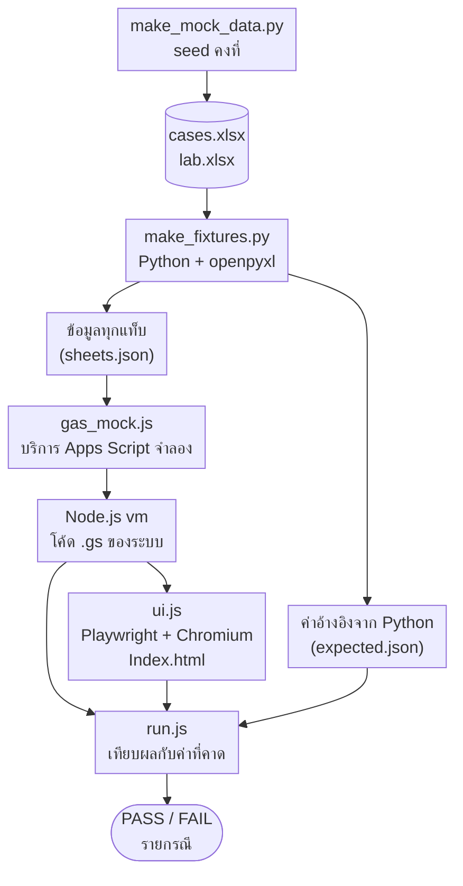

# บทที่ 4 การทดสอบระบบและวิเคราะห์ผล

> ร่างโดย thesis-writer — ตัวเลขทุกค่าในบทนี้มาจากผลการรัน `node apps-script/test/run.js` เมื่อวันที่ 3 พ.ย. 2569 (commit bab2b1c ผ่าน 96/96) และเอกสารผลทดสอบ `docs/test-results/01-mock-data.md`, `02-dashboard-apps-script.md`, `03-linebot.md` ห้ามแก้ตัวเลขโดยไม่รันชุดทดสอบใหม่
> เลขอ้างอิงต่อจากบทที่ 3 (ข้อ [48]–[50] อยู่ท้ายไฟล์นี้) รายการทดสอบฉบับเต็มทีละกรณีอยู่ใน `docs/test-results/` เพราะเครื่องมือสร้างเล่มยังใส่ตารางในภาคผนวกไม่ได้

บทนี้อธิบายวิธีการทดสอบระบบที่ออกแบบไว้ในบทที่ 3 และผลการทดสอบ ครอบคลุมความถูกต้องของข้อมูลจำลองและ Dashboard การควบคุมสิทธิ์ ความถูกต้องของสถิติสรุป การทำงานของแชตบอต LINE และรายงานสรุปอัตโนมัติ และการตรวจตามหลักการคุ้มครองข้อมูลส่วนบุคคล การทดสอบทั้งหมดใช้ข้อมูลจำลองและบริการจำลอง ยังไม่ได้ทดสอบกับบัญชี Google จริง กลุ่ม LINE จริง หรือ Gemini API จริง ข้อจำกัดนี้อธิบายไว้ในหัวข้อ 4.1.3 และ 4.7.2

## 4.1 วิธีการและสภาพแวดล้อมการทดสอบ

### 4.1.1 ข้อมูลจำลอง

ข้อมูลคดีของหน่วยงานเป็นข้อมูลจริงที่มีชื่อเจ้าหน้าที่ สถานีตำรวจ และเลขคดี การนำข้อมูลนี้มาใช้ทดสอบหรือแสดงในเล่มจะเป็นการเปิดเผยข้อมูลส่วนบุคคลเกินวัตถุประสงค์ตามพระราชบัญญัติคุ้มครองข้อมูลส่วนบุคคล พ.ศ. 2562 [7] โครงงานจึงทดสอบด้วยข้อมูลจำลองเท่านั้น (หัวข้อ 3.7)

ข้อมูลจำลองสร้างด้วยสคริปต์ `tools/make_mock_data.py` ซึ่งเขียนไฟล์ด้วยไลบรารี openpyxl [50] ได้ไฟล์ 2 ไฟล์ คือ `cases.xlsx` (ข้อมูลรายคดีและแท็บ “ผู้ใช้”) และ `lab.xlsx` (ข้อมูลห้องปฏิบัติการ) โครงสร้างแท็บและคอลัมน์ตรงกับ `docs/data-schema.md` ทุกคอลัมน์ สคริปต์กำหนดค่าเริ่มต้นของตัวสุ่ม (seed) คงที่เป็น 20260101 และกำหนด “วันนี้” ของข้อมูลคงที่เป็นวันที่ 31 ตุลาคม 2569 แทนการอ่านวันที่ของเครื่อง จึงสร้างซ้ำได้ไฟล์เดิมทุกไบต์ ค่าทุกค่าเป็นของสมมติ เช่น ผู้ตรวจ “เจ้าหน้าที่ ก” ถึง “เจ้าหน้าที่ จ” สถานี “สภ.ตัวอย่าง1” ถึง “สภ.ตัวอย่าง15” เลขหนังสือ `ตย.0000/…` และอีเมลโดเมน `@example.com` ส่วนค่าความลับที่ชุดทดสอบใช้ เช่น channel access token และ API key เป็นข้อความสมมติที่ขึ้นต้นด้วย `mock-` ลักษณะของข้อมูลจำลองสรุปในตารางที่ 4.1

ตารางที่ 4.1 ลักษณะของข้อมูลจำลองที่ใช้ทดสอบ

| รายการ | ค่าในข้อมูลจำลอง | วัตถุประสงค์ในการทดสอบ |
|---|---|---|
| จำนวนแถวในแท็บข้อมูลคดี | 731 แถว วันที่รับ 1 ม.ค. 2565 – 30 ต.ค. 2569 (8–18 คดีต่อเดือน) | ปริมาณข้อมูลใกล้เคียงการใช้งานหลายปี |
| สถานะคดี | รับผลไปแล้ว 692 แถว, เสร็จแล้ว รอรับผล 17 แถว, กำลังดำเนินการ 22 แถว | ทดสอบการแยกคดีค้าง 2 กลุ่ม |
| ค่าว่าง (กรณีขอบ) | ประเภทคดีว่างร้อยละ 14.0 ผู้ตรวจว่างร้อยละ 15.2 | ทดสอบกลุ่ม “ไม่ระบุ” |
| วันที่ข้ามปีและข้ามปีงบประมาณ | มีคดีรับวันที่ 31 ธ.ค., 1 ม.ค., 30 ก.ย. และ 1 ต.ค. ครบทุกปีในช่วงข้อมูล | ทดสอบการจัดเดือนและปีของคดี |
| แถวที่ไม่นับในสถิติ | 3 แถว (คอลัมน์ “นับในสถิติ” = 0) | ทดสอบการกรองแถว |
| แถวที่มีข้อสังเกต | 12 แถว 4 ชนิด | ทดสอบหน้าตรวจสอบข้อมูล |
| ของกลางเกินเกณฑ์ | 5 คดีเกินเกณฑ์ 40 ชิ้นที่ตั้งไว้ในชีต | ทดสอบแถบหมายเหตุของกลางผิดปกติ |
| ข้อมูลห้องปฏิบัติการ | แท็บข้อมูลเคส 58 แถว, ข้อมูลงบ 39 แถว, ข้อมูล Lot 86 แถว, หมายเหตุ 4 แถว | ทดสอบเมนูงบประมาณและ Lot พัสดุ |
| คอลัมน์ User ID (LINE) | ไม่มี (ตัดออกตามการตัดสินใจของเจ้าของโครงงาน) | ยืนยันว่าระบบไม่พึ่งคอลัมน์นี้ |

### 4.1.2 เครื่องมือและขั้นตอนการทดสอบ

โค้ดของระบบเขียนสำหรับ Google Apps Script ซึ่งรันได้เฉพาะบนเซิร์ฟเวอร์ของ Google ชุดทดสอบจึงจำลองสภาพแวดล้อมของ Apps Script ขึ้นในเครื่อง โดยแบ่งเป็น 3 ส่วน ดังนี้

1) **ส่วนเซิร์ฟเวอร์** โหลดไฟล์ `Stats.gs` `Code.gs` `Intent.gs` `LineBot.gs` และ `Summary.gs` ด้วยโมดูล `vm` ของ Node.js [48] ร่วมกับตัวจำลอง (mock) ของบริการ SpreadsheetApp, Session, PropertiesService, CacheService, LockService, ContentService, HtmlService, ScriptApp, Utilities และ UrlFetchApp ในไฟล์ `apps-script/test/gas_mock.js` ตัวจำลองของ SpreadsheetApp ป้อนข้อมูลจากไฟล์ข้อมูลจำลอง ส่วนตัวจำลองของ UrlFetchApp บันทึกทุกคำขอที่ระบบส่งออก ตอบแทน LINE และ Gemini ตามกรณีทดสอบ และโยนข้อผิดพลาดถ้าระบบพยายามเรียก URL อื่น การทดสอบจึงตรวจได้ว่าระบบส่งอะไรออกไปบ้าง โดยไม่มีคำขอใดออกไปยังเครือข่ายจริง
2) **ค่าอ้างอิงที่คำนวณอิสระ** สคริปต์ `apps-script/test/make_fixtures.py` อ่านไฟล์ข้อมูลจำลองด้วย Python และ openpyxl แล้วคำนวณผลที่ควรได้ เช่น จำนวนคดี จำนวนของกลาง จำนวนคดีแยกประเภท ตารางผู้ตรวจ × ประเภทคดี และคดีค้าง โดยไม่ใช้โค้ด JavaScript ของระบบ ค่านี้ใช้เป็นตัวตัดสินผลการทดสอบ (test oracle) ของการคำนวณ
3) **ส่วนหน้าเว็บ** สคริปต์ `apps-script/test/ui.js` เปิด `Index.html` ด้วยเบราว์เซอร์ Chromium แบบไม่มีหน้าต่าง (headless) ผ่านเครื่องมือ Playwright [49] และแทน `google.script.run` ด้วยตัวจำลองที่คืนผลของ `getBook` จริงจากส่วนเซิร์ฟเวอร์ คำขอทุกรายการของหน้าเว็บถูกดักและตอบจากไฟล์ในเครื่อง คำขอที่ไม่ได้คาดไว้ถูกบันทึกเป็นข้อผิดพลาด ฟอนต์ใช้ฟอนต์ไทยของเครื่องแทนฟอนต์จากอินเทอร์เน็ต

ความสัมพันธ์ของส่วนต่าง ๆ แสดงในรูปที่ 4.1 สคริปต์หลัก `apps-script/test/run.js` รันทั้ง 3 ส่วนด้วยคำสั่งเดียว แล้วพิมพ์ผล PASS หรือ FAIL ของแต่ละกรณี

[รูปที่ 4.1: โครงสร้างของชุดทดสอบ ตั้งแต่การสร้างข้อมูลจำลองจนถึงการตัดสินผล]

ผลทดสอบในบทนี้มาจาก 2 แหล่ง คือ (1) การทดสอบข้อมูลจำลองและ Dashboard ต้นแบบ (`dashboard/index.html`) 18 กรณี ซึ่งผู้ตรวจคุณภาพของทีมทดสอบด้วย Chromium ผ่าน Playwright และบันทึกไว้ใน `docs/test-results/01-mock-data.md` และ (2) ชุดทดสอบอัตโนมัติ `run.js` 96 กรณี ซึ่งรันครั้งล่าสุดเพื่อจัดทำบทนี้ เครื่องมือและสภาพแวดล้อมของการรันครั้งนี้แสดงในตารางที่ 4.2

ตารางที่ 4.2 เครื่องมือและสภาพแวดล้อมของการรันชุดทดสอบอัตโนมัติ

| รายการ | ค่า |
|---|---|
| วันที่รัน | 3 พฤศจิกายน 2569 |
| รุ่นของโค้ด | commit `bab2b1c` (ใช้คำ “ไม่ระบุ” กับค่าว่างทั้ง Dashboard และแชตบอต) |
| คำสั่ง | `node apps-script/test/run.js` |
| ระบบปฏิบัติการ | Linux (x86_64) |
| Node.js | 22.23.4 (โมดูล `vm`) |
| Python และ openpyxl | Python 3.13.18, openpyxl 3.1.5 |
| เบราว์เซอร์ | Playwright 1.63.0 กับ Chromium 153 แบบ headless |
| ความกว้างหน้าจอที่ทดสอบ | 1,440 พิกเซล (คอมพิวเตอร์) และ 390 พิกเซล (โทรศัพท์) |
| ผลรวม | ผ่าน 96 จาก 96 กรณี ใช้เวลาประมาณ 24 วินาที |

### 4.1.3 สิ่งที่ยังไม่ได้ทดสอบ

การทดสอบด้วยบริการจำลองยืนยันได้ว่าโค้ดทำงานตามที่ออกแบบเมื่อบริการภายนอกตอบตามที่เอกสารระบุ แต่ไม่ได้ยืนยันพฤติกรรมจริงของแพลตฟอร์ม รายการที่ยังไม่ได้ทดสอบแสดงในตารางที่ 4.3 ซึ่งต้องทดสอบหลังนำระบบขึ้นใช้งานจริงตามคู่มือ `apps-script/README.md` (หัวข้อ 4.8)

ตารางที่ 4.3 รายการที่ยังไม่ได้ทดสอบและเหตุผล

| รายการ | เหตุผลที่ยังไม่ได้ทดสอบ |
|---|---|
| การเปิด Dashboard ด้วยบัญชี Google จริง หน้าขออนุญาต OAuth และการแชร์ Sheet จริง | ทดสอบด้วยตัวจำลองของ Session และ SpreadsheetApp เท่านั้น ค่าอีเมลว่างเมื่อ deploy แบบ Execute as: Me อ้างอิงจากเอกสารของ Google [12] |
| การรับ webhook จาก LINE Platform จริง ปุ่ม Verify และการตอบแบบเปลี่ยนเส้นทาง (HTTP 302) ของ Apps Script | ยังไม่ได้ deploy จริง เหตุการณ์ webhook สร้างตามรูปแบบในเอกสารของ LINE |
| การส่ง reply และ push ไปยังกลุ่ม LINE จริง | การส่งข้อความเข้ากลุ่มจริงต้องให้เจ้าของโครงงานอนุมัติก่อน |
| ความถูกต้องของการแยกเจตนาโดย Gemini จริง | ตัวจำลองของ Gemini คืนเจตนาที่กำหนดไว้ล่วงหน้า จึงทดสอบได้เฉพาะการตัดข้อมูลก่อนส่งและการจัดการผลที่ได้กลับมา ไม่ได้วัดความแม่นยำของแบบจำลอง |
| การทำงานของตัวตั้งเวลาจริงของ Apps Script | ทดสอบโดยเรียก `dailySummaryJob` พร้อมวันเวลาจำลอง |
| ความเร็ว โควตา และการใช้งานพร้อมกันหลายคน | ชุดทดสอบไม่ได้วัดเวลาตอบหรือจำลองผู้ใช้พร้อมกัน |
| การทดลองใช้และความพึงพอใจของเจ้าหน้าที่ | ยังไม่ได้ให้เจ้าหน้าที่จริงทดลองใช้ |

## 4.2 การทดสอบความถูกต้องของข้อมูลจำลองและ Dashboard

### 4.2.1 ข้อมูลจำลองและ Dashboard ต้นแบบ

การทดสอบชุดแรกตรวจว่าข้อมูลจำลองมีลักษณะตามที่ออกแบบ และ Dashboard ต้นแบบที่อ่านไฟล์ .xlsx ในเบราว์เซอร์แสดงตัวเลขตรงกับค่าที่คำนวณด้วย Python วิธีทดสอบคือเสิร์ฟโฟลเดอร์ `dashboard/` ในเครื่อง เปิด `index.html` ด้วย Chromium เลือกชุดข้อมูลตัวอย่างทั้งสองชุด และเปิดทุกเมนู ผลทั้ง 18 กรณีสรุปในตารางที่ 4.4

ตารางที่ 4.4 ผลการทดสอบข้อมูลจำลองและ Dashboard ต้นแบบ

| กรณีทดสอบ | ผลที่คาด | ผลจริง | ผล |
|---|---|---|---|
| รันสคริปต์สร้างข้อมูล 2 ครั้ง | ไฟล์เหมือนเดิมทุกไบต์ | ค่า SHA-1 ตรงกันทั้งสองไฟล์ | ผ่าน |
| จำนวนแถวและช่วงวันที่ | 600–800 แถว ช่วงปี 2565–2569 | 731 แถว 1 ม.ค. 2565 – 30 ต.ค. 2569 | ผ่าน |
| ความสอดคล้องของวันที่กับสถานะ | วันที่รับ ≤ ตรวจเสร็จ ≤ มารับผล และไม่มีวันที่ที่ขัดกับสถานะ | ขัดแย้ง 0 แถว | ผ่าน |
| ค่าสถานะ | มีเฉพาะ 3 ค่าตามแม่แบบ | 692 / 17 / 22 แถว | ผ่าน |
| ประเภทคดีและผู้ตรวจว่าง | ว่างประมาณร้อยละ 15 | ร้อยละ 14.0 และ 15.2 Dashboard แสดง “ไม่ระบุ” 101 และ 111 คดี | ผ่าน |
| วันที่ข้ามปีและข้ามปีงบประมาณ | มีคดีรับ 31 ธ.ค., 1 ม.ค., 30 ก.ย., 1 ต.ค. | มีครบทุกปีในช่วงข้อมูล | ผ่าน |
| ของกลางเกินเกณฑ์ | อ่านเกณฑ์ 40 ชิ้นจากชีต และแจ้ง 5 คดี | แจ้ง 5 คดี รวม 372 ชิ้น | ผ่าน |
| ภาพรวมทุกปี | คดี 728 (ไม่นับ 3 แถว) ของกลาง 3,832 ชิ้น | ตรงตามคาด เฉลี่ย 5.28 ชิ้นต่อคดี | ผ่าน |
| กรองปี 2568 | 154 คดี | 154 คดี ของกลาง 789 ชิ้น | ผ่าน |
| เมนูพื้นที่และประเภทคดี | 5 จังหวัด 15 สถานี | 5 จังหวัด 15 สถานี ระบุประเภท 627 คดี ระบุผู้ตรวจ 617 คดี | ผ่าน |
| เมนูระยะเวลาและงานค้าง | คดีค้าง 39 คดี (22 + 17) | 39 คดี มัธยฐานรับถึงตรวจเสร็จ 20 วัน | ผ่าน |
| เมนูตรวจสอบข้อมูล และเมนูประเภท/ผู้ตรวจรายเดือน (2 กรณี) | ข้อสังเกต 12 แถว 4 ชนิด ไม่นับ 3 แถว และกราฟกับตารางแสดงได้ | ตรงตามคาด กราฟ 1 ภาพ ตาราง 138 แถว | ผ่าน |
| ชุดข้อมูลห้องปฏิบัติการ ปีงบประมาณ 2569 | ตัวอย่าง 2,050 ของกลาง 1,012 งบประมาณ 2,282,300 บาท Lot 17 | ตรงทุกค่า | ผ่าน |
| เมนูงบประมาณและ Lot พัสดุ | แสดงกราฟและตาราง | งบประมาณ: กราฟ 2 ตาราง 7 แถว · Lot: กราฟ 2 | ผ่าน |
| ปุ่มเลือกปี | ข้อมูลห้องปฏิบัติการ 2565–2570 ข้อมูลคดี 2565–2569 | ตรงตามคาด | ผ่าน |
| ข้อผิดพลาด JavaScript | ไม่มี pageerror | ไม่มี pageerror (พบคำขอไฟล์ตั้งค่าที่ไม่บังคับได้ผล 404 ซึ่งแก้แล้วในตารางที่ 4.6) | ผ่าน |
| ข้อมูลในไฟล์จำลองเป็นค่าสมมติ | ไม่มีชื่อ เลข หรืออีเมลจริง ไม่มี DNA profile | ตรงตามคาด | ผ่าน |

ข้อสังเกตจากตารางที่ 4.4 คือ ร้อยละของค่าว่างในข้อมูลจำลองกำหนดให้ใกล้เคียงข้อสังเกตในหัวข้อ 3.2.4 ที่ว่าคอลัมน์ประเภทคดีและผู้ตรวจยังกรอกไม่ครบ จำนวน 101 และ 111 คดีที่ Dashboard แสดงเป็น “ไม่ระบุ” รวมกับคดีที่ระบุประเภท 627 คดีและระบุผู้ตรวจ 617 คดี ได้ 728 คดีเท่ากับจำนวนคดีที่นับในสถิติ จึงไม่มีคดีหายไประหว่างการจัดกลุ่ม

### 4.2.2 การอ่านข้อมูลฝั่งเซิร์ฟเวอร์

กลุ่มนี้ทดสอบฟังก์ชันใน `Code.gs` ที่อ่าน Sheet และส่งข้อมูลให้หน้าเว็บ (หัวข้อ 3.4.4–3.4.6) ผลทั้ง 8 กรณีแสดงในตารางที่ 4.5

ตารางที่ 4.5 ผลการทดสอบการอ่านข้อมูลฝั่งเซิร์ฟเวอร์

| กรณีทดสอบ | ผลที่คาด | ผลจริง | ผล |
|---|---|---|---|
| `getSources` | คืนแหล่งข้อมูล 2 แหล่งและอีเมลผู้ใช้ | ตรงตามคาด | ผ่าน |
| `getBook("cases")` ส่งเฉพาะคอลัมน์ที่ใช้ | ไม่มี User ID (LINE) เลขหนังสือนำส่ง ลงวันที่ ตั้งค่า | 14 คอลัมน์ตามตารางที่ 3.8 | ผ่าน |
| แปลงวันที่เป็นเลข serial | วันที่รับของแถวแรก (1 ม.ค. 2565) = 44562 | 44562 | ผ่าน |
| จำนวนแถวข้อมูลคดี | 731 แถวและแถวหัวตาราง | 732 แถว (รวมหัว) | ผ่าน |
| `getBook("lab")` | มี 4 แท็บของข้อมูลห้องปฏิบัติการ | ตรงตามคาด | ผ่าน |
| แคช: เรียก `getBook` ซ้ำ | ครั้งที่ 2 ไม่เปิด Sheet อีก ผลเหมือนเดิม | การเรียกครั้งแรกเปิด Sheet 2 ครั้ง ครั้งที่ 2 ไม่เปิดเพิ่ม ข้อมูลถูกแบ่งเก็บในแคช 4 ชิ้น | ผ่าน |
| `checkSetup` | บอกจำนวนแถวของทุกแท็บ ไม่มีค่าข้อมูลคดี | ข้อมูลคดี 731 แถว ข้อมูลเคส 58 ข้อมูลงบ 39 ข้อมูล Lot 86 หมายเหตุ 4 แถว | ผ่าน |
| Sheet ที่ยังมีคอลัมน์ User ID (LINE) | `getBook` และคำตอบของแชตบอตไม่มีคอลัมน์และค่านี้ | ตรงตามคาด | ผ่าน |

กรณีสุดท้ายในตารางที่ 4.5 จำลองสถานการณ์ที่ Sheet จริงยังไม่ได้ลบคอลัมน์ User ID (LINE) โดยแทรกคอลัมน์ที่มีค่าสมมติเข้าไปในหน่วยความจำระหว่างทดสอบ ผลยืนยันว่าการเลือกส่งเฉพาะคอลัมน์ที่กำหนดทำงานแม้คอลัมน์นี้ยังอยู่

### 4.2.3 หน้าเว็บ Dashboard รุ่น Apps Script

กลุ่มนี้เปิด `Index.html` ด้วย Chromium โดยใช้ข้อมูลที่ได้จากส่วนเซิร์ฟเวอร์ในหัวข้อ 4.2.2 กรณีที่ตรวจการแสดงผลของแต่ละเมนูมี 17 กรณี สรุปในตารางที่ 4.6 ส่วนกรณีที่เทียบตัวเลขบนหน้าเว็บกับ `Stats.gs` และแชตบอตอยู่ในหัวข้อ 4.4

ตารางที่ 4.6 ผลการทดสอบการแสดงผลของ Dashboard รุ่น Apps Script

| กรณีทดสอบ | ผลที่คาด | ผลจริง | ผล |
|---|---|---|---|
| เปิดหน้าแรก | แสดงชุดข้อมูลคดีเป็นค่าเริ่มต้น | คดีทั้งหมด 728 สถานะ “เชื่อมสด · Google Sheet · อัปเดต …” | ผ่าน |
| ป้ายแกน x เมื่อเลือก “ทั้งหมด” ที่ความกว้าง 1,440 พิกเซล | ป้ายเดือนไม่ซ้อนกัน | กราฟละ 10 ป้าย ซ้อน 0 | ผ่าน |
| เมนูของข้อมูลคดี 5 เมนู (พื้นที่และประเภทคดี, ประเภท/ผู้ตรวจรายเดือน, ระยะเวลาและงานค้าง, ตรวจสอบข้อมูล, แหล่งข้อมูล) (5 กรณี) | แสดงได้ ไม่มีข้อความผิดพลาด | ทุกเมนูแสดงได้ | ผ่าน |
| เมนูแหล่งข้อมูล | แสดงอีเมลผู้ใช้ ไม่มีปุ่มเพิ่มลิงก์ Google Sheets | ตรงตามคาด | ผ่าน |
| เปิดไฟล์ Excel ในเครื่อง (`cases.xlsx`) | อ่านได้ ตัวเลขเท่ากับข้อมูลจากเซิร์ฟเวอร์ | คดี 728 ตรงกัน | ผ่าน |
| ชุดข้อมูลห้องปฏิบัติการ เมนูภาพรวม งบประมาณ และ Lot พัสดุ (3 กรณี) | แสดงได้ ไม่มีข้อความผิดพลาด | ภาพรวม 3 กราฟ งบประมาณ 2 กราฟ Lot พัสดุ 2 กราฟ | ผ่าน |
| หน้าจอโทรศัพท์ 390 พิกเซล เลือก “ทั้งหมด” | ป้ายแกน x ไม่ซ้อน ไม่มีแถบเลื่อนแนวนอน | กราฟละ 5 ป้าย | ผ่าน |
| หน้า “ไม่มีสิทธิ์เข้าถึง” | แสดงอีเมลและผู้ที่ต้องติดต่อเป็นภาษาไทย | ตรงตามคาด | ผ่าน |
| Dashboard ต้นแบบไม่ขอไฟล์ `sources.json` | ไม่มีคำขอไฟล์นี้ (เดิมได้ผล 404) | ตรงตามคาด | ผ่าน |
| Dashboard ต้นแบบ ป้ายแกน x เมื่อเลือก “ทั้งหมด” | ป้ายเดือนไม่ซ้อน คดีทั้งหมด 728 | กราฟละ 10 ป้าย ซ้อน 0 | ผ่าน |
| ข้อผิดพลาดในคอนโซลและคำขอออกนอกเครื่อง (ทุกหน้า) | 0 รายการ | 0 รายการ | ผ่าน |

ข้อมูลจำลองมี 58 เดือน เมื่อเลือก “ทั้งหมด” หน้าจอขนาด 1,440 พิกเซลแสดงป้ายเดือนทุก 6 เดือน และหน้าจอโทรศัพท์แสดงทุก 12 เดือน ป้ายจึงไม่ซ้อนกัน ตัวอย่างหน้าจอที่ได้จากการทดสอบแสดงในรูปที่ 4.2 และรูปที่ 4.3

[รูปที่ 4.2: หน้าภาพรวมของ Dashboard รุ่น Apps Script เมื่อกรองปี 2568 ขณะทดสอบ — ภาพจากข้อมูลจำลอง]

[รูปที่ 4.3: หน้าภาพรวมบนหน้าจอโทรศัพท์ความกว้าง 390 พิกเซล — ภาพจากข้อมูลจำลอง]

### 4.2.4 ตัวชี้วัดบน Dashboard เทียบกับค่าที่คำนวณอิสระ

ตัวชี้วัดหลักที่ Dashboard แสดงเทียบกับค่าที่คำนวณด้วย Python ซึ่งไม่ใช้โค้ดของระบบ แสดงในตารางที่ 4.7 ทุกค่าตรงกัน

ตารางที่ 4.7 ตัวชี้วัดบน Dashboard เทียบกับค่าที่คำนวณด้วย Python

| ตัวชี้วัด | ค่าที่คำนวณด้วย Python | ค่าที่ Dashboard แสดง | ผล |
|---|---|---|---|
| คดีทั้งหมด (ทุกปี) | 728 | 728 | ตรงกัน |
| ของกลางรวม (ทุกปี) | 3,832 ชิ้น | 3,832 ชิ้น | ตรงกัน |
| คดีปี 2565 / ของกลาง | 138 / 621 | 138 / 621 | ตรงกัน |
| คดีปี 2568 / ของกลาง | 154 / 789 | 154 / 789 | ตรงกัน |
| คดีค้าง: กำลังดำเนินการ / เสร็จแล้ว รอรับผล | 22 / 17 (รวม 39) | 22 / 17 (รวม 39) | ตรงกัน |
| ข้อมูลห้องปฏิบัติการ ปีงบประมาณ 2569: ตัวอย่าง / ของกลาง | 2,050 / 1,012 | 2,050 / 1,012 | ตรงกัน |
| ข้อมูลห้องปฏิบัติการ ปีงบประมาณ 2569: งบประมาณ / Lot | 2,282,300 บาท / 17 | 2,282,300 บาท / 17 | ตรงกัน |

## 4.3 การทดสอบการควบคุมสิทธิ์

### 4.3.1 การควบคุมสิทธิ์ของ Dashboard

กลุ่มนี้ทดสอบ `checkAccess_` และ `requireAccess_` ตามกรณีในตารางที่ 3.6 โดยกำหนดอีเมลของผู้เปิด สิทธิ์การอ่าน Sheet และ Script Properties ผ่านตัวจำลอง ผลทั้ง 11 กรณีแสดงในตารางที่ 4.8

ตารางที่ 4.8 ผลการทดสอบการควบคุมสิทธิ์ของ Dashboard

| กรณีทดสอบ | ผลที่คาด | ผลจริง | ผล |
|---|---|---|---|
| อีเมลอยู่ในแท็บ “ผู้ใช้” | ได้หน้า Dashboard | ได้หน้า Dashboard พร้อมชื่อหน้าและ viewport ใช้ X-Frame-Options เริ่มต้น | ผ่าน |
| อีเมลเดียวกันแต่เป็นตัวพิมพ์ใหญ่และมีช่องว่าง | เปิดได้ | ตรงตามคาด | ผ่าน |
| อีเมลไม่อยู่ในรายชื่อ (`not-listed`) | หน้า “ไม่มีสิทธิ์เข้าถึง” พร้อมอีเมลและผู้ที่ต้องติดต่อ ไม่มีเนื้อหา Dashboard | ตรงตามคาด | ผ่าน |
| อีเมลว่าง (`no-email`) | ปฏิเสธ และแจ้งว่าระบบไม่ทราบอีเมล | ตรงตามคาด | ผ่าน |
| อีเมลที่มีแท็ก `<script>` | แสดงแบบแปลงอักขระพิเศษแล้ว | ตรงตามคาด | ผ่าน |
| ผู้ใช้ไม่ได้รับแชร์ Sheet (`no-sheet-access`) | ปฏิเสธ พร้อมเหตุผล | ปฏิเสธ แจ้งว่ายังไม่ได้รับสิทธิ์ผู้มีสิทธิ์อ่าน | ผ่าน |
| ไม่มีแท็บ “ผู้ใช้” (`no-users-tab`) | ปฏิเสธทุกคน | ตรงตามคาด | ผ่าน |
| ยังไม่ตั้ง `CASES_SHEET_ID` (`no-config`) | ปฏิเสธ และบอกให้ตั้งค่า | ตรงตามคาด | ผ่าน |
| เรียก `getBook` และ `getSources` โดยตรงโดยไม่มีสิทธิ์ | โยนข้อผิดพลาด “ไม่มีสิทธิ์” ทุกฟังก์ชัน | ตรงตามคาด | ผ่าน |
| ลบอีเมลออกจากแท็บ “ผู้ใช้” ระหว่างใช้งาน | คำขอข้อมูลครั้งถัดไปหลังแคชสิทธิ์หมดอายุถูกปฏิเสธ | ตรงตามคาด | ผ่าน |
| `getBook` ด้วยชื่อแหล่งข้อมูลแปลก (`__proto__`, `x`) | โยนข้อผิดพลาด | ตรงตามคาด | ผ่าน |

ตารางที่ 4.8 ครอบคลุมเหตุผลการปฏิเสธในตารางที่ 3.6 ครบทุกข้อ ยกเว้น `wrong-deployment` ซึ่งทดสอบในหัวข้อ 4.3.2 ทุกกรณีที่เงื่อนไขไม่ครบให้ผลเป็นการปฏิเสธ ตรงกับหลักการปฏิเสธเมื่อไม่แน่ใจ (fail closed) ที่ออกแบบไว้ หน้า “ไม่มีสิทธิ์เข้าถึง” ที่ได้จากการทดสอบแสดงในรูปที่ 4.4

[รูปที่ 4.4: หน้า “ไม่มีสิทธิ์เข้าถึง” เมื่อเปิดด้วยอีเมลที่ไม่อยู่ในรายชื่อ — ภาพจากข้อมูลจำลอง]

### 4.3.2 การป้องกันจาก deployment ของแชตบอตและฟังก์ชันผู้ดูแล

เนื่องจากแชตบอตอยู่ในโปรเจกต์เดียวกับ Dashboard แต่ deploy แบบ Execute as: Me (หัวข้อ 3.4.8) จึงทดสอบเพิ่มว่าลิงก์ของแชตบอตใช้เปิดข้อมูล Dashboard ไม่ได้ และฟังก์ชันผู้ดูแลถูกเรียกจากหน้าเว็บไม่ได้ ผลแสดงในตารางที่ 4.9

ตารางที่ 4.9 ผลการทดสอบการป้องกันจาก deployment ของแชตบอตและฟังก์ชันผู้ดูแล

| กรณีทดสอบ | ผลที่คาด | ผลจริง | ผล |
|---|---|---|---|
| เปิดลิงก์ของแชตบอตโดยไม่ล็อกอิน (ไม่ทราบอีเมลผู้เปิด) | `doGet` คืนหน้าไม่มีสิทธิ์ `getBook` `getSources` และ `checkSetup` โยนข้อผิดพลาด | ตรงตามคาด | ผ่าน |
| ผู้ใช้ในรายชื่อเปิดลิงก์ของแชตบอต (Google ส่งอีเมลมา แต่สคริปต์ทำงานในนามเจ้าของ) | ปฏิเสธด้วยเหตุผล `wrong-deployment` และไม่เปิด Sheet ข้อมูล | ตรงตามคาด Sheet ถูกเปิด 0 ครั้ง | ผ่าน |
| `doPost` ตอบกลับทาง HTTP | เนื้อหาคำตอบเป็น `OK` ทุกกรณี ไม่มีข้อมูลคดี | ตรงตามคาด | ผ่าน |
| ผู้ใช้ Dashboard ที่ไม่ใช่ `ADMIN_EMAIL` เรียกฟังก์ชันผู้ดูแล 8 ฟังก์ชัน และกรณียังไม่ตั้ง `ADMIN_EMAIL` | โยนข้อผิดพลาดทุกฟังก์ชัน | ตรงตามคาด | ผ่าน |
| เรียก `dailySummaryJob` โดยไม่ผ่านตัวตั้งเวลา หรือส่ง `triggerUid` ปลอม | ปฏิเสธ ไม่ส่งข้อความ | ตรงตามคาด | ผ่าน |

## 4.4 การทดสอบความถูกต้องของสถิติสรุป

### 4.4.1 สถิติรายเดือนและรายปี

กลุ่มนี้เทียบผลของ `Stats.summarize` กับค่าที่คำนวณด้วย Python ทุกค่า ได้แก่ จำนวนคดี จำนวนของกลาง จำนวนคดีแยกประเภท และจำนวนคดีของผู้ตรวจแต่ละคนแยกตามประเภท ช่วงเวลาที่เลือกครอบคลุมปีเต็ม เดือนธันวาคมต่อเดือนมกราคม (ข้ามปี) เดือนกันยายนต่อเดือนตุลาคม (ข้ามปีงบประมาณ) และเดือนล่าสุดของข้อมูล จากนั้นนำตัวเลขเดียวกันไปเทียบกับตาราง “สถิติรายเดือน” และตัวชี้วัดเมื่อกรองปีบนหน้า Dashboard ผลแสดงในตารางที่ 4.10

ตารางที่ 4.10 สถิติจาก `Stats.gs` เทียบกับ Python และ Dashboard (จำนวนคดี / ของกลาง)

| ช่วงเวลา | Python | `Stats.gs` (กลุ่มประเภท, กลุ่มผู้ตรวจ) | Dashboard | ผล |
|---|---|---|---|---|
| ปี 2565 (ม.ค.–ธ.ค.) | 138 / 621 | 138 / 621 (7, 6) | 138 / 621 | ตรงทุกค่า |
| ปี 2568 (ม.ค.–ธ.ค.) | 154 / 789 | 154 / 789 (7, 6) | 154 / 789 | ตรงทุกค่า |
| ธ.ค. 2565 | 13 / 44 | 13 / 44 (6, 6) | 13 / 44 | ตรงทุกค่า |
| ม.ค. 2566 (ข้ามปี) | 14 / 54 | 14 / 54 (5, 6) | 14 / 54 | ตรงทุกค่า |
| ก.ย. 2568 | 12 / 80 | 12 / 80 (5, 5) | 12 / 80 | ตรงทุกค่า |
| ต.ค. 2568 (ข้ามปีงบประมาณ) | 12 / 62 | 12 / 62 (5, 5) | 12 / 62 | ตรงทุกค่า |
| ต.ค. 2569 (เดือนล่าสุด) | 14 / 57 | 14 / 57 (6, 6) | 14 / 57 | ตรงทุกค่า |

จำนวนกลุ่มในวงเล็บนับกลุ่ม “ไม่ระบุ” ด้วยเมื่อช่วงเวลานั้นมีค่าว่าง คำว่า “ตรงทุกค่า” หมายถึงจำนวนคดีของทุกประเภทและทุกคู่ผู้ตรวจ × ประเภทตรงกับ Python ด้วย ไม่ใช่เฉพาะยอดรวม

### 4.4.2 การคำนวณช่วงเวลาของรายงาน

รายงานอัตโนมัติคำนวณ “เดือนก่อนหน้า” และ “ปีก่อนหน้า” จากเวลาประเทศไทย (หัวข้อ 3.4.6) กรณีทดสอบเลือกเวลาที่วันที่ตามเวลาไทยต่างจากวันที่ตามเวลา UTC เช่น เวลา 00:05 น. ของวันที่ 1 มกราคมตามเวลาไทยยังเป็นวันที่ 31 ธันวาคมตามเวลา UTC และเลือกเดือนกุมภาพันธ์ทั้งปีปกติและปีอธิกสุรทิน ผลแสดงในตารางที่ 4.11

ตารางที่ 4.11 ผลการทดสอบการคำนวณช่วงเวลาของรายงาน

| เวลาไทยที่จำลอง | ช่วงที่ต้องสรุป | ผลที่คาด | ผล |
|---|---|---|---|
| 1 ม.ค. 2570 เวลา 00:05 น. | เดือนก่อนหน้า | 1–31 ธ.ค. 2569 | ผ่าน |
| 1 ม.ค. 2570 เวลา 00:05 น. | ปีก่อนหน้า | 1 ม.ค. – 31 ธ.ค. 2569 | ผ่าน |
| 1 ต.ค. 2569 เวลา 08:00 น. | เดือนก่อนหน้า | 1–30 ก.ย. 2569 | ผ่าน |
| 1 มี.ค. 2569 เวลา 06:59 น. | เดือนก่อนหน้า (ปีปกติ) | 1–28 ก.พ. 2569 | ผ่าน |
| 1 มี.ค. 2567 เวลา 01:00 น. | เดือนก่อนหน้า (ปีอธิกสุรทิน) | 1–29 ก.พ. 2567 | ผ่าน |

### 4.4.3 คดีค้าง การค้นคดี และความตรงกันระหว่าง Dashboard กับแชตบอต

กรณีที่เหลือของ `Stats.gs` และกรณีที่เทียบตัวเลขระหว่างหน้า Dashboard `Stats.gs` และข้อความของแชตบอต แสดงในตารางที่ 4.12

ตารางที่ 4.12 ผลการทดสอบคดีค้าง การค้นคดี และความตรงกันระหว่างส่วนต่าง ๆ ของระบบ

| กรณีทดสอบ | ผลที่คาด | ผลจริง | ผล |
|---|---|---|---|
| คดีค้างจาก `Stats.pendingCases` | 39 คดี (Python) | 39 คดี กำลังดำเนินการ 22 เสร็จแล้ว รอรับผล 17 | ผ่าน |
| ค้นคดี 1/2565 | พบ สถานะรับผลไปแล้ว | พบ 1 รายการ ผลที่คืนไม่มีชื่อผู้ตรวจ | ผ่าน |
| ค้นคดีด้วยเลขไทย เลขที่มี 0 นำหน้า และช่องว่าง | พบคดีเดียวกัน | ตรงตามคาด | ผ่าน |
| ค้นคดีที่ไม่มี (9999/2569) และข้อความว่าง | ไม่พบ | ตรงตามคาด | ผ่าน |
| แถวที่ช่องสถานะว่างหรือสะกดต่างไป | นับเป็น “กำลังดำเนินการ” และบอกจำนวนสถานะว่าง | ตรงตามคาด | ผ่าน |
| ฟังก์ชันใน `Stats` เรียกจากหน้าเว็บไม่ได้ | ไม่มีฟังก์ชันระดับบนสุดชื่อ `summarize` หรือ `findCase` | ตรงตามคาด | ผ่าน |
| ตารางผู้ตรวจ × ประเภทคดี เดือน ต.ค. 2569 บน Dashboard เทียบกับ `Stats.gs` | ทุกเซลล์ตรงกัน | 6 แถวผู้ตรวจ (รวม “ไม่ระบุผู้ตรวจ”) 48 เซลล์ตรงทั้งหมด | ผ่าน |
| คดีที่ยังไม่รับผลบนหน้าระยะเวลาและงานค้าง เทียบกับ `Stats.pendingCases` | 39 คดี | ตรงตามคาด | ผ่าน |
| คดีค้างแยก 2 กลุ่มบน Dashboard เทียบกับข้อความของแชตบอต | 22 / 17 | Dashboard 22 / 17 เท่ากับแชตบอต | ผ่าน |

กรณีแถวที่ช่องสถานะว่างทดสอบโดยแก้สถานะของ 3 แถวในหน่วยความจำ เพราะข้อมูลจำลองไม่มีแถวลักษณะนี้ ผลในตารางที่ 4.10 ถึงตารางที่ 4.12 แสดงว่าตัวเลขชุดเดียวกันได้ค่าเท่ากันทั้ง 4 ทาง คือ Python, `Stats.gs`, หน้า Dashboard และข้อความของแชตบอต (ข้อความสรุปเทียบในหัวข้อ 4.5.4) ซึ่งเป็นไปตามข้อกำหนดในหัวข้อ 3.6.4 ว่าตัวเลขในรายงานต้องตรงกับ Dashboard

## 4.5 การทดสอบแชตบอต LINE

การทดสอบแชตบอตสร้างเหตุการณ์ webhook ตามรูปแบบในเอกสารของ LINE [37] แล้วส่งให้ `doPost` ในรูปออบเจ็กต์เดียวกับที่ Apps Script ส่งให้ (พารามิเตอร์ `token` ใน URL และเนื้อหาคำขอ) จากนั้นตรวจคำขอที่ระบบส่งออกผ่านตัวจำลองของ UrlFetchApp ว่ามีการตอบกลับ (reply) กี่ครั้ง มีการเรียก Gemini หรือไม่ และเนื้อหาที่ส่งคืออะไร กลุ่มแชตบอตมี 22 กรณี ในจำนวนนี้ 1 กรณี (ฟังก์ชันผู้ดูแล) อยู่ในตารางที่ 4.9 แล้ว ส่วนกลุ่มสรุปอัตโนมัติมี 11 กรณี ในจำนวนนี้ 1 กรณี (การเรียก `dailySummaryJob` โดยตรง) อยู่ในตารางที่ 4.9 เช่นกัน

### 4.5.1 การเรียกบอต การเงียบ และข้อความตอบ

ตารางที่ 4.13 แสดงผลการทดสอบว่าบอตตอบเมื่อถูกเรียกตามตารางที่ 3.10 และเงียบเมื่อไม่ได้ถูกเรียก

ตารางที่ 4.13 ผลการทดสอบการเรียกบอต การเงียบ และข้อความตอบ

| กรณีทดสอบ | ผลที่คาด | ผลจริง | ผล |
|---|---|---|---|
| พิมพ์เลข บก. 1/2565 จากกลุ่มที่อนุญาต | ตอบ 1 ครั้ง มีสถานะ ประเภท ของกลาง และวันที่ 3 รายการ ไม่มีชื่อผู้ตรวจ สถานี จังหวัด เลขรายงาน ไม่เรียก Gemini | ตอบตามตัวอย่างในหัวข้อ 3.5.3 | ผ่าน |
| เลข บก. แบบเลขไทย “คดี ๑/๒๕๖๕ ถึงไหนแล้ว” | ตอบเหมือนเลขอารบิก | ข้อความตอบเหมือนกันทุกตัวอักษร | ผ่าน |
| เลข บก. ที่ไม่มีในข้อมูล (9999/2569) | แจ้งว่าไม่พบ พร้อมรูปแบบเลขที่ถูกต้อง | ตรงตามคาด | ผ่าน |
| หลายเลขในข้อความเดียว “บอต 1/2565, 2/2565” | ตอบทั้ง 2 คดีในข้อความเดียว | ตรงตามคาด | ผ่าน |
| คำสั่ง “คดีค้าง” | แยกกำลังดำเนินการ 22 และเสร็จแล้ว รอรับผล 17 พร้อม 3 คดีที่ค้างนานที่สุดต่อกลุ่ม ตรงกับ Python | ตรงทุกค่า ข้อความยาว 293 ตัวอักษร | ผ่าน |
| คำสั่งคดีค้างแบบอื่น (“มีคดีค้างกี่คดี”, “บอต งานที่ยังไม่รับผล”, “/ค้าง”, “สรุปคดีค้าง?”) | ตอบสรุปคดีค้าง ไม่เรียก Gemini | ตรงตามคาด | ผ่าน |
| กล่าวถึงบอต (mention) ตามด้วย “ขอดูคดีค้าง” | ถือว่าเรียกบอต | ตรงตามคาด | ผ่าน |
| ข้อความสนทนาทั่วไป 9 ข้อความ การกล่าวถึงผู้ใช้อื่น และรูปภาพ | เงียบ ไม่มีคำขอออกจากระบบเลย | ไม่มีคำขอทั้ง 11 ข้อความ | ผ่าน |
| “บอต” เพียงคำเดียว “บอต วิธีใช้” และ “bot help” | ตอบวิธีใช้ ไม่เรียก Gemini | ตรงตามคาด | ผ่าน |

ข้อความสนทนาทั่วไปที่ใช้ทดสอบการเงียบ ได้แก่ “สวัสดีครับ” “บอทนี่ใช้ดีนะ” “ส่งของกลางคดี 123/2568 ไปแล้วนะ” “พรุ่งนี้ประชุม 9 โมง” “งานค้างเยอะจัง” “ใครเห็นคดี 45/2569 บ้าง” “โอเค” “บอตตอง” และ “5555” ข้อความเหล่านี้มีคำที่ใกล้เคียงคำสั่ง เช่น เลขคดีในประโยค คำว่า “ค้าง” และคำที่ขึ้นต้นด้วย “บอต” แต่ไม่ใช่คำเรียก ผลคือบอตไม่ตอบ ไม่อ่าน Sheet และไม่เรียก Gemini ทุกข้อความ

### 4.5.2 การส่งข้อความให้ Gemini

ตารางที่ 4.14 แสดงผลการทดสอบส่วนที่เกี่ยวข้องกับ Gemini ซึ่งใช้ตัวจำลองแทน Gemini API จริง

ตารางที่ 4.14 ผลการทดสอบการส่งข้อความให้ Gemini

| กรณีทดสอบ | ผลที่คาด | ผลจริง | ผล |
|---|---|---|---|
| เรียกบอตด้วยข้อความที่กฎไม่เข้าใจ ซึ่งมีชื่อ หมายเลขโทรศัพท์ อีเมล เลขรายงาน ชื่อสถานี เลขคดี และ URL | ส่งเฉพาะข้อความที่ตัดข้อมูลแล้ว ไม่มีข้อมูลจาก Sheet ได้เจตนาแล้วตอบด้วยโค้ด | ข้อความที่ส่งตรงกับตารางที่ 3.11 | ผ่าน |
| Gemini ตอบเจตนา “สถานะคดี” พร้อมเลขคดีมาด้วย | ไม่ใช้เลขคดีจาก Gemini ขอให้ผู้ใช้พิมพ์เลข บก. และไม่ค้น Sheet | ตรงตามคาด | ผ่าน |
| Gemini ใช้งานไม่ได้: HTTP 429, HTTP 500, หมดเวลา, JSON ไม่ถูกต้อง, เจตนาที่ไม่รู้จัก (5 แบบ) | ตอบวิธีใช้แบบสั้นทุกแบบ | ตรงตามคาด | ผ่าน |
| ไม่มี `GEMINI_API_KEY`, เกินโควตาที่ตั้ง (`GEMINI_MAX_PER_HOUR` = 1), ชื่อรุ่นในรูปแบบที่ไม่ถูกต้อง | ไม่เรียก Gemini ตอบวิธีใช้ | ตรงตามคาด | ผ่าน |

ในกรณีแรกของตารางที่ 4.14 ชุดทดสอบไม่ได้ตรวจเพียงข้อความผลลัพธ์ แต่ตรวจเนื้อหาคำขอทั้งหมดที่ส่งไปยัง Gemini ว่า (1) ข้อความคำถามและคำสั่งระบบไม่มีตัวเลขทั้งเลขอารบิกและเลขไทย (2) ไม่มีชื่อ “สมชาย” “ใจดี” อีเมล โดเมน คำว่า “สภ.” ชื่อสถานี URL รหัสกลุ่ม `userId` ของผู้ส่ง และ reply token (3) ไม่มีข้อความใดที่ยาว 3 ตัวอักษรขึ้นไปจากแท็บข้อมูลคดี และ (4) API key ส่งในส่วนหัว `x-goog-api-key` ไม่อยู่ใน URL นอกจากนี้ ตัวจำลองของ Gemini ตอบเลขคดี 999/2568 ปนมากับเจตนา และข้อความตอบของบอตไม่มีเลขนี้ ยืนยันว่าระบบไม่นำค่าอื่นจาก Gemini มาใช้

### 4.5.3 การจำกัดกลุ่มและการป้องกัน webhook

ตารางที่ 4.15 แสดงผลการทดสอบมาตรการทดแทนการตรวจลายมือชื่อ webhook ในตารางที่ 3.12 และโหมดตั้งค่า

ตารางที่ 4.15 ผลการทดสอบการจำกัดกลุ่มและการป้องกัน webhook

| กรณีทดสอบ | ผลที่คาด | ผลจริง | ผล |
|---|---|---|---|
| ข้อความจากกลุ่มอื่น แชตส่วนตัว และห้องแชต | เงียบ | ตรงตามคาด | ผ่าน |
| ยังไม่ตั้ง `ALLOWED_GROUP_ID` | เงียบทุกกลุ่ม | ตรงตามคาด | ผ่าน |
| รหัสลับใน URL ผิด ขาดไป 1 ตัว ไม่มี ยังไม่ตั้ง `WEBHOOK_TOKEN` หรือสั้นเกินไป (5 แบบ) | ทิ้งคำขอ ไม่ตอบ ไม่อ่าน Sheet คำตอบ HTTP เป็น `OK` เหมือนกรณีปกติ | ตรงตามคาด | ผ่าน |
| คำขอจากปุ่ม Verify (ไม่มีเหตุการณ์) และเนื้อหาที่ไม่ใช่ JSON | ตอบ `OK` ไม่มีคำขอออก | ตรงตามคาด | ผ่าน |
| เหตุการณ์ซ้ำ (`webhookEventId` เดิม) การส่งซ้ำ (redelivery) และเหตุการณ์เก่า 10 นาที | ตอบครั้งเดียว ไม่ตอบการส่งซ้ำและเหตุการณ์เก่า | ตรงตามคาด | ผ่าน |
| โหมดตั้งค่า: เชิญบอตเข้ากลุ่มใหม่ | บันทึกรหัสกลุ่มใน Script Properties ไม่ตอบในแชต และ `allowSeenGroup` ตั้ง `ALLOWED_GROUP_ID` แล้วปิดโหมด | ตรงตามคาด | ผ่าน |
| โหมดตั้งค่าหมดเวลาหรือไม่ได้เปิด | ไม่บันทึกรหัสกลุ่ม | ตรงตามคาด | ผ่าน |
| `makeWebhookToken` | สร้างรหัสสุ่ม 64 ตัวอักษร ไม่พิมพ์ค่าในบันทึกการทำงาน รันซ้ำไม่เปลี่ยนรหัสเดิม | ตรงตามคาด | ผ่าน |

### 4.5.4 รายงานสรุปอัตโนมัติ

กลุ่มนี้ทดสอบ `Summary.gs` โดยเรียก `dailySummaryJob` พร้อมวันเวลาจำลอง และแปลงข้อความสรุปกลับเป็นตัวเลขเพื่อเทียบกับ Python ผล 10 กรณีแสดงในตารางที่ 4.16 (อีก 1 กรณีอยู่ในตารางที่ 4.9)

ตารางที่ 4.16 ผลการทดสอบรายงานสรุปอัตโนมัติ

| กรณีทดสอบ | ผลที่คาด | ผลจริง | ผล |
|---|---|---|---|
| ข้อความสรุปเดือน ต.ค. 2569 (`previewSummary`) | ตัวเลขทุกค่าตรงกับ Python และ `Stats.summarize` ไม่ส่งจริง ไม่มีเลขคดีและชื่อสถานี | คดี 14 ของกลาง 57 ชิ้น 6 กลุ่มประเภท 6 กลุ่มผู้ตรวจ ยาว 576 ตัวอักษร | ผ่าน |
| ข้อความสรุปปี 2568 (`previewYearSummary`) | เช่นเดียวกับข้างต้น | คดี 154 ของกลาง 789 ชิ้น 7 กลุ่มประเภท 6 กลุ่มผู้ตรวจ ยาว 938 ตัวอักษร | ผ่าน |
| รัน `installTriggers` 3 ครั้ง | มีตัวตั้งเวลารายวัน 1 ตัว เวลา 08:00 น. เขตเวลา Asia/Bangkok | ตรงตามคาด | ผ่าน |
| วันที่ 1 พ.ย. 2569 เวลา 08:10 น. | push 1 คำขอ 1 ข้อความ (สรุป ต.ค. 2569) ไปยังกลุ่มที่อนุญาต พร้อม `X-Line-Retry-Key` | ส่งงวด 2026-10 | ผ่าน |
| ตัวตั้งเวลาทำงานซ้ำในวันเดียวกัน วันที่ 2–3 และวันที่ 15 | ไม่ส่งซ้ำ | ตรงตามคาด | ผ่าน |
| ยังไม่ตั้ง `PUSH_ENABLED` เป็น `yes` | ไม่ส่ง บันทึกเฉพาะตัวอย่างข้อความ ไม่บันทึกว่าส่งแล้ว | ตรงตามคาด | ผ่าน |
| วันที่ 1 ม.ค. 2569 เวลา 08:10 น. | push 1 คำขอ 2 ข้อความ (สรุป ธ.ค. 2568 และสรุปปี 2568) ตรงกับ Python | ส่งงวด 2025-12 และ 2025 ในคำขอเดียว | ผ่าน |
| LINE ตอบ HTTP 500 ในวันที่ 1 และตอบ 409 | วันที่ 1 ไม่บันทึกว่าส่งแล้ว วันที่ 2 ส่งงวดเดิมด้วย retry key เดิม รหัส 409 ถือว่าส่งแล้ว และเลยวันที่ 3 ไม่ส่งย้อนหลัง | ตรงตามคาด | ผ่าน |
| ความยาวข้อความ | ทุกข้อความสั้นกว่า 2,000 ตัวอักษร | 576, 938, 535, 938 และ 293 ตัวอักษร | ผ่าน |
| ข้อความยาวเกิน 5,000 ตัวอักษร | ถูกตัดให้ไม่เกิน 5,000 ตัวอักษรพร้อมหมายเหตุให้ดูต่อใน Dashboard | ตรงตามคาด | ผ่าน |

ความยาว 5 ค่าในตารางที่ 4.16 คือ สรุปเดือน ต.ค. 2569, สรุปปี 2568, สรุปเดือน ธ.ค. 2568 และสรุปปี 2568 ที่ส่งในวันที่ 1 มกราคม และคำตอบคดีค้าง ตามลำดับ นอกจากนี้ ชุดทดสอบสร้างข้อมูลกรณีหนักที่สุดที่คาดไว้ คือ ผู้ตรวจ 5 คนที่มีชื่อยาวและกลุ่ม “ไม่ระบุผู้ตรวจ” รวม 6 กลุ่ม คูณประเภทคดี 7 กลุ่มครบทุกคู่ และจำนวนของกลางหลักหมื่น ข้อความสรุปยาว 1,233 ตัวอักษร ยังต่ำกว่าเพดานที่ระบบตัดไว้ 5,000 ตัวอักษร และการส่ง 2 ข้อความในวันที่ 1 มกราคมยังอยู่ในขีดจำกัด 5 ข้อความต่อคำขอของ LINE [18]

## 4.6 การทดสอบด้าน PDPA

ข้อกำหนดด้านการคุ้มครองข้อมูลส่วนบุคคลจากหัวข้อ 3.7 ถูกตรวจผ่านกรณีทดสอบในหัวข้อก่อนหน้า ตารางที่ 4.17 รวบรวมข้อกำหนดแต่ละข้อกับหลักฐานจากการทดสอบ

ตารางที่ 4.17 รายการตรวจด้าน PDPA และผลการทดสอบ

| ข้อกำหนด | หลักฐานจากการทดสอบ | ผล |
|---|---|---|
| ใช้ข้อมูลจำลองเท่านั้น ไม่มี DNA profile | ค่าทุกค่าในไฟล์จำลองเป็นค่าสมมติ (ตารางที่ 4.4) ภาพหน้าจอจากการทดสอบเก็บในโฟลเดอร์ผลลัพธ์ชั่วคราวที่ไม่ถูกนำเข้า repository | ผ่าน |
| ระบบไม่พึ่งคอลัมน์ User ID (LINE) | ข้อมูลจำลองไม่มีคอลัมน์นี้ และเมื่อแทรกคอลัมน์นี้เข้าไป ระบบก็ไม่ส่งออก (ตารางที่ 4.5) | ผ่าน |
| ส่งข้อมูลไปยังเบราว์เซอร์เท่าที่จำเป็น | `getBook("cases")` ส่ง 14 คอลัมน์ `checkSetup` แสดงเฉพาะจำนวนแถว (ตารางที่ 4.5) | ผ่าน |
| ผู้ไม่มีสิทธิ์เข้าไม่ถึงข้อมูล | ปฏิเสธทุกกรณีที่เงื่อนไขไม่ครบ รวมการเปิดผ่านลิงก์ของแชตบอต (ตารางที่ 4.8 และ 4.9) | ผ่าน |
| คำตอบสถานะคดีมีข้อมูลน้อยที่สุด | ไม่มีชื่อผู้ตรวจ สถานี จังหวัด และเลขรายงาน (ตารางที่ 4.13) | ผ่าน |
| รายงานสรุปไม่มีเลขคดี | ข้อความสรุปไม่มีรูปแบบเลขคดีและชื่อสถานี (ตารางที่ 4.16) | ผ่าน |
| ไม่ส่งข้อมูลคดีและข้อมูลระบุตัวบุคคลให้ Gemini | เนื้อหาคำขอไม่มีตัวเลข ชื่อ อีเมล URL รหัสกลุ่ม `userId` และค่าจาก Sheet (หัวข้อ 4.5.2) | ผ่าน |
| ข้อความสนทนาทั่วไปไม่ออกนอกระบบ | ไม่มีคำขอใดออกจากระบบสำหรับข้อความที่ไม่ได้เรียกบอต (ตารางที่ 4.13) | ผ่าน |
| คำตอบ HTTP ของ webhook ไม่มีข้อมูล | `doPost` ตอบ `OK` ทุกกรณี (ตารางที่ 4.9) | ผ่าน |
| หน้าเว็บไม่ส่งคำขอออกนอกระบบ | คำขอที่ไม่ได้คาดไว้ 0 รายการ (ตารางที่ 4.6) | ผ่าน |
| ค่าความลับไม่รั่วในบันทึกการทำงานหรือ URL | รหัสลับของ webhook ไม่ถูกพิมพ์ในบันทึกการทำงาน (ตารางที่ 4.15) API key ของ Gemini อยู่ในส่วนหัวของคำขอ (หัวข้อ 4.5.2) | ผ่าน |
| ส่งข้อความเข้ากลุ่มจริงเมื่อเจ้าของโครงงานอนุมัติแล้วเท่านั้น | ไม่ส่ง push เมื่อยังไม่ตั้ง `PUSH_ENABLED` (ตารางที่ 4.16) | ผ่าน |

ข้อกำหนดเรื่องการเก็บค่าความลับใน Script Properties แทนการเขียนในโค้ด (หัวข้อ 3.7 ข้อ 3) ไม่มีกรณีทดสอบอัตโนมัติที่ค้นหาค่าความลับในโค้ดโดยตรง ชุดทดสอบเพียงป้อนค่าความลับทั้งหมดผ่านตัวจำลองของ PropertiesService ซึ่งแสดงว่าโค้ดอ่านค่าจากที่นั้น

## 4.7 สรุปผลการทดสอบ

### 4.7.1 ผลการทดสอบรวม

จำนวนกรณีทดสอบและผลแยกตามหมวดแสดงในตารางที่ 4.18 หมวดในตารางตรงกับกลุ่มที่ชุดทดสอบพิมพ์ออกมา

ตารางที่ 4.18 สรุปจำนวนกรณีทดสอบแยกตามหมวด

| หมวด | แหล่งผลทดสอบ | หัวข้อในบทนี้ | จำนวนกรณี | ผ่าน |
|---|---|---|---|---|
| ข้อมูลจำลองและ Dashboard ต้นแบบ | `01-mock-data.md` | 4.2.1 | 18 | 18 |
| การควบคุมสิทธิ์ | `run.js` | 4.3.1 | 11 | 11 |
| deployment ของแชตบอต | `run.js` | 4.3.2 | 3 | 3 |
| การอ่านข้อมูลฝั่งเซิร์ฟเวอร์ | `run.js` | 4.2.2 | 8 | 8 |
| สถิติ (`Stats.gs`) | `run.js` | 4.4 | 18 | 18 |
| แชตบอต LINE | `run.js` | 4.5.1–4.5.3, 4.3.2 | 22 | 22 |
| รายงานสรุปอัตโนมัติ | `run.js` | 4.5.4, 4.3.2 | 11 | 11 |
| หน้าเว็บ (Playwright) | `run.js` | 4.2.3, 4.4.3 | 23 | 23 |
| รวมชุดทดสอบอัตโนมัติ `run.js` | | | 96 | 96 |
| รวมทั้งหมด | | | 114 | 114 |

### 4.7.2 วิเคราะห์ผล

ผลการทดสอบผ่านครบทุกกรณี และให้ข้อสรุปตามวัตถุประสงค์ข้อที่ 4 ในหัวข้อ 1.2 ดังนี้

1) **ความถูกต้องของการคำนวณ** ตัวเลขจาก `Stats.gs` หน้า Dashboard และข้อความของแชตบอต ตรงกับค่าที่คำนวณด้วย Python ทุกค่าที่ทดสอบ ทั้งยอดรวม การแยกประเภท และการแยกผู้ตรวจตามประเภท (ตารางที่ 4.7 และตารางที่ 4.10) ช่วงเวลาที่ทดสอบรวมกรณีข้ามปี ข้ามปีงบประมาณ และเวลาที่วันที่ตามเวลาไทยต่างจากเวลา UTC ซึ่งเป็นจุดที่การคำนวณวันที่มักผิดพลาด ผลนี้สนับสนุนการออกแบบให้แชตบอตและรายงานอัตโนมัติใช้ฟังก์ชันคำนวณชุดเดียวกัน (หัวข้อ 3.6.4)
2) **การควบคุมสิทธิ์** ตรรกะการตรวจสิทธิ์ปฏิเสธทุกกรณีที่เงื่อนไขไม่ครบ ทั้งที่หน้าแรกและเมื่อเรียกฟังก์ชันข้อมูลโดยตรง และลิงก์ของแชตบอตเปิดข้อมูล Dashboard ไม่ได้ (ตารางที่ 4.8 และ 4.9)
3) **พฤติกรรมของแชตบอต** บอตเงียบเมื่อไม่ได้ถูกเรียก ตอบเฉพาะกลุ่มที่อนุญาต ไม่ตอบซ้ำ และยังตอบได้เมื่อ Gemini ใช้งานไม่ได้ (ตารางที่ 4.13 ถึง 4.15) รายงานอัตโนมัติไม่ส่งซ้ำ ส่งตามหลังได้เมื่อ LINE ขัดข้อง และวันที่ 1 มกราคมรวม 2 ข้อความในคำขอเดียว (ตารางที่ 4.16)
4) **การคุ้มครองข้อมูลส่วนบุคคล** ข้อมูลที่ส่งออกจากระบบทุกทาง ได้แก่ ไปยังเบราว์เซอร์ ไปยังกลุ่ม LINE และไปยัง Gemini มีเฉพาะข้อมูลที่ออกแบบไว้ (ตารางที่ 4.17)

ข้อจำกัดของผลการทดสอบมีดังนี้

1) **ทดสอบกับบริการจำลอง** ผลยืนยันว่าโค้ดทำงานถูกต้องเมื่อบริการของ Google และ LINE ทำงานตามที่ตัวจำลองกำหนด ถ้าพฤติกรรมจริงต่างจากที่จำลอง เช่น ค่าที่ `Session.getActiveUser()` คืนในแต่ละแบบ deploy [12] หรือการตอบแบบเปลี่ยนเส้นทางของ Apps Script ต่อปุ่ม Verify [45] ผลจริงอาจต่างไป จึงต้องทดสอบซ้ำหลังนำขึ้นใช้งาน (หัวข้อ 4.8)
2) **ไม่ได้วัดความแม่นยำของการแยกเจตนา** กฎในโค้ดทดสอบด้วยข้อความตัวอย่างจำนวนน้อย และ Gemini ถูกแทนด้วยตัวจำลองที่ตอบตามที่กำหนด ผลจึงยังไม่บอกว่าแชตบอตเข้าใจคำถามจริงของเจ้าหน้าที่ได้ดีเพียงใด
3) **การตัดข้อมูลก่อนส่ง Gemini ทดสอบด้วยข้อความตัวอย่างข้อความเดียว** ผลยืนยันกฎที่เขียนไว้ แต่ไม่ครอบคลุมทุกรูปแบบที่ผู้ใช้อาจพิมพ์ เช่น ชื่อบุคคลที่ไม่มีคำนำหน้า (หัวข้อ 3.5.2)
4) **ค่าอ้างอิงเขียนโดยทีมเดียวกัน** โค้ด Python ใช้คนละภาษาและไม่ใช้โค้ดของระบบ จึงจับข้อผิดพลาดในการเขียนโปรแกรมได้ แต่ทั้งสองฝั่งตีความกติกาการนับจากข้อกำหนดชุดเดียวกัน ถ้าข้อกำหนดผิด ทั้งสองฝั่งจะผิดเหมือนกัน
5) **ข้อมูลจำลองสะอาดกว่าข้อมูลจริง** ข้อมูลจำลองสร้างให้วันที่สอดคล้องกับสถานะทุกแถว ส่วนกรณีที่ข้อมูลไม่สมบูรณ์ เช่น ช่องสถานะว่าง ทดสอบด้วยการแก้ข้อมูลในหน่วยความจำเพียงไม่กี่แถว ข้อมูลจริงอาจมีรูปแบบที่ไม่ได้คาดไว้
6) **ไม่ได้ทดสอบด้านประสิทธิภาพและการใช้งาน** ชุดทดสอบไม่ได้วัดเวลาตอบ ไม่ได้ทดสอบโควตาของ Apps Script และ LINE ภายใต้การใช้งานจริง และยังไม่มีผลการประเมินจากผู้ใช้

## 4.8 การทดสอบกับการใช้งานจริง

[รอใส่: ผลการทดสอบหลัง deploy จริง — การเปิด Dashboard ด้วยบัญชีจริง, ปุ่ม Verify webhook/302, การตอบในกลุ่ม LINE จริง, ภาพหน้าจอ]

[รอใส่: ผลแบบประเมินความพึงพอใจของเจ้าหน้าที่ ถ้ามี]

---

## เอกสารอ้างอิง (บทที่ 4 — ต่อจากบทที่ 3)

> บทนี้อ้างซ้ำข้อ [7], [12], [18], [37] และ [45] และเพิ่มข้อ [48]–[50] ทุกรายการเปิดตรวจแล้วเมื่อวันที่ 3 พฤศจิกายน 2569

[48] OpenJS Foundation. VM (executing JavaScript), Node.js documentation [Online]. Available: https://nodejs.org/api/vm.html (เข้าถึงเมื่อ 3 พ.ย. 2569)

[49] Microsoft. Installation, Playwright documentation [Online]. Available: https://playwright.dev/docs/intro (เข้าถึงเมื่อ 3 พ.ย. 2569)

[50] E. Gazoni and C. Clark. openpyxl - A Python library to read/write Excel 2010 xlsx/xlsm files [Online]. Available: https://openpyxl.readthedocs.io/en/stable/ (เข้าถึงเมื่อ 3 พ.ย. 2569)
