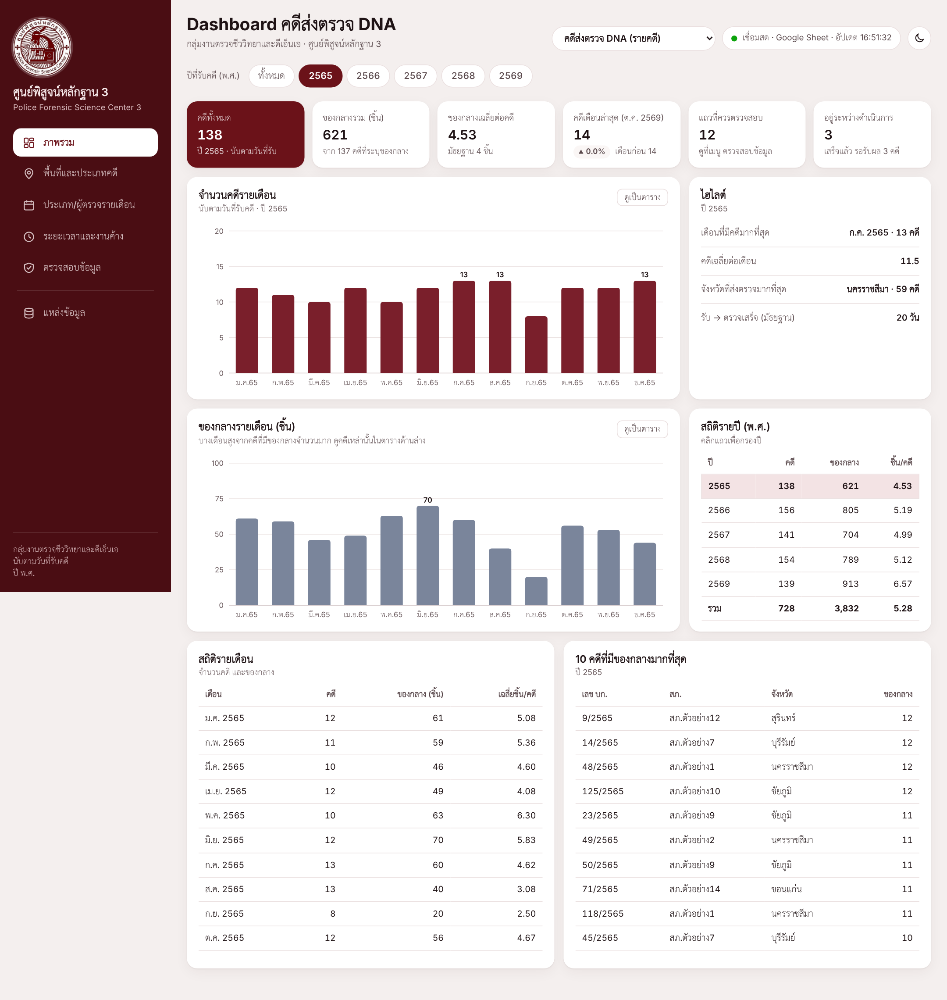
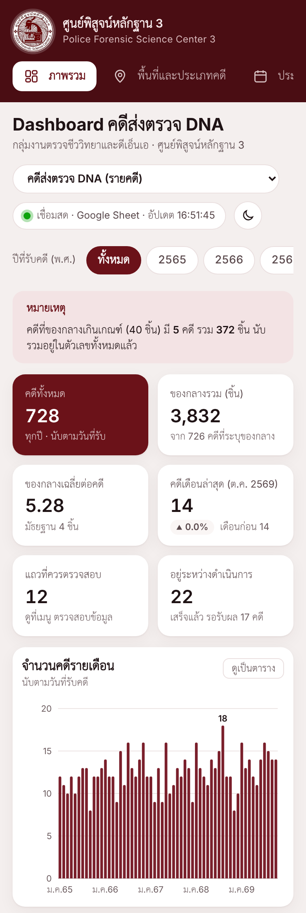
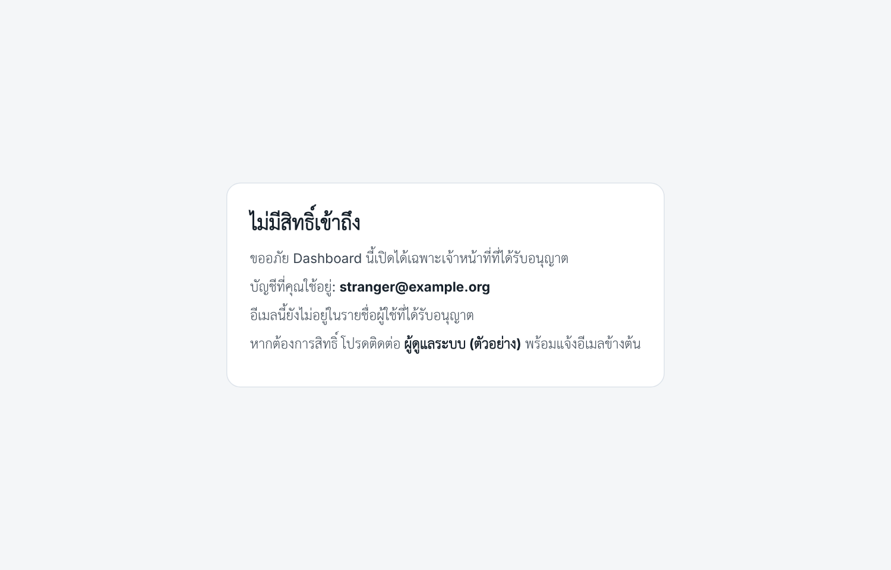

# บทที่ 4 การทดสอบระบบและวิเคราะห์ผล

> ร่างโดย thesis-writer — ตัวเลขทุกค่าในบทนี้มาจากผลการรัน `node apps-script/test/run.js` เมื่อวันที่ 3 พ.ย. 2569 (commit bab2b1c ผ่าน 96/96) และเอกสารผลทดสอบ `docs/test-results/01-mock-data.md`, `02-dashboard-apps-script.md`, `03-linebot.md` ห้ามแก้ตัวเลขโดยไม่รันชุดทดสอบใหม่
> ฉบับย่อตามที่เจ้าของโครงงานตัดสินใจ (ข้อ 31): รวมตารางย่อยเป็นตารางสรุปตามหมวด รายการทดสอบทีละกรณีอยู่ใน `docs/test-results/` เลขอ้างอิงต่อจากบทที่ 3 (ข้อ [48]–[50] อยู่ท้ายไฟล์นี้)

บทนี้อธิบายวิธีการทดสอบระบบที่ออกแบบไว้ในบทที่ 3 และผลการทดสอบ ครอบคลุม Dashboard ความถูกต้องของสถิติ การควบคุมสิทธิ์ แชตบอต LINE รายงานสรุปอัตโนมัติ และการคุ้มครองข้อมูลส่วนบุคคล การทดสอบทั้งหมดใช้ข้อมูลจำลองและบริการจำลอง ยังไม่ได้ทดสอบกับบัญชี Google จริง กลุ่ม LINE จริง หรือ Gemini API จริง

## 4.1 วิธีการและสภาพแวดล้อมการทดสอบ

### 4.1.1 ข้อมูลจำลอง

ข้อมูลคดีจริงมีชื่อเจ้าหน้าที่ สถานีตำรวจ และเลขคดี การนำมาใช้ทดสอบหรือแสดงในเล่มจะเป็นการเปิดเผยข้อมูลส่วนบุคคลเกินวัตถุประสงค์ตามพระราชบัญญัติคุ้มครองข้อมูลส่วนบุคคล พ.ศ. 2562 [7] โครงงานจึงทดสอบด้วยข้อมูลจำลองเท่านั้น (หัวข้อ 3.7)

ข้อมูลจำลองสร้างด้วยสคริปต์ `tools/make_mock_data.py` ซึ่งเขียนไฟล์ด้วยไลบรารี openpyxl [50] ได้ไฟล์ `cases.xlsx` (ข้อมูลรายคดีและแท็บ “ผู้ใช้”) และ `lab.xlsx` (ข้อมูลห้องปฏิบัติการ) มีแท็บและคอลัมน์ตรงกับ `docs/data-schema.md` ยกเว้นคอลัมน์ User ID (LINE) ที่เจ้าของโครงงานตัดออก สคริปต์กำหนด seed คงที่ (20260101) และกำหนด “วันนี้” ของข้อมูลเป็นวันที่ 31 ตุลาคม 2569 จึงสร้างซ้ำได้ไฟล์เดิมทุกไบต์ ค่าทุกค่าเป็นของสมมติ เช่น ผู้ตรวจ “เจ้าหน้าที่ ก” ถึง “เจ้าหน้าที่ จ” สถานี “สภ.ตัวอย่าง1” ถึง “สภ.ตัวอย่าง15” และอีเมลโดเมน `@example.com` ค่าความลับที่ชุดทดสอบใช้เป็นข้อความสมมติที่ขึ้นต้นด้วย `mock-` ข้อมูลจำลองมีกรณีขอบที่ระบบต้องจัดการ เช่น ค่าว่างในคอลัมน์ประเภทคดีและผู้ตรวจ (สอดคล้องกับข้อสังเกตด้านคุณภาพข้อมูลในหัวข้อ 3.2.4) และวันที่ข้ามปีและข้ามปีงบประมาณ ลักษณะของข้อมูลและสภาพแวดล้อมการทดสอบสรุปในตารางที่ 4.1

ตารางที่ 4.1 ข้อมูลจำลองและสภาพแวดล้อมการทดสอบ

| รายการ | ค่า |
|---|---|
| แท็บข้อมูลคดี | 731 แถว วันที่รับ 1 ม.ค. 2565 – 30 ต.ค. 2569 (8–18 คดีต่อเดือน) นับในสถิติ 728 คดี ของกลาง 3,832 ชิ้น |
| สถานะคดี | รับผลไปแล้ว 692, เสร็จแล้ว รอรับผล 17, กำลังดำเนินการ 22 แถว |
| กรณีขอบ | ประเภทคดีว่างร้อยละ 14.0 ผู้ตรวจว่างร้อยละ 15.2 มีคดีรับวันที่ 31 ธ.ค., 1 ม.ค., 30 ก.ย., 1 ต.ค. ทุกปี ไม่นับในสถิติ 3 แถว มีข้อสังเกต 12 แถว 4 ชนิด ของกลางเกินเกณฑ์ 40 ชิ้น 5 คดี |
| ข้อมูลห้องปฏิบัติการ | ข้อมูลเคส 58, ข้อมูลงบ 39, ข้อมูล Lot 86, หมายเหตุ 4 แถว |
| การรัน | 3 พ.ย. 2569, commit `bab2b1c`, Node.js 22.23.4, Python 3.13.18, openpyxl 3.1.5, Playwright 1.63.0 กับ Chromium 153 แบบ headless บน Linux หน้าจอกว้าง 1,440 และ 390 พิกเซล |
| ผลรวม | ผ่าน 96 จาก 96 กรณี ใช้เวลาประมาณ 24 วินาที |

### 4.1.2 เครื่องมือและขั้นตอนการทดสอบ

โค้ดของระบบรันได้เฉพาะบนเซิร์ฟเวอร์ของ Google ชุดทดสอบจึงจำลองสภาพแวดล้อมของ Apps Script ขึ้นในเครื่อง แบ่งเป็น 3 ส่วน

1) **ส่วนเซิร์ฟเวอร์** โหลดไฟล์ `.gs` ทั้ง 5 ไฟล์ด้วยโมดูล `vm` ของ Node.js [48] ร่วมกับตัวจำลอง (mock) ของบริการ Apps Script ที่ระบบใช้ใน `apps-script/test/gas_mock.js` ตัวจำลองของ UrlFetchApp บันทึกทุกคำขอที่ระบบส่งออก ตอบแทน LINE และ Gemini และโยนข้อผิดพลาดถ้าระบบเรียก URL อื่น จึงตรวจได้ว่าระบบส่งอะไรออกไปโดยไม่มีคำขอใดออกสู่เครือข่ายจริง
2) **ค่าอ้างอิงที่คำนวณอิสระ** สคริปต์ `make_fixtures.py` อ่านไฟล์ข้อมูลจำลองด้วย Python แล้วคำนวณผลที่ควรได้โดยไม่ใช้โค้ด JavaScript ของระบบ ใช้เป็นตัวตัดสินผลการทดสอบ (test oracle)
3) **ส่วนหน้าเว็บ** สคริปต์ `ui.js` เปิด `Index.html` ด้วย Chromium ผ่าน Playwright [49] โดยแทน `google.script.run` ด้วยตัวจำลองที่คืนผลของ `getBook` จริงจากส่วนเซิร์ฟเวอร์ และบันทึกคำขอที่ไม่ได้คาดไว้เป็นข้อผิดพลาด

ความสัมพันธ์ของส่วนต่าง ๆ แสดงในรูปที่ 4.1 สคริปต์หลัก `run.js` รันทั้ง 3 ส่วนด้วยคำสั่งเดียวแล้วพิมพ์ผล PASS หรือ FAIL ของแต่ละกรณี

[รูปที่ 4.1: โครงสร้างของชุดทดสอบ ตั้งแต่การสร้างข้อมูลจำลองจนถึงการตัดสินผล]

ผลทดสอบมาจาก 2 แหล่ง คือ การทดสอบข้อมูลจำลองและ Dashboard ต้นแบบ (`dashboard/index.html`) 18 กรณี และชุดทดสอบอัตโนมัติ `run.js` 96 กรณี รวม 114 กรณี บทนี้นำเสนอเป็นตารางสรุปตามหมวด รายละเอียดผลที่คาดและผลจริงรายกรณีอยู่ในไฟล์ผลการทดสอบของโครงงาน

### 4.1.3 สิ่งที่ยังไม่ได้ทดสอบ

การทดสอบด้วยบริการจำลองยืนยันว่าโค้ดทำงานตามที่ออกแบบเมื่อบริการภายนอกตอบตามเอกสาร แต่ไม่ได้ยืนยันพฤติกรรมจริงของแพลตฟอร์ม รายการที่ยังไม่ได้ทดสอบ ได้แก่ (1) การเปิด Dashboard ด้วยบัญชี Google จริง หน้าขออนุญาต OAuth และการแชร์ Sheet จริง (2) การรับ webhook จาก LINE จริง ปุ่ม Verify การตอบแบบเปลี่ยนเส้นทาง (HTTP 302) ของ Apps Script และการส่งข้อความเข้ากลุ่มจริง ซึ่งต้องให้เจ้าของโครงงานอนุมัติก่อน (3) ความแม่นยำของการแยกเจตนาโดย Gemini จริง (4) ตัวตั้งเวลาจริงของ Apps Script และ (5) ความเร็ว โควตา การใช้งานพร้อมกัน และการทดลองใช้กับเจ้าหน้าที่ รายการเหล่านี้ต้องทดสอบหลังนำระบบขึ้นใช้งานตามคู่มือ `apps-script/README.md` (หัวข้อ 4.7)

## 4.2 การทดสอบ Dashboard

การทดสอบ Dashboard แบ่งเป็น 3 กลุ่ม คือ ข้อมูลจำลองกับ Dashboard ต้นแบบ การอ่านข้อมูลฝั่งเซิร์ฟเวอร์ใน `Code.gs` (หัวข้อ 3.4.4–3.4.6) และหน้าเว็บ `Index.html` ของรุ่น Apps Script ผลสรุปในตารางที่ 4.2

ตารางที่ 4.2 ผลการทดสอบ Dashboard แยกตามกลุ่ม

| กลุ่ม (กรณี) | สิ่งที่ตรวจและผลจริง | ผล |
|---|---|---|
| ข้อมูลจำลองและ Dashboard ต้นแบบ (18) | สร้างข้อมูล 2 ครั้งได้ SHA-1 ตรงกัน วันที่ขัดกับสถานะ 0 แถว ทุกเมนูของทั้งสองชุดข้อมูลแสดงได้ แจ้งของกลางเกินเกณฑ์ 5 คดี รวม 372 ชิ้น พบ 5 จังหวัด 15 สถานี ข้อสังเกต 12 แถว ไม่มี pageerror และไม่มีค่าจริงในไฟล์จำลอง | ผ่าน 18 |
| การอ่านข้อมูลฝั่งเซิร์ฟเวอร์ (8) | `getBook("cases")` ส่ง 14 คอลัมน์ตามตารางที่ 3.8 ได้ 732 แถวรวมหัว วันที่แปลงเป็นเลข serial ถูกต้อง `getBook("lab")` มี 4 แท็บ แคชทำให้การเรียกซ้ำไม่เปิด Sheet อีก `checkSetup` แสดงเฉพาะจำนวนแถว | ผ่าน 8 |
| หน้าเว็บรุ่น Apps Script (17) | หน้าแรกแสดงคดี 728 พร้อมสถานะ “เชื่อมสด” เมนูข้อมูลคดี 5 เมนูและข้อมูลห้องปฏิบัติการ 3 เมนูแสดงได้ ไฟล์ Excel ในเครื่องได้ตัวเลขเท่าข้อมูลจากเซิร์ฟเวอร์ ป้ายแกน x ไม่ซ้อน หน้า “ไม่มีสิทธิ์เข้าถึง” เป็นภาษาไทย ข้อผิดพลาดในคอนโซลและคำขอออกนอกเครื่อง 0 รายการ | ผ่าน 17 |

คดีที่ไม่ระบุประเภท 101 คดีรวมกับที่ระบุ 627 คดี และคดีที่ไม่ระบุผู้ตรวจ 111 คดีรวมกับที่ระบุ 617 คดี ได้ 728 คดีเท่ากับจำนวนคดีที่นับในสถิติ จึงไม่มีคดีหายไประหว่างการจัดกลุ่ม “ไม่ระบุ” กลุ่มการอ่านข้อมูลมีกรณีที่แทรกคอลัมน์ User ID (LINE) ค่าสมมติเข้าไปในหน่วยความจำ ผลคือ `getBook` และคำตอบของแชตบอตไม่มีคอลัมน์นี้ ส่วนข้อผิดพลาด 404 จากการขอไฟล์ตั้งค่าที่ไม่บังคับ ซึ่งพบใน Dashboard ต้นแบบครั้งแรก ได้แก้ไขและยืนยันแล้ว ตัวอย่างหน้าจอจากการทดสอบแสดงในรูปที่ 4.2 และรูปที่ 4.3 เมื่อเลือกข้อมูลทุกปี (58 เดือน) หน้าจอกว้าง 1,440 พิกเซลแสดงป้ายเดือนทุก 6 เดือน และหน้าจอโทรศัพท์แสดงทุก 12 เดือน

## 4.3 การทดสอบความถูกต้องของสถิติ

ข้อกำหนดสำคัญคือ ตัวเลขในรายงานอัตโนมัติและคำตอบของแชตบอตต้องตรงกับ Dashboard (หัวข้อ 3.6.4) การทดสอบจึงเทียบตัวเลขชุดเดียวกันจาก 4 ทาง คือ Python, `Stats.gs`, หน้า Dashboard และข้อความของแชตบอต ในช่วงเวลาที่ครอบคลุมปีเต็ม การข้ามปี การข้ามปีงบประมาณ และเดือนล่าสุดของข้อมูล ผลแสดงในตารางที่ 4.3

ตารางที่ 4.3 ตัวเลขจาก Python, `Stats.gs` และ Dashboard (จำนวนคดี / ของกลาง)

| ช่วงเวลาหรือตัวชี้วัด | Python | `Stats.gs` (กลุ่มประเภท, กลุ่มผู้ตรวจ) | Dashboard |
|---|---|---|---|
| ทุกปี | 728 / 3,832 | — | 728 / 3,832 |
| ปี 2565 | 138 / 621 | 138 / 621 (7, 6) | 138 / 621 |
| ปี 2568 | 154 / 789 | 154 / 789 (7, 6) | 154 / 789 |
| ธ.ค. 2565 → ม.ค. 2566 (ข้ามปี) | 13 / 44 → 14 / 54 | 13 / 44 (6, 6) → 14 / 54 (5, 6) | 13 / 44 → 14 / 54 |
| ก.ย. → ต.ค. 2568 (ข้ามปีงบประมาณ) | 12 / 80 → 12 / 62 | 12 / 80 (5, 5) → 12 / 62 (5, 5) | 12 / 80 → 12 / 62 |
| ต.ค. 2569 (เดือนล่าสุด) | 14 / 57 | 14 / 57 (6, 6) | 14 / 57 |
| คดีค้าง: กำลังดำเนินการ / เสร็จแล้ว รอรับผล | 22 / 17 | 22 / 17 | 22 / 17 (แชตบอต 22 / 17) |
| ห้องปฏิบัติการ ปีงบประมาณ 2569 | ตัวอย่าง 2,050 ของกลาง 1,012 งบประมาณ 2,282,300 บาท Lot 17 | — | ค่าเดียวกัน |

ทุกค่าในตารางที่ 4.3 ตรงกัน จำนวนกลุ่มในวงเล็บนับกลุ่ม “ไม่ระบุ” ด้วย และการเทียบไม่ได้ดูเฉพาะยอดรวม แต่ดูจำนวนคดีของทุกประเภทและทุกคู่ผู้ตรวจ × ประเภท ตารางผู้ตรวจ × ประเภทคดีของเดือน ต.ค. 2569 บนหน้า Dashboard ตรงกับ `Stats.gs` ทั้ง 48 เซลล์ (6 แถวผู้ตรวจรวม “ไม่ระบุผู้ตรวจ”) Dashboard ต้นแบบได้ค่าเดียวกัน โดยมีมัธยฐานระยะเวลาจากวันที่รับถึงวันที่ตรวจเสร็จ 20 วัน

กรณีอื่นของกลุ่มสถิติ (รวม 18 กรณี) ได้แก่ การคำนวณช่วง “เดือนก่อนหน้า” และ “ปีก่อนหน้า” ตามเวลาประเทศไทย 5 กรณี ซึ่งเลือกเวลาที่วันที่ตามเวลาไทยต่างจากเวลา UTC เช่น 00:05 น. ของวันที่ 1 ม.ค. 2570 ได้ช่วง ธ.ค. 2569 และปี 2569 ถูกต้อง และเดือนกุมภาพันธ์ได้ 28 วันในปี 2569 และ 29 วันในปี 2567 การค้นคดีด้วยเลข 1/2565 พบ 1 รายการโดยผลที่คืนไม่มีชื่อผู้ตรวจ เลขเดียวกันที่เขียนเป็นเลขไทย มีเลข 0 นำหน้า หรือมีช่องว่างพบคดีเดียวกัน ส่วนเลขที่ไม่มี (9999/2569) ให้ผลไม่พบ แถวที่ช่องสถานะว่าง (ทดสอบโดยแก้ 3 แถวในหน่วยความจำ) นับเป็น “กำลังดำเนินการ” ตรงกับกติกาของ Dashboard และฟังก์ชันใน `Stats` เรียกจากหน้าเว็บไม่ได้ ทุกกรณีผ่าน

## 4.4 การทดสอบการควบคุมสิทธิ์

การทดสอบกำหนดอีเมลของผู้เปิด สิทธิ์การอ่าน Sheet และ Script Properties ผ่านตัวจำลอง แล้วตรวจผลของ `checkAccess_` และ `requireAccess_` ตามกรณีในตารางที่ 3.6 และตรวจว่าลิงก์ของแชตบอต ซึ่งอยู่ในโปรเจกต์เดียวกันแต่ deploy แบบ Execute as: Me (หัวข้อ 3.4.8) ใช้เปิดข้อมูล Dashboard ไม่ได้ ผลสรุปในตารางที่ 4.4

ตารางที่ 4.4 ผลการทดสอบการควบคุมสิทธิ์

| กลุ่มกรณี (กรณี) | สิ่งที่ทดสอบ | ผลจริง |
|---|---|---|
| อนุญาต (2) | อีเมลในแท็บ “ผู้ใช้” ทั้งแบบปกติและแบบตัวพิมพ์ใหญ่มีช่องว่าง | ได้หน้า Dashboard |
| ปฏิเสธตามตารางที่ 3.6 (5) | `not-listed`, `no-email`, `no-sheet-access`, `no-users-tab`, `no-config` | ปฏิเสธทุกกรณี แสดงเหตุผลและผู้ที่ต้องติดต่อเป็นภาษาไทย |
| เรียกข้อมูลโดยตรงและถอนสิทธิ์ (4) | เรียก `getBook`/`getSources` โดยไม่มีสิทธิ์ ลบอีเมลระหว่างใช้งาน ชื่อแหล่งข้อมูลแปลก และอีเมลที่มีแท็ก `<script>` | โยนข้อผิดพลาด “ไม่มีสิทธิ์” ถูกปฏิเสธเมื่อแคชสิทธิ์หมดอายุ อีเมลถูกแปลงอักขระพิเศษ |
| deployment ของแชตบอต (3) | เปิดลิงก์ของแชตบอตโดยไม่ล็อกอินและโดยผู้ใช้ในรายชื่อ และคำตอบ HTTP ของ `doPost` | ปฏิเสธ (`wrong-deployment`) โดยเปิด Sheet 0 ครั้ง `doPost` ตอบ `OK` ทุกกรณี |
| ฟังก์ชันผู้ดูแลและตัวตั้งเวลา (2) | ผู้ที่ไม่ใช่ `ADMIN_EMAIL` เรียกฟังก์ชันผู้ดูแล 8 ฟังก์ชัน และเรียก `dailySummaryJob` โดยไม่ผ่านตัวตั้งเวลา | โยนข้อผิดพลาด ไม่ส่งข้อความ |

ทุกกรณีที่เงื่อนไขไม่ครบให้ผลเป็นการปฏิเสธ ครอบคลุมเหตุผลในตารางที่ 3.6 ครบทุกข้อ ตรงกับหลักการปฏิเสธเมื่อไม่แน่ใจ (fail closed) หน้า “ไม่มีสิทธิ์เข้าถึง” แสดงในรูปที่ 4.4

## 4.5 การทดสอบแชตบอต LINE และรายงานสรุปอัตโนมัติ

### 4.5.1 แชตบอต LINE

การทดสอบสร้างเหตุการณ์ webhook ตามรูปแบบในเอกสารของ LINE [37] ส่งให้ `doPost` ในรูปเดียวกับที่ Apps Script ส่ง แล้วตรวจคำขอที่ระบบส่งออกว่ามีการตอบกี่ครั้ง มีการเรียก Gemini หรือไม่ และส่งเนื้อหาอะไร ผล 22 กรณีสรุปในตารางที่ 4.5 (กรณีเรื่องฟังก์ชันผู้ดูแล 1 กรณีแสดงในตารางที่ 4.4)

ตารางที่ 4.5 ผลการทดสอบแชตบอต LINE แยกตามหมวด

| หมวด | สิ่งที่ทดสอบ | ผลจริง |
|---|---|---|
| ตอบเมื่อถูกเรียก | เลข บก. ปกติ เลขไทย เลขที่ไม่มี หลายเลขในข้อความเดียว คำสั่งคดีค้าง 5 รูปแบบ การ mention และคำสั่งวิธีใช้ | ตอบ 1 ครั้งตามหัวข้อ 3.5.3 ไม่มีชื่อผู้ตรวจ สถานี จังหวัด เลขรายงาน คดีค้างแยก 22 / 17 ตรงกับ Python ไม่เรียก Gemini |
| เงียบ | ข้อความสนทนาทั่วไป 9 ข้อความ การ mention ผู้อื่น และรูปภาพ | ไม่มีคำขอออกจากระบบ ไม่อ่าน Sheet |
| ส่งข้อความให้ Gemini | ข้อความที่มีชื่อ โทรศัพท์ อีเมล เลขรายงาน สถานี เลขคดี URL, Gemini ตอบเลขคดีปนมา, Gemini ขัดข้อง 5 แบบ, ไม่มี API key, เกินโควตา | ส่งเฉพาะข้อความที่ตัดแล้วตามตารางที่ 3.11 ไม่ใช้เลขคดีจาก Gemini เมื่อ Gemini ใช้ไม่ได้ตอบวิธีใช้แบบสั้น |
| จำกัดกลุ่มและป้องกัน webhook | กลุ่มอื่นและแชตส่วนตัว ยังไม่ตั้ง `ALLOWED_GROUP_ID` รหัสลับใน URL ผิด 5 แบบ ปุ่ม Verify เหตุการณ์ซ้ำและเก่า | เงียบหรือทิ้งคำขอโดยไม่อ่าน Sheet ตอบ `OK` เหมือนกรณีปกติ ตอบเหตุการณ์ซ้ำครั้งเดียว |
| โหมดตั้งค่า | เชิญบอตเข้ากลุ่มขณะเปิดและปิดโหมด และ `makeWebhookToken` | บันทึกรหัสกลุ่มเฉพาะเมื่อเปิดโหมดโดยไม่ตอบในแชต รหัสสุ่ม 64 ตัวอักษรไม่ถูกพิมพ์ในบันทึก |

ข้อความทดสอบการเงียบจงใจให้มีคำใกล้เคียงคำสั่ง เช่น “ส่งของกลางคดี 123/2568 ไปแล้วนะ” “งานค้างเยอะจัง” และ “บอตตอง” บอตไม่ตอบทุกข้อความ ในกรณีส่งข้อความให้ Gemini ชุดทดสอบตรวจเนื้อหาคำขอทั้งหมด ว่าไม่มีตัวเลขทั้งเลขอารบิกและเลขไทย ไม่มีชื่อ อีเมล คำว่า “สภ.” URL รหัสกลุ่ม `userId` และ reply token ไม่มีข้อความยาว 3 ตัวอักษรขึ้นไปจากแท็บข้อมูลคดี และ API key อยู่ในส่วนหัว `x-goog-api-key` ไม่อยู่ใน URL เมื่อตัวจำลองของ Gemini ตอบเลขคดี 999/2568 ปนมา ข้อความตอบของบอตไม่มีเลขนี้ ยืนยันว่าระบบใช้เฉพาะเจตนาจาก Gemini

### 4.5.2 รายงานสรุปอัตโนมัติ

กลุ่มนี้เรียก `dailySummaryJob` พร้อมวันเวลาจำลอง และแปลงข้อความสรุปกลับเป็นตัวเลขเพื่อเทียบกับ Python ผล 11 กรณีสรุปในตารางที่ 4.6 (กรณีเรียก `dailySummaryJob` โดยตรง 1 กรณีแสดงในตารางที่ 4.4)

ตารางที่ 4.6 ผลการทดสอบรายงานสรุปอัตโนมัติ

| หมวด | ผลจริง |
|---|---|
| เนื้อหา | สรุปเดือน ต.ค. 2569: คดี 14 ของกลาง 57 ชิ้น 6 กลุ่มประเภท 6 กลุ่มผู้ตรวจ สรุปปี 2568: คดี 154 ของกลาง 789 ชิ้น 7 กลุ่มประเภท 6 กลุ่มผู้ตรวจ ตรงกับ Python ทุกค่า ไม่มีเลขคดีและชื่อสถานี |
| รอบเวลา | รัน `installTriggers` 3 ครั้งได้ตัวตั้งเวลารายวันตัวเดียว เวลา 08:00 น. (Asia/Bangkok) วันที่ 1 พ.ย. 2569 push 1 คำขอ 1 ข้อความ วันที่ 1 ม.ค. 2569 push 1 คำขอ 2 ข้อความ (สรุป ธ.ค. 2568 และปี 2568) |
| กันส่งซ้ำและส่งตามหลัง | ไม่ส่งซ้ำเมื่อตัวตั้งเวลาทำงานซ้ำหรือในวันอื่น เมื่อ LINE ตอบ HTTP 500 วันที่ 2 ส่งงวดเดิมด้วย retry key เดิม รหัส 409 ถือว่าส่งแล้ว เลยวันที่ 3 ไม่ส่งย้อนหลัง ไม่ส่งจริงเมื่อยังไม่ตั้ง `PUSH_ENABLED` |
| ความยาว | 576, 938, 535, 938 และ 293 ตัวอักษร ต่ำกว่า 2,000 ทุกข้อความ ข้อความที่ยาวเกิน 5,000 ตัวอักษรถูกตัดพร้อมหมายเหตุให้ดูต่อใน Dashboard |

ความยาว 5 ค่าคือ สรุปเดือน ต.ค. 2569, สรุปปี 2568, สรุปเดือน ธ.ค. 2568 และสรุปปี 2568 ที่ส่งวันที่ 1 มกราคม และคำตอบคดีค้าง ตามลำดับ กรณีหนักที่สุดที่คาดไว้ (ผู้ตรวจ 6 กลุ่ม × ประเภทคดี 7 กลุ่มครบทุกคู่ และของกลางหลักหมื่น) ได้ข้อความยาว 1,233 ตัวอักษร และการส่ง 2 ข้อความในวันที่ 1 มกราคมยังอยู่ในขีดจำกัด 5 ข้อความต่อคำขอของ LINE [18]

## 4.6 สรุปและวิเคราะห์ผลการทดสอบ

### 4.6.1 ผลการทดสอบรวมและการตรวจด้าน PDPA

จำนวนกรณีทดสอบแยกตามหมวดแสดงในตารางที่ 4.7 ผ่านครบทุกกรณี

ตารางที่ 4.7 สรุปจำนวนกรณีทดสอบแยกตามหมวด

| หมวด | หัวข้อ | กรณี | ผ่าน |
|---|---|---|---|
| ข้อมูลจำลองและ Dashboard ต้นแบบ | 4.2 | 18 | 18 |
| การอ่านข้อมูลฝั่งเซิร์ฟเวอร์ | 4.2 | 8 | 8 |
| หน้าเว็บ (Playwright) | 4.2, 4.3 | 23 | 23 |
| สถิติ (`Stats.gs`) | 4.3 | 18 | 18 |
| การควบคุมสิทธิ์และ deployment ของแชตบอต | 4.4 | 14 | 14 |
| แชตบอต LINE | 4.5.1 | 22 | 22 |
| รายงานสรุปอัตโนมัติ | 4.5.2 | 11 | 11 |
| รวม (`run.js` 96 กรณี และ Dashboard ต้นแบบ 18 กรณี) | | 114 | 114 |

ข้อกำหนดด้านการคุ้มครองข้อมูลส่วนบุคคลในหัวข้อ 3.7 ตรวจผ่านกรณีทดสอบข้างต้น ตารางที่ 4.8 รวบรวมข้อกำหนดกับหลักฐาน ทุกข้อผ่าน

ตารางที่ 4.8 รายการตรวจด้าน PDPA และหลักฐานจากการทดสอบ

| ข้อกำหนด | หลักฐาน |
|---|---|
| ใช้ข้อมูลจำลองเท่านั้น ไม่มี DNA profile | ค่าทุกค่าในไฟล์จำลองเป็นค่าสมมติ ภาพหน้าจอในเล่มตรวจแล้วว่ามีแต่ข้อมูลจำลอง |
| ไม่พึ่งและไม่ส่งออกคอลัมน์ User ID (LINE) | เมื่อแทรกคอลัมน์นี้เข้าไป ระบบก็ไม่ส่งออก (หัวข้อ 4.2) |
| ส่งข้อมูลเท่าที่จำเป็น | เบราว์เซอร์ได้ 14 คอลัมน์ คำตอบสถานะคดีไม่มีชื่อผู้ตรวจ สถานี จังหวัด เลขรายงาน รายงานสรุปไม่มีเลขคดี (ตารางที่ 4.2, 4.5, 4.6) |
| ผู้ไม่มีสิทธิ์เข้าไม่ถึงข้อมูล | ปฏิเสธทุกกรณีที่เงื่อนไขไม่ครบ รวมลิงก์ของแชตบอต (ตารางที่ 4.4) |
| ไม่ส่งข้อมูลคดีและข้อมูลระบุตัวบุคคลให้ Gemini | เนื้อหาคำขอไม่มีตัวเลข ชื่อ อีเมล URL รหัสกลุ่ม `userId` และค่าจาก Sheet (หัวข้อ 4.5.1) |
| ข้อมูลไม่ออกนอกระบบโดยไม่จำเป็น | ข้อความที่ไม่ได้เรียกบอตไม่ทำให้เกิดคำขอ `doPost` ตอบ `OK` เสมอ หน้าเว็บมีคำขอที่ไม่คาดไว้ 0 รายการ |
| ค่าความลับไม่รั่ว และส่งเข้ากลุ่มจริงเมื่ออนุมัติแล้วเท่านั้น | รหัสลับ webhook ไม่ถูกพิมพ์ในบันทึก API key อยู่ในส่วนหัว ไม่ส่ง push เมื่อยังไม่ตั้ง `PUSH_ENABLED` |

ข้อกำหนดเรื่องการเก็บค่าความลับใน Script Properties (หัวข้อ 3.7 ข้อ 3) ไม่มีกรณีทดสอบที่ค้นหาค่าความลับในโค้ดโดยตรง ชุดทดสอบเพียงป้อนค่าความลับผ่านตัวจำลองของ PropertiesService ซึ่งแสดงว่าโค้ดอ่านค่าจากที่นั้น

### 4.6.2 วิเคราะห์ผล

ผลการทดสอบผ่านครบ 114 กรณี และให้ข้อสรุปตามวัตถุประสงค์ข้อที่ 4 ในหัวข้อ 1.2 ดังนี้

1) **ความถูกต้องของการคำนวณ** ตัวเลขจาก `Stats.gs` หน้า Dashboard และข้อความของแชตบอตตรงกับ Python ทุกค่าที่ทดสอบ รวมกรณีข้ามปี ข้ามปีงบประมาณ และเวลาที่วันที่ตามเวลาไทยต่างจาก UTC ซึ่งสนับสนุนการออกแบบให้ใช้ฟังก์ชันคำนวณชุดเดียวกัน (หัวข้อ 3.6.4)
2) **การควบคุมสิทธิ์** ปฏิเสธทุกกรณีที่เงื่อนไขไม่ครบ ทั้งที่หน้าแรกและเมื่อเรียกฟังก์ชันข้อมูลโดยตรง และลิงก์ของแชตบอตเปิดข้อมูล Dashboard ไม่ได้
3) **พฤติกรรมของแชตบอตและรายงาน** บอตเงียบเมื่อไม่ได้ถูกเรียก ตอบเฉพาะกลุ่มที่อนุญาต ไม่ตอบซ้ำ และยังตอบได้เมื่อ Gemini ใช้ไม่ได้ รายงานไม่ส่งซ้ำและส่งตามหลังได้เมื่อ LINE ขัดข้อง
4) **การคุ้มครองข้อมูลส่วนบุคคล** ข้อมูลที่ออกจากระบบทุกทาง (เบราว์เซอร์ กลุ่ม LINE และ Gemini) มีเฉพาะข้อมูลที่ออกแบบไว้

ข้อจำกัดของผลการทดสอบมีดังนี้

1) **ทดสอบกับบริการจำลอง** ถ้าพฤติกรรมจริงต่างจากที่จำลอง เช่น ค่าที่ `Session.getActiveUser()` คืนในแต่ละแบบ deploy [12] หรือการตอบแบบเปลี่ยนเส้นทางต่อปุ่ม Verify [45] ผลจริงอาจต่างไป จึงต้องทดสอบซ้ำหลังนำขึ้นใช้งาน (หัวข้อ 4.7)
2) **ไม่ได้วัดความแม่นยำของการแยกเจตนา** กฎในโค้ดทดสอบด้วยข้อความตัวอย่างจำนวนน้อย และ Gemini ถูกแทนด้วยตัวจำลอง ผลจึงยังไม่บอกว่าแชตบอตเข้าใจคำถามจริงของเจ้าหน้าที่ได้ดีเพียงใด
3) **การตัดข้อมูลก่อนส่ง Gemini ทดสอบด้วยข้อความตัวอย่างข้อความเดียว** ไม่ครอบคลุมทุกรูปแบบที่ผู้ใช้อาจพิมพ์ เช่น ชื่อบุคคลที่ไม่มีคำนำหน้า (หัวข้อ 3.5.2)
4) **ค่าอ้างอิงเขียนโดยทีมเดียวกัน** โค้ด Python จับข้อผิดพลาดในการเขียนโปรแกรมได้ แต่ทั้งสองฝั่งตีความกติกาการนับจากข้อกำหนดชุดเดียวกัน ถ้าข้อกำหนดผิดจะผิดเหมือนกัน
5) **ข้อมูลจำลองสะอาดกว่าข้อมูลจริง** ข้อมูลจำลองมีค่าว่างในคอลัมน์ประเภทคดีและผู้ตรวจประมาณร้อยละ 15 ขณะที่ข้อมูลจริง ณ วันที่ได้รับโครงสร้างไฟล์กรอกสองคอลัมน์นี้ไว้เพียงส่วนน้อย (หัวข้อ 3.2.4) และกรณีข้อมูลไม่สมบูรณ์ เช่น ช่องสถานะว่าง ทดสอบด้วยการแก้ข้อมูลเพียงไม่กี่แถว
6) **ไม่ได้ทดสอบด้านประสิทธิภาพและการใช้งาน** ไม่ได้วัดเวลาตอบและโควตาภายใต้การใช้งานจริง และยังไม่มีผลการประเมินจากผู้ใช้

## 4.7 การทดสอบกับการใช้งานจริง

[รอใส่: ผลการทดสอบหลัง deploy จริง — การเปิด Dashboard ด้วยบัญชีจริง, ปุ่ม Verify webhook/302, การตอบในกลุ่ม LINE จริง, ภาพหน้าจอ]

[รอใส่: ผลแบบประเมินความพึงพอใจของเจ้าหน้าที่ ถ้ามี]

---

## เอกสารอ้างอิง (บทที่ 4 — ต่อจากบทที่ 3)

> บทนี้อ้างซ้ำข้อ [7], [12], [18], [37] และ [45] และเพิ่มข้อ [48]–[50] ทุกรายการเปิดตรวจแล้วเมื่อวันที่ 3 พฤศจิกายน 2569

[48] OpenJS Foundation. VM (executing JavaScript), Node.js documentation [Online]. Available: https://nodejs.org/api/vm.html (เข้าถึงเมื่อ 3 พ.ย. 2569)

[49] Microsoft. Installation, Playwright documentation [Online]. Available: https://playwright.dev/docs/intro (เข้าถึงเมื่อ 3 พ.ย. 2569)

[50] E. Gazoni and C. Clark. openpyxl - A Python library to read/write Excel 2010 xlsx/xlsm files [Online]. Available: https://openpyxl.readthedocs.io/en/stable/ (เข้าถึงเมื่อ 3 พ.ย. 2569)
